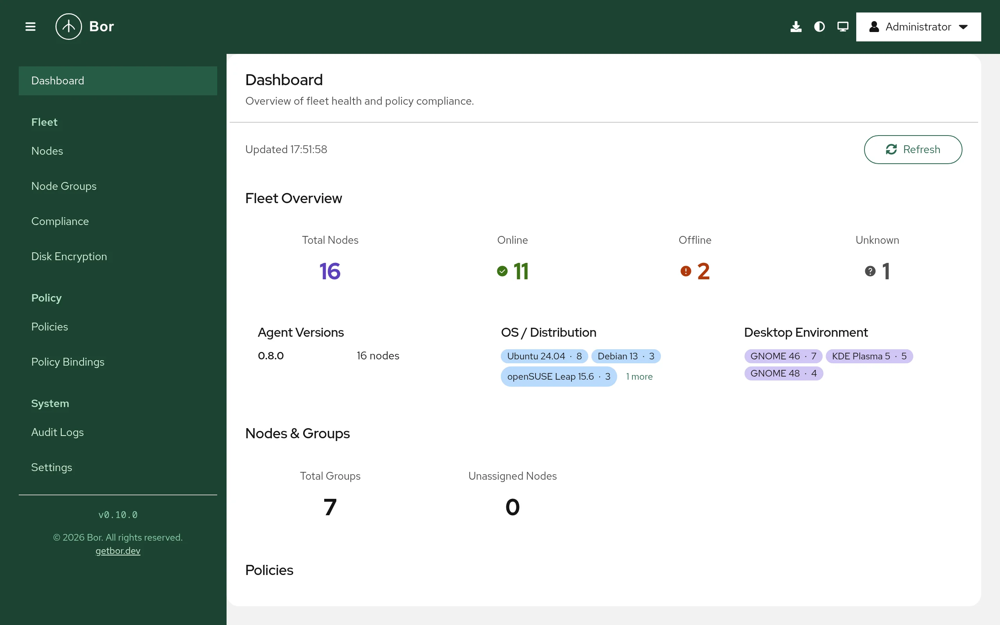

# Bor

**Policy management for Linux desktops.**

[Website](https://getbor.dev) ·
[Documentation](https://docs.getbor.dev) ·
[Download](https://getbor.dev/download/) ·
[Contributing](doc/development/contributing.md)

Bor manages the configuration of Linux desktops and laptops from one place.
You define policies in a web interface, assign them to groups of machines,
and the Bor agent on each desktop applies them within seconds, keeps them in
place and reports back whether each machine is compliant.



## What Bor manages

| Area | Policy types |
|---|---|
| Browsers and mail | Firefox, Chrome and Chromium, Microsoft Edge, Thunderbird |
| Desktop environments | KDE Plasma (KConfig and Kiosk), GNOME (dconf) |
| System | Polkit rules, firewalld zones, session access times, disk encryption (LUKS2 with TPM 2.0, Tang and escrowed recovery keys) |
| Software | Packages and repositories (APT, DNF, Zypper), Flatpak remotes and applications |

See [Policy types](https://docs.getbor.dev/policy-types/) for what each one
can do.

## Highlights

- **Real time.** Agents keep a persistent, mutually authenticated TLS
  connection to the server, so policy changes reach desktops immediately.
- **Tamper protection.** The agent watches every file it manages and
  restores it when someone changes it locally, and reports the event.
- **Compliance reporting.** Every machine reports, per policy, whether it is
  compliant, and the web interface shows the state of the whole fleet.
  Bor Enterprise adds point-in-time compliance reports that freeze that
  state as signed evidence for auditors.
- **Simple rollout.** Each server hosts signed agent package repositories
  and a deploy wizard, so agents install and enroll with one script and
  managed desktops need no internet access.
- **Built for regulated environments.** FIPS 140-3 validated cryptography,
  role-based access control, multi-factor authentication (TOTP and
  WebAuthn), LDAP and Active Directory, Kerberos enrollment, optional HSM
  storage for the CA key and a complete audit log.
- **Native packages.** deb, rpm, apk and Arch Linux packages for amd64,
  arm64 and ppc64le.

## Getting started

- [Concepts](https://docs.getbor.dev/getting-started/concepts/): how
  servers, agents, policies and node groups fit together.
- [Quick start](https://docs.getbor.dev/getting-started/quickstart/): a
  server and a first managed desktop in about 20 minutes.
- [Installation](https://docs.getbor.dev/installation/requirements/):
  requirements and production setup.

## Building from source

```bash
make frontend server agent
```

The [development guide](https://docs.getbor.dev/development/) covers the
development environment, the architecture, tests and packaging.

## Contributing

Bug reports, ideas and pull requests are welcome. Read the
[contributing guide](doc/development/contributing.md) before you start.
Report security vulnerabilities privately to <bor@vute.tech>, not in a
public issue.

## License

Copyright (C) 2026 Vute Tech LTD
Copyright (C) 2026 Bor contributors

Bor is free software: you can redistribute it and/or modify it under the
terms of the [GNU Affero General Public License, version 3](LICENSE)
(`AGPL-3.0-only`). If you run a modified version of the Bor server for others
over a network, the AGPL requires you to offer them the source code of your
version.

Bor Enterprise, the commercial edition from Vute Tech LTD, is distributed
under a separate proprietary license. For commercial licensing, contact
<bor@vute.tech>.

Contributions are accepted under the
[Contributor License Agreement](CLA.md); see
[Contributing](doc/development/contributing.md).
