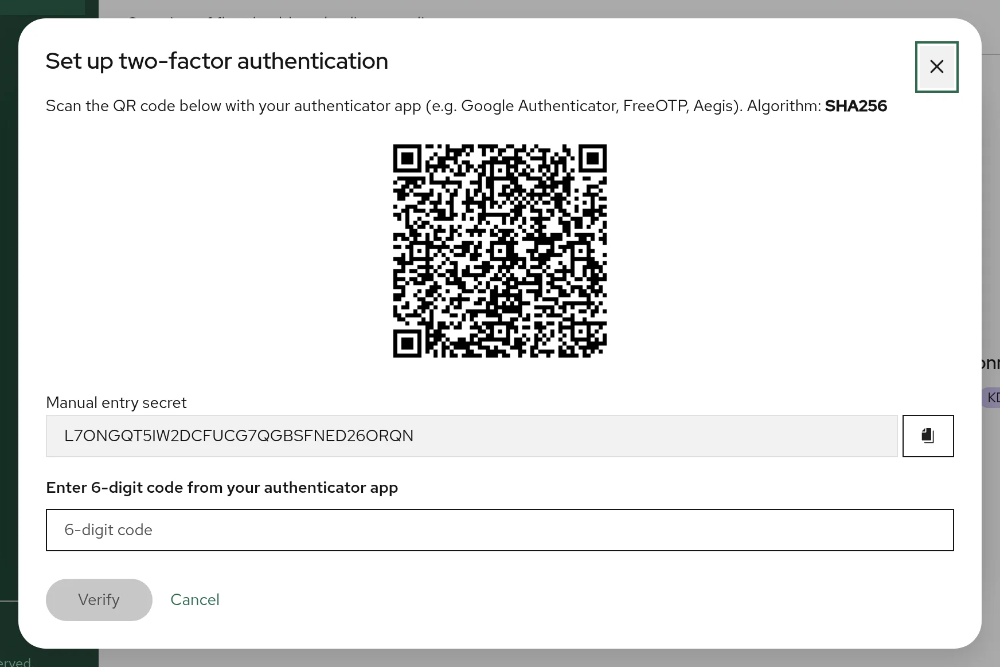

# Multi-factor authentication

Bor supports two second factors for web UI accounts: an **authenticator
app** (TOTP) and **security keys or passkeys** (WebAuthn/FIDO2). This page
covers how users set them up and sign in with them, the MFA policy
administrators can enforce, the server configuration that security keys
need, the extra check before sensitive actions (step-up authentication),
and how to recover an account whose second factor is lost.

MFA applies to local accounts and to [LDAP](ldap.md) accounts alike.

## Set up an authenticator app

{ loading=lazy }

Any app that implements time-based one-time passwords works, for example
FreeOTP, Aegis or Google Authenticator. Bor generates 6-digit codes that
change every 30 seconds, using SHA-256 by default (SHA-512 if the
administrator selected it). Make sure your app supports the algorithm;
apps that only implement SHA-1 produce codes that Bor rejects.

1. Click your user name in the top right corner and choose **Account
   security**. The **Account Settings** dialog opens on the **Security**
   tab.
2. Under **Method 1: Authenticator app (TOTP)**, click **Set up**.
3. Scan the QR code with your app. If you cannot scan it, enter the
   **Manual entry secret** in the app instead.
4. Type the current code from the app into **Enter 6-digit code from your
   authenticator app** and click **Verify**.
5. Bor shows eight **backup codes** (format `XXXXX-XXXXX`). Use **Copy
   codes** or **Download** (saves `bor-backup-codes.txt`) and keep them
   somewhere safe, away from the device that runs the authenticator app.
6. Tick **I have saved these backup codes in a safe place** and click
   **Done**.

The Security tab now shows **Configured** next to the authenticator app.

Each backup code can be used once in place of an authenticator code. Bor
stores only hashes of them; if you lose them, remove and set up the
authenticator app again to get new ones.

!!! note "Backup codes at sign-in"
    The **Authenticator code** field on the sign-in page accepts only six
    digits, so backup codes cannot be typed there in the current release.
    They are accepted where a free-form TOTP field is shown, such as the
    re-authentication dialog before revealing a recovery key. If you lose
    your authenticator, ask an administrator to
    [reset your MFA](#reset-mfa-for-a-locked-out-user).

### Remove the authenticator app

On the **Security** tab click **Remove**, enter your password under
**Confirm your password to remove the authenticator app**, and click
**Remove authenticator app**. The backup codes are deleted with it. If the
MFA policy requires a second factor and you have no security key, you will
be asked to set one up at your next sign-in.

## Register a security key

Security keys (YubiKey and other FIDO2 USB/NFC keys) and passkeys stored by
a password manager or the operating system can be used once the server is
[configured for WebAuthn](#configure-webauthn-on-the-server). Until then
registering a key fails with `WebAuthn not configured`.

1. Open **Account security** from the user menu.
2. Under **Method 2: Security keys (WebAuthn)**, click **Add key**.
3. Enter a **Security key name** that tells your keys apart, for example
   `YubiKey 5 blue`, and click **Register**.
4. Follow the browser prompt: insert and touch the key, or confirm with the
   passkey provider.
5. The dialog shows **Security key registered**. Click **Done**.

Register at least two keys, or a key and an authenticator app, so that
losing one does not lock you out. Registered keys are listed on the
Security tab, where each can be renamed or removed with the buttons next to
it.

## Sign in with a second factor

The sign-in page asks for the second factor **before** the password:

1. Enter your **Username** and click **Continue**.
2. If you have a second factor, Bor asks for it:
    - With a security key registered, click **Authenticate with security
      key** and use the key. If you also have an authenticator app, **Use
      authenticator code instead** switches to the code form.
    - Otherwise enter the 6-digit **Authenticator code** and click
      **Verify**.
3. After an authenticator code, enter your **Password** and click **Log
   in**.

A security key completes the sign-in on its own: no password is asked
after it. For LDAP accounts this also means the directory is not contacted,
so group-to-role synchronization runs only at sign-ins that use the
password.

Users without a second factor go straight from the user name to the
password.

## MFA policy (administrators)

{ loading=lazy }

Administrators with the `settings:manage` permission configure the policy
under **Settings -> MFA Policy**. Changes are recorded in the audit log.

| Setting | Default | Effect |
|---------|---------|--------|
| **Require MFA for all users** | Disabled | When enabled, every sign-in needs a second factor registered in Bor. Users who already have one are unaffected. |
| **Set up MFA while signing in** | Allowed | When MFA is required and a user has no second factor: if allowed, the user enters the password and is then guided to set up an authenticator app (**Set up an authenticator app**) or a security key (**Use a security key**) before getting a session. If not allowed, the sign-in is refused after the password check and an administrator must help the user enroll. |
| **TOTP algorithm** | SHA256 | Hash algorithm for **new** authenticator app enrollments: `SHA256` or `SHA512`. Existing enrollments keep the algorithm they were created with. |

Click **Save** to apply. The policy takes effect at the next sign-in; it
does not end existing sessions.

!!! tip "Roll out MFA safely"
    1. Make sure your own account has two factors (for example an
       authenticator app and a security key).
    2. Announce the change and keep **Set up MFA while signing in**
       allowed, so users can enroll on their own.
    3. Enable **Require MFA for all users**.
    4. Keep shell access to the server for the
       [reset procedure](#reset-mfa-for-a-locked-out-user).

## Configure WebAuthn on the server

Browsers bind security keys to the site name, so the server must know the
exact name and URL users open. Add a `webauthn` section to
`/etc/bor/server.yaml`:

```yaml
webauthn:
  rpid: "bor.example.com"
  origins:
    - "https://bor.example.com"
  display_name: "Bor Policy Manager"
```

| YAML key | Environment variable | Default | Description |
|----------|----------------------|---------|-------------|
| `webauthn.rpid` | `BOR_WEBAUTHN_RPID` | `""` | Relying party ID: the host name in the browser's address bar, without `https://` and without a port. Empty disables security keys. |
| `webauthn.origins` | `BOR_WEBAUTHN_ORIGINS` | `https://<rpid>` | Every origin users open, exactly as the browser shows it: scheme, host and port. Comma-separated in the environment variable. |
| `webauthn.display_name` | `BOR_WEBAUTHN_DISPLAY_NAME` | `Bor Policy Manager` | Name the browser shows in its prompt. |

Rules that matter:

- List the origin exactly as users open it. With the recommended web port
  443 that is `https://bor.example.com` (no port), as in the example. If
  the server uses the default web port **8443** (or any port other than
  443), list `https://bor.example.com:8443`; otherwise registration and
  sign-in fail with an origin mismatch.
- When `webauthn.origins` is empty, the server uses `https://<rpid>`,
  which implies port 443, and logs a warning about the default at startup.
  Set the origin explicitly to avoid the warning.
- Browsers allow WebAuthn only on HTTPS with a certificate they trust. With
  the auto-generated certificate, [trust the Bor CA](tls.md#trust-the-bor-ca-in-browsers)
  first.
- The RP ID cannot be an IP address. Use a DNS name.
- Keys are bound to the RP ID. Changing `rpid` later makes every registered
  key unusable; users must register their keys again.
- If users reach Bor under several names, list each origin. All of them
  must be the RP ID itself or a subdomain of it.

Restart the server and check the log for `WebAuthn enabled (RPID=...)`:

```bash
sudo systemctl restart bor-server
sudo journalctl -u bor-server -b | grep -i webauthn
```

## Step-up authentication

Some actions are sensitive enough that a valid session is not sufficient.
For these, Bor asks the user to re-authenticate and issues a single-use
token that is valid for 5 minutes and only for that one action.

Currently this applies to **revealing a LUKS recovery key** (see [Disk
encryption](../policy-types/disk-encryption.md)). The **Reveal recovery
key** dialog asks for:

- **Reason or ticket number**, stored in the audit log,
- **Your password** (for LDAP accounts, checked against the directory),
- a **TOTP code** from the authenticator app.

The TOTP rules are:

| User has an authenticator app | `disk_encryption.require_mfa_for_reveal` | Result |
|-------------------------------|------------------------------------------|--------|
| Yes | any | Password and TOTP code (or a backup code) are required. |
| No | `true` (default) | Refused with `enroll MFA (TOTP) to perform this action`. |
| No | `false` | Password alone is enough. |

!!! note
    Only the authenticator app counts for step-up authentication. A user who
    has only security keys must also set up an authenticator app before
    revealing recovery keys while `require_mfa_for_reveal` is `true`.

## Reset MFA for a locked-out user

When a user has lost their authenticator app and backup codes, an
administrator with root access to the Bor server removes the user's
authenticator app enrollment from the command line:

```bash
sudo -u bor bor-server --reset-mfa alice
```

```text
MFA disabled for user "alice" (id=...)
```

How the command works:

- It reads the same configuration as the service: `/etc/bor/server.yaml`
  (or `BOR_CONFIG`) plus environment variables, connects to the database,
  deletes the user's TOTP secret and backup codes, and exits. It does not
  start the server; the running service is not affected.
- It runs as `bor` so that it can read `server.yaml` (mode `0640`,
  group `bor`) and so that PostgreSQL peer authentication over the local
  socket maps it to the `bor` database role.
- It does **not** read `/etc/bor/server.env`, which only systemd loads. If
  your database password or host is set there, export the file first:

    ```bash
    sudo sh -c 'set -a; . /etc/bor/server.env; exec runuser -u bor -- bor-server --reset-mfa alice'
    ```

- The reset is not written to the Bor audit log. Record it in your own
  change log.

After the reset the user signs in with the password only. If **Require MFA
for all users** is enabled and **Set up MFA while signing in** is allowed,
the user is asked to set up a new factor right after the password.

!!! warning "Security keys are not removed"
    `--reset-mfa` removes only the authenticator app. Registered security
    keys stay, and while a user has one, the sign-in page keeps asking for
    it. If the user has lost their security keys as well, delete them in the
    database:

    ```bash
    sudo -u bor psql -h /var/run/postgresql bor -c \
      "DELETE FROM user_webauthn_credentials WHERE user_id = (SELECT id FROM users WHERE username = 'alice');"
    ```

    Use the connection settings from your `database` section if you do not
    use the local socket.

To recover the built-in `admin` account the same way, run the command with
`admin` as the user name.
