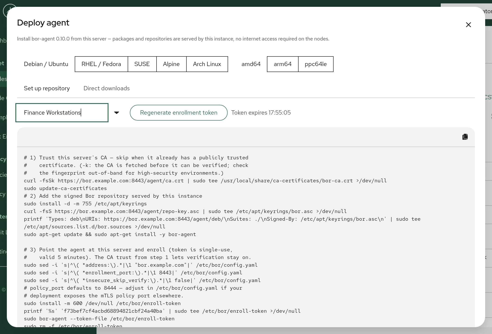

# Installing the agent

This page explains how to install `bor-agent` on a Linux desktop, point it at
your server, enroll it into a node group and start it. It covers the
**Deploy agent** wizard in the web UI, setting up the package repository by
hand, installing a downloaded package, the agent configuration file,
re-enrollment, and tips for deploying many machines.

## How agent installation works

Every Bor server ships the `bor-agent` packages for all supported platforms
and serves them itself on its web port under `https://bor.example.com/agent/`
(add `:8443` if the server still uses the default port):

| URL | Content |
|-----|---------|
| `/agent/` | A short instructions page. |
| `/agent/ca.crt` | The server's internal CA certificate (PEM). |
| `/agent/repo-key.asc` | The public key that signs the repositories. |
| `/agent/deb/` | An apt repository with the `.deb` packages. |
| `/agent/rpm/` | A dnf / zypper repository with the `.rpm` packages. |
| `/agent/apk/`, `/agent/arch/` | Alpine and Arch packages for direct download. |
| `/agent/manifest.json` | Version, signing state and SHA-256 checksum of every file. |

These URLs are public (no login), because package managers on the desktops
cannot authenticate. Desktops therefore need no internet access: they
install and later upgrade the agent from your Bor server. The server always
serves the agent version that belongs to its own release.

Installing an agent takes four steps:

1. Trust the server's CA (only when the server uses its internal CA).
2. Install the `bor-agent` package.
3. Point `/etc/bor/config.yaml` at the server and enroll with a one-time
   token.
4. Enable and start the `bor-agent` service.

The **Deploy agent** wizard generates a script that does all four.

## Before you begin

- The server is installed and reachable from the desktop by the name in its
  certificate. See [Requirements](requirements.md#dns-and-host-names).
- A node group exists for the desktop. See
  [Node groups](../user-guide/node-groups.md).
- You have root access on the desktop.
- Each desktop has a unique host name. The host name becomes the node name,
  and the server refuses to enroll a second node with the same name.

## Install with the Deploy agent wizard

{ loading=lazy }

1. In the web UI, open the wizard in one of two ways:
    - the **Deploy agent** button on the **Nodes** page, or
    - the download icon in the top bar.

    If neither is visible, your account lacks the `node:view` permission or
    the server package does not include the agent repository (check the
    server log for `Agent package repo: disabled`).

2. Select the desktop's platform: **Debian / Ubuntu**, **RHEL / Fedora**,
   **SUSE**, **Alpine** or **Arch Linux**.
3. Select the architecture: **amd64**, **arm64** or **ppc64le**.
4. Optional but recommended: in **Enroll into node group...**, select the
   node group and click **Add enrollment step**. The wizard generates a
   one-time token and appends the enrollment commands to the script. The
   token expires after 5 minutes (the expiry time is shown next to the
   button) and can be used only once. Click
   **Regenerate enrollment token** for a fresh one. This option requires the
   `node_group:view` and `node_group:create` permissions.
5. Click the copy icon on the script and run it in a shell on the desktop.

The generated script:

1. Downloads `/agent/ca.crt` and adds it to the system trust store. This
   first download uses `curl -k` because the CA cannot be verified before it
   is trusted; skip this step if the server has a publicly trusted
   certificate.
2. Adds the signed repository served by your server and installs
   `bor-agent` (Debian/Ubuntu, RHEL/Fedora, SUSE), or downloads and installs
   the package directly (Alpine, Arch).
3. With the enrollment step: sets `server.address` and
   `server.enrollment_port` in `/etc/bor/config.yaml` to the address you
   used to open the web UI (a URL without a port, such as
   `https://bor.example.com`, gives `enrollment_port` 443), sets `insecure_skip_verify` to `false`, writes
   the token to a root-only file, runs
   `bor-agent --token-file /etc/bor/enroll-token`, deletes the token file
   and runs `systemctl enable --now bor-agent`.

The **Direct downloads** tab lists the individual package files for the
selected architecture with their sizes and SHA-256 checksums.

!!! note
    A warning in the wizard means either that the packaged agent version
    differs from the server version, or that the repository is unsigned
    (development builds). Release packages are signed.

## Set up the repository by hand

Use these commands to script installations yourself, for example in a
configuration management tool. Replace `bor.example.com` with your
server's address. If the server uses a web port other than 443, for
example the default 8443, write it as `bor.example.com:8443`.

### Trust the server CA

Skip this when the server uses a certificate from a publicly trusted CA.

=== "Debian / Ubuntu"

    ```bash
    curl -fsSk https://bor.example.com/agent/ca.crt | sudo tee /usr/local/share/ca-certificates/bor-ca.crt >/dev/null
    sudo update-ca-certificates
    ```

=== "RHEL / Fedora"

    ```bash
    curl -fsSk https://bor.example.com/agent/ca.crt | sudo tee /etc/pki/ca-trust/source/anchors/bor-ca.crt >/dev/null
    sudo update-ca-trust
    ```

=== "SUSE"

    ```bash
    curl -fsSk https://bor.example.com/agent/ca.crt | sudo tee /etc/pki/trust/anchors/bor-ca.crt >/dev/null
    sudo update-ca-certificates
    ```

=== "Alpine"

    ```bash
    curl -fsSk https://bor.example.com/agent/ca.crt | sudo tee /usr/local/share/ca-certificates/bor-ca.crt >/dev/null
    sudo update-ca-certificates
    ```

=== "Arch Linux"

    ```bash
    curl -fsSk https://bor.example.com/agent/ca.crt | sudo tee /etc/ca-certificates/trust-source/anchors/bor-ca.crt >/dev/null
    sudo update-ca-trust
    ```

!!! warning
    The CA download skips TLS verification (`-k`). In high-security
    environments, compare the fingerprint
    (`openssl x509 -in <file> -noout -fingerprint -sha256`) with the
    fingerprint of `/var/lib/bor/pki/ca/ca.crt` on the server, or distribute
    the CA certificate through your own trusted channel.

### Add the repository and install the agent

=== "Debian / Ubuntu"

    ```bash
    sudo install -d -m 755 /etc/apt/keyrings
    curl -fsS https://bor.example.com/agent/repo-key.asc | sudo tee /etc/apt/keyrings/bor.asc >/dev/null
    printf 'Types: deb\nURIs: https://bor.example.com/agent/deb/\nSuites: ./\nSigned-By: /etc/apt/keyrings/bor.asc\n' \
      | sudo tee /etc/apt/sources.list.d/bor.sources >/dev/null
    sudo apt-get update && sudo apt-get install -y bor-agent
    ```

=== "RHEL / Fedora"

    ```bash
    cat <<EOF | sudo tee /etc/yum.repos.d/bor.repo >/dev/null
    [bor]
    name=Bor Agent
    baseurl=https://bor.example.com/agent/rpm/
    enabled=1
    gpgcheck=0
    repo_gpgcheck=1
    gpgkey=https://bor.example.com/agent/repo-key.asc
    EOF
    sudo dnf install -y bor-agent
    ```

    The repository metadata is signed (`repo_gpgcheck=1`); the metadata
    carries the SHA-256 checksum of every package.

=== "SUSE"

    ```bash
    sudo zypper addrepo --refresh https://bor.example.com/agent/rpm/ bor
    sudo zypper --gpg-auto-import-keys install -y bor-agent
    ```

=== "Alpine"

    Alpine and Arch have no hosted repository; download the package
    directly. Look up the exact file name in
    `https://bor.example.com/agent/manifest.json` or on the
    **Direct downloads** tab of the wizard.

    ```bash
    curl -fsSO https://bor.example.com/agent/apk/<file>.apk
    sudo apk add --allow-untrusted ./<file>.apk
    ```

    The package is not signed with an Alpine key; its integrity is protected
    by the TLS connection to your server.

    !!! warning "No OpenRC service is shipped"
        The package installs only a systemd unit. On Alpine create an OpenRC
        service for `/usr/bin/bor-agent` yourself. The agent must run as
        root.

=== "Arch Linux"

    ```bash
    curl -fsSO https://bor.example.com/agent/arch/<file>.pkg.tar.zst
    sudo pacman -U --noconfirm ./<file>.pkg.tar.zst
    ```

### Install a downloaded package instead

If you prefer, download `bor-agent` from the
[GitHub releases](https://github.com/VuteTech/Bor/releases) or
[getbor.dev/download](https://getbor.dev/download/) and install the file
with your package manager, exactly like the server package (for example
`sudo apt install ./bor-agent_VERSION_amd64.deb`). Use the same version as
your server. Agents installed this way are not upgraded automatically by
`apt` or `dnf`, because no repository is configured.

### What the package installs

| Path | Purpose |
|------|---------|
| `/usr/bin/bor-agent` | Agent binary. |
| `/etc/bor/config.yaml` | Configuration, mode `0600`. Marked as a configuration file, so upgrades keep your changes. |
| `/lib/systemd/system/bor-agent.service` | systemd unit. Runs the agent as root and restarts it on failure after 30 seconds. |
| `/var/lib/bor/agent/` | Enrollment data: agent certificate, private key and CA certificate (mode `0750`). |

The package recommends `cryptsetup` and suggests `clevis-luks`,
`clevis-dracut` and `tpm2-tools` for the disk encryption policy type. The
installation script only reloads systemd; it does not start the agent.

## Configure the agent

Edit `/etc/bor/config.yaml`. The minimal settings are in the `server`
section:

```yaml
server:
  address: "bor.example.com"
  enrollment_port: 443     # must equal the server's server.enrollment_port
  policy_port: 8444
  insecure_skip_verify: false

agent:
  client_id: ""

enrollment:
  data_dir: "/var/lib/bor/agent"
```

`server.address`
:   Host name or IP address of the server, without port. Must match a name
    in the server certificate (see `server.hostnames` on the server). The
    packaged default is `localhost`.

`server.enrollment_port`
:   The server's web port (enrollment and UI). Default `8443`; set it to
    the server's `server.enrollment_port`, for example `443` as
    recommended for production.

`server.policy_port`
:   Port of the mutual-TLS policy service. Default `8444`.

`server.insecure_skip_verify`
:   Controls only the **enrollment** connection (token or Kerberos). When
    `false`, the agent verifies the server certificate against the system
    trust store, so you must have trusted the server CA first. When `true`,
    the server certificate is not verified during enrollment and the agent
    logs a warning. After enrollment the setting is ignored: the agent
    always verifies the policy port against the CA certificate it received
    during enrollment. **The packaged configuration file sets this to
    `true`.** Set it to `false` once the CA is trusted; the wizard's
    enrollment step does that.

`agent.client_id`
:   The node name. Empty means the machine's host name. It must be unique in
    your fleet and becomes the Common Name of the agent certificate.

`enrollment.data_dir`
:   Where the certificate, key and CA certificate are stored. Default
    `/var/lib/bor/agent`.

The file also contains settings for policy output paths and for Kerberos,
Flatpak and disk encryption. See [Agent configuration](../configuration/agent.md)
for all keys.

## Enroll the agent

Enrollment exchanges a one-time token for a client certificate signed by the
server's internal CA. You need a token for the node group the desktop should
join:

- in the wizard, as described above, or
- on **Fleet -> Node Groups**: open the row's actions menu, choose
  **Generate token** and click **Generate Token**. Copy the token from
  **Token Only**. It is shown only once.

Tokens are single-use and valid for 5 minutes. Then, on the desktop:

```bash
sudo install -m 600 /dev/null /etc/bor/enroll-token
printf '%s' 'PASTE-THE-TOKEN-HERE' | sudo tee /etc/bor/enroll-token >/dev/null
sudo bor-agent --token-file /etc/bor/enroll-token
sudo rm -f /etc/bor/enroll-token
```

You can also pass the token in the `BOR_ENROLLMENT_TOKEN` environment
variable, or with `--token` (deprecated: the token is visible in the process
list; the **Node Groups** dialog shows a `sudo bor-agent --token ...`
command for convenience). If several are given, `--token-file` wins over
`BOR_ENROLLMENT_TOKEN`, which wins over `--token`.

During enrollment the agent:

1. Generates a private key and a certificate signing request.
2. Sends the token and the request to `server.address:enrollment_port`.
3. Receives its signed certificate (valid for 90 days) and the CA
   certificate. The server creates the node and adds it to the token's node
   group.
4. Saves `agent.crt`, `agent.key` and `ca.crt` in `/var/lib/bor/agent`.
5. Prints the next steps and exits.

```text
Enrollment successful. Certificates stored in /var/lib/bor/agent

To enable and start the Bor agent service, run:

    sudo systemctl enable --now bor-agent
```

### Kerberos enrollment

Desktops joined to FreeIPA or Active Directory can enroll without a token,
using their machine keytab. When Kerberos is enabled in the agent
configuration and the keytab exists, the agent tries Kerberos first and
falls back to a token if it fails. See
[Kerberos enrollment](../configuration/kerberos.md).

## Start the agent

```bash
sudo systemctl enable --now bor-agent
sudo systemctl status bor-agent
```

At start the agent renews its certificate if it expires within 30 days,
connects to the policy port and applies every policy it receives.

## Verify the node

1. Follow the agent log:

    ```bash
    sudo journalctl -u bor-agent -f
    ```

    A healthy agent logs `Connecting to policy stream (last_known_revision=0)...`
    followed by the policies it applied, or
    `Received empty snapshot (no policies assigned)` when the node's groups
    have no enabled bindings yet.

2. In the web UI, open **Fleet -> Nodes**. The desktop is listed under its
   host name, with its node group, operating system and agent version, and
   is shown online while the agent is connected.

## Re-enroll an agent

Re-enroll when you want to replace the agent's certificate, after
restoring the server's CA from scratch, or when the node record was
deleted.

1. In the web UI, delete the existing node on **Fleet -> Nodes**. This
   revokes its certificate. The server refuses to enroll a node whose name
   already exists, with the error
   `a node named "<name>" already exists; delete it before re-enrolling`.
2. Generate a new token and run `bor-agent --token-file ...` again on the
   desktop. When the agent is given a token while it is already enrolled,
   it deletes its old certificate, key and CA certificate before enrolling.
3. Restart the service: `sudo systemctl restart bor-agent`.

!!! note
    The token is consumed as soon as the server accepts it, even if the
    enrollment then fails (for example because of a duplicate node name).
    Generate a new token for the next attempt.

To move a node to a different node group you do not need to re-enroll:
change its group membership on the **Nodes** page and restart the agent so
it picks up the new membership.

## Deploying many desktops

- **One token per desktop.** Tokens are single-use and expire after 5
  minutes, so a single token cannot enroll several machines. There are no
  multi-use tokens. Generate the token on the fly as part of each
  machine's deployment run.
- **Use Kerberos for domain-joined fleets.** With
  [Kerberos enrollment](../configuration/kerberos.md) no tokens are needed;
  every agent enrolls into the configured default node group.
- **Automate token generation.** Tokens can be generated through the REST
  API (`POST /api/v1/node-groups/{id}/tokens`) by an account with the
  `node_group:create` permission. In addition, when `security.admin_token`
  is set on the server, the enrollment gRPC service accepts
  `CreateEnrollmentToken` calls authenticated with that static token in the
  `x-admin-token` metadata header.
- **Keep host names unique** or set `agent.client_id` explicitly, because
  the node name is the identity.
- **Install from the hosted repository** so later upgrades come from your
  server with the normal package tools. See
  [Upgrading and removing](upgrade-uninstall.md).
- **Do not image enrolled machines.** If you build a golden image, install
  the package but do not enroll it; enroll each clone after first boot.
  Clones of an enrolled machine share its certificate and node name.

## Troubleshooting

| Symptom | Cause and fix |
|---------|---------------|
| `Agent is not enrolled and no enrollment token was provided.` | Run the enrollment command with a token first, then start the service. |
| `enrollment RPC failed: ... certificate signed by unknown authority` | `insecure_skip_verify` is `false` but the server CA is not trusted. Run the CA trust step. |
| `enrollment RPC failed: ... certificate is valid for ..., not ...` | `server.address` is not in the server certificate. Add it to `server.hostnames` on the server and restart `bor-server`. |
| `enrollment failed: ...` (Unauthenticated) | The token is wrong, expired or already used. Generate a new one. |
| `a node named "..." already exists` | Delete the old node in the web UI, then enroll with a new token. |
| `Policy stream disconnected: ... reconnecting in ...` repeating | Port 8444 is blocked, the server is down, or the node was deleted (certificate revoked). Check the firewall and the server log. |

More help: [Troubleshooting](../operations/troubleshooting.md).
