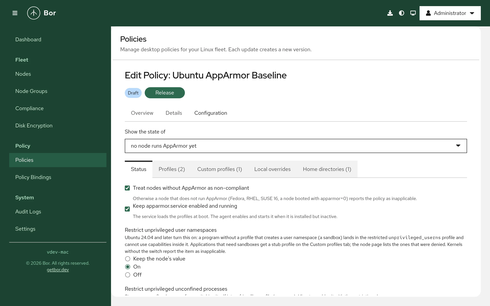

# AppArmor

The **AppArmor** policy type (technical name `Apparmor`) manages the
mandatory access control layer of nodes that run AppArmor: Ubuntu, Debian,
SLES 15 and openSUSE Leap 15. A policy keeps AppArmor enabled and its
service running, controls the restriction of unprivileged user
namespaces, sets the mode of vendor profiles by name or pattern, deploys
custom profiles, adds site-local rules to vendor profiles and extra home
directory roots. This page explains what the agent changes on the
endpoint, how to build a policy in the editor, how several policies are
merged, and how to verify and troubleshoot the result.

!!! note "One type per mandatory access control system"
    Nodes that run SELinux (Fedora, RHEL, SLES 16) are managed by the
    [SELinux](selinux.md) type. An AppArmor policy bound to such a node
    reports **inapplicable**, unless it requires AppArmor.

## What it controls

- **Status** - whether a node without AppArmor counts as non-compliant,
  and whether `apparmor.service` (which loads the profiles at boot) is
  kept enabled and running.
- **User namespace restriction** - the kernel switches
  `kernel.apparmor_restrict_unprivileged_userns` and
  `kernel.apparmor_restrict_unprivileged_unconfined`, on by default since
  Ubuntu 24.04. With the restriction on, a program without a profile that
  creates a user namespace (a sandbox) lands in the restricted
  `unprivileged_userns` profile and cannot use capabilities inside it;
  applications that need sandboxes get a stub profile (below). The
  switches exist on Ubuntu kernels only; elsewhere the item is
  inapplicable.
- **Profile modes** - **Enforce**, **Complain** or **Disabled** for the
  profile files under `/etc/apparmor.d`, by exact file name or by pattern
  (`usr.sbin.*`, `*`). The agent sets modes through the `force-complain/`
  and `disable/` links the parser honours, so vendor files (package
  conffiles) stay untouched. A vendor file that sets `flags=(complain)`
  itself can be enforced only when the entry's **edit vendor flags** is
  on and the node allows it; the agent then strips the flag, keeps a
  backup and restores it later.
- **Custom profiles** - profiles Bor writes to `/etc/apparmor.d/bor-<name>`,
  checked with `apparmor_parser` before they are loaded. The editor's
  templates cover the common cases: allow user namespaces for one
  application, confine an application starting in complain mode, deny the
  network.
- **Local overrides** - rules added to a vendor profile through its
  `local/` include, inside a block Bor owns; the rest of the local file
  and the vendor profile stay as they are.
- **Home directories** - extra roots for `@{HOMEDIRS}` (NFS or autofs
  homes), written to `tunables/home.d/bor`.

Everything the agent changes is recorded in
`/var/lib/bor/agent/apparmor-state.json` the first time it is touched, and
restored when the key leaves every policy.

## Endpoint prerequisites

- **AppArmor enabled** in the kernel (`/sys/module/apparmor/parameters/enabled`
  is `Y`). Debian, Ubuntu and SUSE kernels enable it by default; a node
  booted with `apparmor=0` reports the policy inapplicable (or
  non-compliant when it requires AppArmor). The agent cannot change the
  kernel command line.
- **`apparmor_parser`** (package `apparmor`), looked up in `PATH` and in
  `/usr/sbin`. Without it, files are still written so they apply at the
  next boot, but nothing can be loaded or checked and the items say so.
- **`journalctl`** for the denial summary; AppArmor records are read from
  the kernel log and the audit transport, so auditd is not required.
- **AppArmor 3.0 or newer** (Ubuntu 22.04, Debian 12). The `userns` rule
  of the stub profiles and the `unconfined` profile flag need 4.0 (Ubuntu
  24.04, Debian 13); the templates declare `abi <abi/4.0>`, which loads on
  4.0, 4.1 and 5.0 parsers alike.

The `aa-status`, `aa-complain` and `aa-enforce` tools are not needed; a
stock Debian desktop does not ship them.

## Agent configuration

| Key | Default | Description |
|-----|---------|-------------|
| `apparmor.profiles_dir` | `/etc/apparmor.d` | The profile directory: Bor profiles, the `local/` files, the home tunable and the two link directories live under it. Tamper-protected. |
| `apparmor.parser_binary` | `apparmor_parser` | The parser executable, looked up in `PATH`, `/usr/sbin` and `/sbin` unless absolute. |
| `apparmor.sysctl_path` | `/etc/sysctl.d/zz-bor-apparmor.conf` | The sysctl file for the user namespace switches; sorts after the distribution's files. Tamper-protected. |
| `apparmor.state_path` | `/var/lib/bor/agent/apparmor-state.json` | Record of every original state, restored when it leaves every policy. |
| `apparmor.backup_dir` | `/var/lib/bor/agent/apparmor-backups` | Backups of vendor files whose mode flags a policy edited (never under the profile directory, which the parser loads as a whole). |
| `apparmor.reconcile_interval` | `5m` | Interval of the pass that re-asserts links, loaded modes and sysctls while a policy applies; `0` disables it. |
| `apparmor.allow_custom_profiles` | `true` | Write Bor profiles and local overrides. With `false` those entries are inapplicable and files written earlier are removed. |
| `apparmor.allow_vendor_flag_edits` | `false` | Let policies strip the complain flag inside vendor profile files. Off by default because the files are package conffiles. |
| `apparmor.follow_audit` | `true` | Follow the kernel's AppArmor status records so a manual profile change is reconciled within seconds. |
| `apparmor.tool_timeout` | `2m` | Maximum run time of one `apparmor_parser` call. |
| `mac.*` | see [SELinux](selinux.md#agent-configuration) | Inventory interval, denial window, denial collection, proposal actions; shared by both types. |

## Create an AppArmor policy

1. Go to **Policies -> Create a policy** and choose **AppArmor** in the
   **System & security** group.
2. Pick a node from **Show the state of** at the top of the editor to see
   how each profile is loaded on that node; without a node the editor
   shows the union of what every node reported plus the server's list of
   common profiles.
3. Fill the tabs described below, review the summary and save. Release
   the policy and bind it to a node group.

{ loading=lazy }

### Editor sections

**Status**
:   Treat nodes without AppArmor as non-compliant; keep `apparmor.service`
    running; the two user namespace switches (Keep, On, Off; turning the
    restriction off asks for a confirmation).

**Profiles**
:   Search profiles (name, file, how the selected node loads it, whether
    the file itself sets complain mode, whether a process of it still
    runs unconfined). Each entry has the mode and the **edit vendor
    flags** checkbox. **All vendor profiles: enforce** adds the `*`
    pattern; exact entries win over it, and patterns leave stub profiles
    (`flags=(unconfined)`) alone. Disabling a profile asks for a
    confirmation; the profiles the user namespace restriction depends on
    (`unconfined`, `unprivileged_userns`, `bwrap-userns-restrict`) cannot
    be disabled. Profiles generated by snapd, Docker, LXD and libvirt are
    shown but cannot be managed.

**Custom profiles**
:   A name (file `bor-<name>`), a note, the executable path for the
    template and the profile text. **Insert a template** renders one of:
    *Allow user namespaces for an application* (the four-line stub Ubuntu
    uses for browsers and Electron applications), *Confine an application,
    complain first* (a starter with the usual desktop abstractions), *Deny
    network for an application*. The text must declare
    `profile bor-<name>`; the server checks the structure and the node's
    parser checks the syntax before the file is installed. A profile whose
    attachment path is already used by another profile on the node is
    refused (two profiles for one executable make the kernel run it
    unconfined). A Bor scheduled task can run under a profile deployed
    here: set `AppArmorProfile` to `bor-<name>` on the task in a
    [Services & timers](systemd.md) policy.

**Local overrides**
:   The vendor profile file (only files that include `local/<file>` are
    offered) and the rules. Use `priority=1` on a rule to override a
    vendor `deny` (AppArmor 4.1 and later).

**Home directories**
:   Extra roots for `@{HOMEDIRS}`.

## Setting reference

| Setting | Field | Values | What the agent does |
|---|---|---|---|
| AppArmor required | `requireEnabled` | bool | a node without AppArmor is non-compliant instead of inapplicable |
| Service | `ensureService` | bool | `systemctl enable --now apparmor` when installed but inactive |
| User namespace restriction | `restrictUnprivilegedUserns` | `APPARMOR_SWITCH_ON` / `_OFF` | writes the sysctl and the sysctl.d file |
| Unconfined restriction | `restrictUnprivilegedUnconfined` | `APPARMOR_SWITCH_ON` / `_OFF` | same |
| Profile mode | `profiles[].match`, `.mode`, `.editVendorFlags` | file name or glob; `APPARMOR_MODE_ENFORCE`, `_COMPLAIN`, `_DISABLED`; bool | links in `force-complain/` and `disable/`, `apparmor_parser -r` / `-R`; optionally the in-file flag edit |
| Custom profile | `customProfiles[].name`, `.text` | name, profile text (64 KiB) | `/etc/apparmor.d/bor-<name>`, `apparmor_parser -Q -K` then `-r` |
| Local override | `localOverrides[].profileFile`, `.text` | vendor file, rules | a managed block in `/etc/apparmor.d/local/<file>`, then `-Q -K` and `-r` of the vendor file |
| Home directories | `extraHomeDirs[]` | absolute paths ending in `/` | `tunables/home.d/bor`, then a reload of every profile |

### Example: Ubuntu desktop baseline

```json
{
  "requireEnabled": true,
  "ensureService": true,
  "restrictUnprivilegedUserns": "APPARMOR_SWITCH_ON",
  "restrictUnprivilegedUnconfined": "APPARMOR_SWITCH_ON",
  "profiles": [{"match": "*", "mode": "APPARMOR_MODE_ENFORCE"}]
}
```

### Example: let an in-house application use sandboxes

```json
{
  "customProfiles": [{
    "name": "corpapp",
    "description": "Electron application; needs user namespaces for its sandbox",
    "text": "abi <abi/4.0>,\ninclude <tunables/global>\n\nprofile bor-corpapp /opt/corpapp/corpapp flags=(unconfined) {\n  userns,\n  include if exists <local/bor-corpapp>\n}\n"
  }]
}
```

## Merge behavior

Several AppArmor policies bound to one node are merged by binding
priority. For every profile file the deciding entry is chosen in this
order: an exact name over a pattern, then the higher priority, then the
more specific pattern, then the stricter mode (enforce over complain over
disabled). Custom profiles and local overrides with the same name but
different texts at equal priority are a conflict, reported as an error
for both policies; the switches take the stricter value on equal priority
(on over off); home directories are a union.

## What the agent changes on the node

| Path or state | Written by | Watched |
|---|---|---|
| `/etc/apparmor.d/disable/<file>`, `/etc/apparmor.d/force-complain/<file>` (symlinks) | profile modes | yes |
| loaded profiles (`apparmor_parser -r` / `-R`) | profile modes, custom profiles, overrides | reconciled |
| `/etc/apparmor.d/<file>` (the complain flag only) | profile modes with **edit vendor flags** | yes |
| `/etc/apparmor.d/bor-<name>` | custom profiles | yes |
| `/etc/apparmor.d/local/<file>` (the Bor block) | local overrides | yes |
| `/etc/apparmor.d/tunables/home.d/bor` | home directories | yes |
| `/etc/sysctl.d/zz-bor-apparmor.conf` and `/proc/sys/kernel/apparmor_restrict_*` | the switches | yes / reconciled |
| `/var/lib/bor/agent/apparmor-state.json`, `/var/lib/bor/agent/apparmor-backups/` | every original state | yes |

Every file Bor writes starts with the line `# Managed by Bor - changes are
overwritten`; the block in a local file is delimited by `# BEGIN Bor
managed` and `# END Bor managed`. Loading one profile takes milliseconds;
a change of the home tunable reloads every profile (a few seconds on
AppArmor 5.0, under ten on 4.1).

## Drift handling

Files and links Bor writes are guarded by the tamper watcher. The loaded
mode of every managed profile and the sysctls are re-asserted by the
reconcile pass every `apparmor.reconcile_interval`, and within seconds
when `apparmor.follow_audit` is on and the kernel logs a profile load,
replace or removal that Bor did not cause. Each correction is a tamper
event with the resource `apparmor:profile:<file>`,
`apparmor:custom:<file>`, `apparmor:local:<file>`,
`apparmor:sysctl:<name>` or `apparmor:service`.

A profile that is loaded after its application started does not confine
the running processes; the node details flag them with **needs restart**,
and the Services & timers section can restart the unit.

## Removal and restore

When a policy is unbound, archived or deleted, the agent unloads and
removes its custom profiles, removes its blocks from the local files
(and the files it created), removes the home tunable and the sysctl file,
restores the sysctls, puts every link back the way it was and reloads
those profiles, and restores vendor files it edited from their backups.

## The node details

The **Mandatory access control** section of a node shows whether AppArmor
is enabled, the parser version, the service state, how many profiles run
in each mode and the user namespace switches; the profiles the node
reported with their loaded mode, file, owner and warnings (needs restart,
attachment conflict, a local link Bor did not create); and the
**denials** of the last report window. A denial of `userns_create` names
the executable that hit the restriction and offers a ready **stub
profile** to copy into a policy. Holders of `mac:operate` can ask the node
for a **rule proposal**: the agent turns that profile's recent denials
into rules (file paths with their permissions, capabilities, network
families, signals) for review. Nothing is applied by the proposal.

## Compliance

One compliance item per entry (`apparmor:enabled`, `apparmor:service`,
`apparmor:userns`, `apparmor:unconfined`, `apparmor:profile`,
`apparmor:custom`, `apparmor:local`, `apparmor:homedirs`). A pattern entry
aggregates the files it decided ("12 profiles: 11 as requested, 1 not, 0
errors, 3 left alone") and names the files that could not be set.

| State | Meaning |
|---|---|
| Compliant | the node loads the profile in the requested mode, the file or sysctl is in place |
| Non-compliant | AppArmor is disabled under a policy that requires it; a vendor file sets complain mode itself and the entry does not edit flags; a loaded mode differs |
| Inapplicable | AppArmor is not enabled, the profile file is not installed, the kernel has no such sysctl, the vendor profile has no local include, a pattern met a stub profile, another policy decided, or the agent configuration disables the feature |
| Error | the parser rejected a profile or override (the message is the parser's), an attachment conflict, an equal-priority conflict |

## Verify on the endpoint

```bash
# Is AppArmor on, which profiles are loaded in which mode
cat /sys/module/apparmor/parameters/enabled
cat /sys/kernel/security/apparmor/profiles | sort

# Bor's links, profiles, overrides and tunable
ls -l /etc/apparmor.d/disable /etc/apparmor.d/force-complain
ls /etc/apparmor.d/bor-* /etc/apparmor.d/tunables/home.d/bor 2>/dev/null
grep -A20 'BEGIN Bor managed' /etc/apparmor.d/local/*

# The user namespace switches
cat /proc/sys/kernel/apparmor_restrict_unprivileged_userns /etc/sysctl.d/zz-bor-apparmor.conf

# Original states the agent will restore
cat /var/lib/bor/agent/apparmor-state.json

# Denials and profile changes
journalctl --since -1h -k -o cat | grep 'apparmor='

# The agent's log
journalctl -u bor-agent | grep -i apparmor
```

## Troubleshooting

**Every item is inapplicable with "AppArmor is not enabled".**
The node runs SELinux, or AppArmor is not in the kernel's LSM list
(`/sys/kernel/security/lsm`). On Arch-based systems add
`lsm=landlock,lockdown,yama,integrity,apparmor,bpf` to the kernel command
line; Debian, Ubuntu and SUSE enable it by default.

**A pattern reports a file as "not": the file sets complain mode itself.**
Debian ships several profiles with `flags=(complain)` (Xorg, LibreOffice).
Add an exact entry for the file with **edit vendor flags**, and set
`apparmor.allow_vendor_flag_edits: true` on the nodes; or accept the
complain mode.

**A custom profile is refused with "attachment ... already used".**
Another profile file on the node attaches to the same executable. Add a
local override to that profile instead, or disable it first.

**The parser rejects the profile.**
The item carries the parser's message with the line number. Profiles
using `userns` or the `unconfined` flag need AppArmor 4.0 or newer on the
node.

**The user namespace items are inapplicable.**
The kernel has no `apparmor_restrict_unprivileged_userns` switch; it
exists on Ubuntu kernels since 23.10 only.

## Security considerations

- Custom profiles and local overrides are administrator-authored policy
  text. Creating, saving, releasing or importing a policy that carries
  them requires the `mac:author` permission on top of the policy
  permissions, and is audited as `policy.mac_custom` with the file names
  and a SHA-256 of
  each text; a node can refuse them with
  `apparmor.allow_custom_profiles: false`.
- A custom profile can never replace a vendor file: its file and profile
  names carry the `bor-` prefix and an attachment another profile uses is
  refused.
- Turning the user namespace restriction off removes a mitigation several
  kernel exploit chains depend on; the editor asks for a confirmation and
  the stub template is the recommended alternative.
- Denial records are aggregated on the node before they are reported:
  user names are dropped and home directories collapsed to `/home/*`; the
  server keeps only the latest summary per node.
