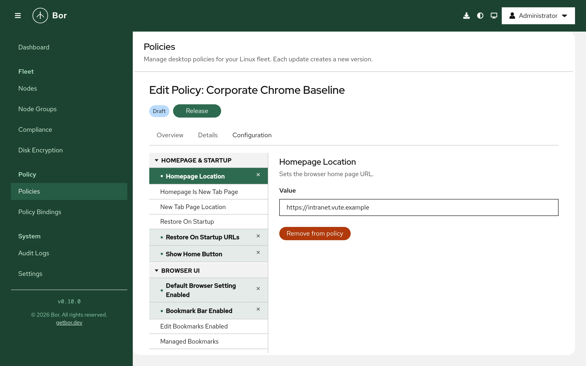

# Chrome and Chromium

The **Chrome** policy type manages Google Chrome and Chromium through their
managed-policy directories. The agent writes one JSON file,
`bor_managed.json`, into every Chrome and Chromium policy directory on the
node, so a single Bor policy covers Google Chrome, upstream Chromium, the
Debian/Ubuntu `chromium-browser` package layout and the Chromium Flatpak.
Managed policies are mandatory: users cannot change them in the browser
settings.

## What it controls

The schema contains several hundred Linux-relevant Chrome policies,
organized in these editor groups:

| Group | Examples |
|---|---|
| Homepage & Startup | **Homepage Location**, **Homepage Is New Tab Page**, **New Tab Page Location**, **Restore On Startup**, **Restore On Startup URLs**, **Show Home Button** |
| Browser UI | Bookmark bar, bookmark editing, default-browser check, developer tools availability, translation |
| Content Settings | Default and per-site settings for cookies, JavaScript, pop-ups, notifications, geolocation, images, clipboard and more |
| Extensions | **Extension Install Forcelist**, **Extension Install Blocklist**, allow lists, install sources, allowed types, extension settings |
| Privacy & Security | **Metrics Reporting Enabled**, **Block Third Party Cookies**, **Incognito Mode Availability**, alternate error pages |
| Safe Browsing | Safe Browsing protection level and related options |
| Passwords & Autofill | **Password Manager Enabled**, address and credit-card autofill |
| User & Sync | **Sync Disabled**, **Sync Types List Disabled**, **Browser Signin** |
| Network & Proxy | **URLBlocklist**, **URLAllowlist**, proxy settings, DNS-over-HTTPS, QUIC |
| Search | Default search provider (name, keyword, search and suggest URLs) |
| HTTP Authentication, Kerberos | Authentication schemes, server allow lists, delegation |
| Printing, Downloads, Updates & Management, Miscellaneous | Printing defaults, download directory and restrictions, component updates and more |

Setting names match the official Chrome policy names (the editor shows
them split into words, for example `HomepageLocation` appears as
**Homepage Location**). Google's Chrome Enterprise policy list documents
the meaning of each policy. Some policies depend on Google services (for
example sync and browser sign-in) and have no effect in Chromium builds.

## Files on the endpoint

The agent writes `bor_managed.json` into each of these directories:

| Browser | Directory | Agent config key |
|---|---|---|
| Google Chrome (all channels) | `/etc/opt/chrome/policies/managed` | `chrome.chrome_policies_path` |
| Chromium (upstream layout, for example Arch Linux) | `/etc/chromium/policies/managed` | `chrome.chromium_policies_path` |
| Chromium (Debian/Ubuntu `chromium-browser` layout) | `/etc/chromium-browser/policies/managed` | `chrome.chromium_browser_policies_path` |
| Chromium Flatpak (`org.chromium.Chromium`) | `/var/lib/flatpak/extension/org.chromium.Chromium.Extension.system-policies/<arch>/1/policies/managed` | `chrome.flatpak_chromium_policies_path` |

`<arch>` is `x86_64` on amd64 and `aarch64` on arm64 nodes.

The directories are created if they do not exist, so all of them appear on
every node that receives a Chrome policy, whether or not the browser is
installed. The file contains only real policy keys (no comment key, because
Chrome warns about unknown keys). It is written atomically with mode
`0644`. Other JSON files that you or other tools place in the same
directories are not touched.

Set a key to an empty string to skip that directory, then restart the
agent:

```yaml
chrome:
  chromium_browser_policies_path: ""
  flatpak_chromium_policies_path: ""
```

Writing the three system directories must succeed for the policy to be
reported as deployed; the Flatpak directory is best effort and a failure
there is only logged.

When no Chrome policy applies to the node anymore, `bor_managed.json` is
deleted from every configured directory.

## Create a Chrome policy

{ loading=lazy }

1. Go to **Policies** and click **Create a policy**.
2. Choose **Chrome** on the **Type** step, then enter a **Name** and
   **Description** on the **Details** step.
3. On the **Configuration** step browse the settings tree. Selecting a
   setting previews it; it becomes part of the policy when you change the
   value or click **Add to policy**. Use **Remove from policy** (or the
   remove button next to a configured setting in the tree) to drop it.
4. Review and create the policy, release it and bind it to a node group on
   **Policy Bindings**.

Editors by setting type:

- Boolean settings: a switch (**Enabled** / **Disabled**).
- Settings with numbered options (for example **Restore On Startup** or
  **Incognito Mode Availability**): a drop-down that shows the numeric
  value with a short description.
- Lists (URL lists, extension lists): **one item per line**.
- Free-form object settings such as **Extension Settings**: a JSON text
  field (**Value (JSON)**) that must contain a valid JSON object or array.

## Examples

### Home page and startup pages

| Group | Setting | Value |
|---|---|---|
| Homepage & Startup | **Homepage Location** | `https://intranet.example.com/` |
| Homepage & Startup | **Show Home Button** | Enabled |
| Homepage & Startup | **Restore On Startup** | `4` (open a list of URLs) |
| Homepage & Startup | **Restore On Startup URLs** | `https://intranet.example.com/` and `https://mail.example.com/` (one per line) |

Resulting `bor_managed.json`:

```json
{
  "HomepageLocation": "https://intranet.example.com/",
  "RestoreOnStartup": 4,
  "RestoreOnStartupURLs": [
    "https://intranet.example.com/",
    "https://mail.example.com/"
  ],
  "ShowHomeButton": true
}
```

**Restore On Startup URLs** is only used when **Restore On Startup** is
`4`.

### Block websites with an exception

| Group | Setting | Value |
|---|---|---|
| Network & Proxy | **URLBlocklist** | `*` |
| Network & Proxy | **URLAllowlist** | `example.com` and `intranet.example.com` (one per line) |

This blocks every site except the allowed domains, a common setup for
kiosks and exam machines. The URL patterns follow Chrome's URL blocklist
filter format.

### Force-install an extension and disable password saving

| Group | Setting | Value |
|---|---|---|
| Extensions | **Extension Install Forcelist** | `<extension-id>;https://clients2.google.com/service/update2/crx` |
| Passwords & Autofill | **Password Manager Enabled** | Disabled |

Each force-list entry is the extension ID, a semicolon and the update URL.
Force-installed extensions are installed silently and users cannot remove
them.

## How multiple Chrome policies are merged

All Chrome policies that apply to a node are combined into one
`bor_managed.json`:

- Settings set by only one policy are copied as they are.
- Object settings (for example **Extension Settings**) are merged key by
  key.
- Lists are concatenated: two policies with URL block lists produce one
  list with all entries.
- When two policies set the same single value differently, the result is
  **not defined**; binding priority is not used for this type.

Keep each setting in exactly one policy. See
[merging and conflicts](index.md#merging-and-conflicts).

## What users see

Chrome and Chromium usually pick up policy file changes while running
(you can force it with **Reload policies**, see below), but some policies
only take effect after a browser restart. The agent can notify logged-in
users after a change (**Settings -> Agent Notifications**,
**Chrome/Chromium policy notification message**).

Open `chrome://policy`:

- Every policy from `bor_managed.json` is listed with source **Platform**
  and level **Mandatory**.
- Click **Reload policies** to re-read the files immediately.
- Policies with an unknown name or a wrong value type show an error or
  warning in the status column.

The browser menu and settings show "Managed by your organization", and
managed settings are locked in the settings pages.

## Verify on the node

```bash
# Which directories contain Bor's file
ls -l /etc/opt/chrome/policies/managed/ /etc/chromium/policies/managed/ \
      /etc/chromium-browser/policies/managed/

# Show and validate the merged policy
sudo cat /etc/opt/chrome/policies/managed/bor_managed.json
python3 -m json.tool /etc/opt/chrome/policies/managed/bor_managed.json > /dev/null && echo OK

# Agent log
sudo journalctl -u bor-agent | grep -i chrom
```

A successful sync logs `Chrome policies synced (N policies)` and the
policy is reported **Compliant** with the message `Deployed`.

## Troubleshooting

**`chrome://policy` does not list the policy.** Make sure the browser reads
the directory Bor writes to. Distribution builds of Chromium differ: some
use `/etc/chromium/policies/managed`, others
`/etc/chromium-browser/policies/managed`. If your build uses another path,
set one of the `chrome.*` keys to it. For the Flatpak, check that
`/var/lib/flatpak/extension/org.chromium.Chromium.Extension.system-policies/`
contains the file.

**A policy shows an error in `chrome://policy`.** The browser version may not
know the policy, or the value has the wrong form (for example an extension
force-list entry without the update URL). Policies that need Google
services do nothing in Chromium.

**Another JSON file in the same directory sets the same policy.** Chrome
reads every JSON file in the managed directory. If another file sets a
conflicting value, `chrome://policy` reports a conflict. Remove the other
file or the setting from the Bor policy.

**Edits to `bor_managed.json` disappear.** The file is tamper-protected; the
agent restores it and records a `tamper_detected` event in the
[audit log](../user-guide/audit-log.md).

**Non-compliant with "failed to sync Chrome policies".** One of the three
system directories could not be written. The message contains the error;
set the key of a directory you do not need to `""` if the location is not
writable on your systems.
