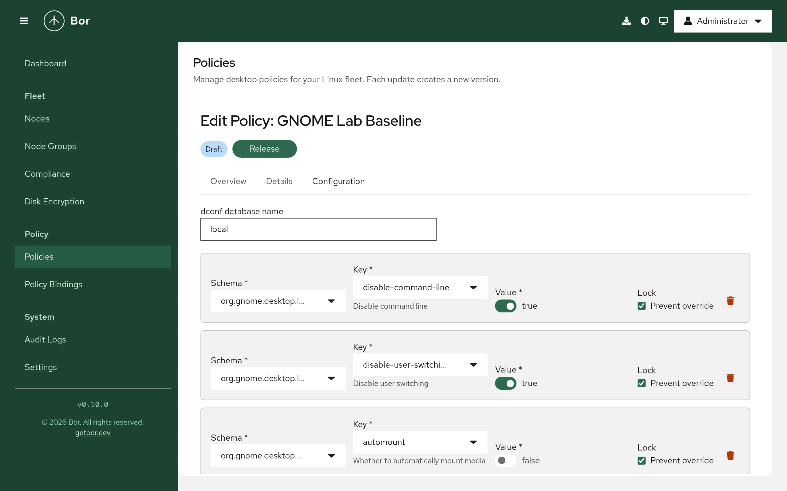

# Dconf (GNOME and GSettings)

The **Dconf** policy type enforces GSettings keys as system-wide settings
through dconf, the configuration store behind GNOME and many other
GSettings-based applications. Each entry sets one key, and can optionally
**lock** it so users cannot change it. This page covers the files the agent
writes, how to pick keys in the editor, value formats, priority-based
merging, compliance and verification on a GNOME desktop.

## What it controls

Any GSettings key in any schema: GNOME Shell, the GNOME desktop
(`org.gnome.desktop.*`), Nautilus, GNOME applications, and third-party
software that stores its configuration in GSettings. Typical uses:

- Screen lock and idle behavior (`org.gnome.desktop.screensaver`,
  `org.gnome.desktop.session`).
- Lockdown keys (`org.gnome.desktop.lockdown`), for example disabling user
  switching or the command line.
- Removable media handling (`org.gnome.desktop.media-handling`).
- Default favorites, backgrounds, themes and fonts.

A policy is a list of entries plus an optional database name:

| Field | Meaning |
|---|---|
| **Schema** | GSettings schema ID, for example `org.gnome.desktop.screensaver` |
| **Key** | Key name in the schema, for example `lock-enabled` |
| **Value** | Value in GVariant text format, for example `true`, `'Adwaita'` or `uint32 300` |
| **Lock** (**Prevent override**) | Adds the key to the locks file so users cannot change it |
| **dconf path override** | Only for relocatable schemas: the dconf path to write to |
| **dconf database name** | System database to write to; default `local` |

## Files on the endpoint

For database `local` (the default) the agent writes:

| File | Content |
|---|---|
| `/etc/dconf/db/local.d/00-bor` | Keyfile with all values, one `[section]` per schema path |
| `/etc/dconf/db/local.d/locks/bor` | One locked key path per line |
| `/etc/dconf/profile/user` | Must contain `system-db:local`; the agent appends the line if it is missing, or creates the file with `user-db:user` and `system-db:local` |

After writing, the agent runs `dconf update` to compile the database.
Running sessions pick up the new values without logging out.

Before the first write the agent keeps a `.bor-backup` copy of any existing
`00-bor` or `locks/bor` file. Both managed files are tamper-protected.

The database name may contain only letters, digits, `.`, `_` and `-`. A
different name writes to `/etc/dconf/db/<name>.d/` and adds
`system-db:<name>` to the user profile instead.

!!! note "Schema catalogue"
    The editor offers schemas from a catalogue on the server. It starts
    with a built-in set of common schemas and grows as agents report the
    schemas installed on their nodes (they scan
    `/usr/share/glib-2.0/schemas` when the agent starts). Schemas
    installed on a node later only appear after the agent restarts.

## Create a Dconf policy

{ loading=lazy }

1. Go to **Policies**, click **Create a policy** and pick **Dconf** on the
   **Type** step. Enter a **Name** on the **Details** step.
2. On the **Configuration** step, leave **dconf database name** empty or at
   `local` unless your systems use another system database.
3. Click **Add entry** for each key and fill in the row:
    - **Schema**: searchable list of schemas; the description shows the
      schema's dconf path, or *(relocatable)*.
    - **Key**: searchable list of the schema's keys, with the key summary
      shown below the field.
    - **Value**: an input that matches the key type: a switch for
      booleans, a drop-down for enum keys and keys with fixed choices, a
      number field for integers and doubles, a text field for string
      arrays and a plain text field for everything else. New entries start
      with the schema's default value.
    - **Lock**: tick **Prevent override** to lock the key.
    - For relocatable schemas, enter a **dconf path override** that starts
      and ends with `/`.
4. Review, create and release the policy, then bind it to a node group.

### GVariant value format

The editor formats values for you. If you import or edit policy JSON
directly, use GVariant text format:

| Key type | Example | Notes |
|---|---|---|
| `b` (boolean) | `true` | |
| `i` (int32) | `5` | No prefix |
| `u` (uint32) | `uint32 300` | Prefix required |
| `q` (uint16) | `uint16 5042` | Prefix required |
| `d` (double) | `1.5` | |
| `s` (string) | `'Adwaita'` | Single quotes required |
| `as` (string array) | `['firefox.desktop', 'org.gnome.Nautilus.desktop']` | |

!!! warning
    A bare number for an unsigned or 16-bit key (for example `300` for a
    `uint32` key) is ignored by dconf. Always include the type prefix.

## Examples

### Lock the screen after five minutes of inactivity

| Schema | Key | Value | Lock |
|---|---|---|---|
| `org.gnome.desktop.session` | `idle-delay` | `uint32 300` | Prevent override |
| `org.gnome.desktop.screensaver` | `lock-enabled` | `true` | Prevent override |
| `org.gnome.desktop.screensaver` | `lock-delay` | `uint32 0` | Prevent override |

The agent writes `/etc/dconf/db/local.d/00-bor`:

```text
# This file is managed by Bor. Do not edit manually.
# Changes will be overwritten by policy enforcement.

[org/gnome/desktop/session]
idle-delay=uint32 300

[org/gnome/desktop/screensaver]
lock-enabled=true
lock-delay=uint32 0
```

and `/etc/dconf/db/local.d/locks/bor`:

```text
/org/gnome/desktop/session/idle-delay
/org/gnome/desktop/screensaver/lock-enabled
/org/gnome/desktop/screensaver/lock-delay
```

### Disable user switching (lockdown)

To find the right key, open the **Schema** list and search for
`lockdown`. Pick `org.gnome.desktop.lockdown`, then search the **Key** list
for `switching`; the summary under the field describes the key.

| Schema | Key | Value | Lock |
|---|---|---|---|
| `org.gnome.desktop.lockdown` | `disable-user-switching` | `true` | Prevent override |

### Turn off automounting, but let users turn it back on

| Schema | Key | Value | Lock |
|---|---|---|---|
| `org.gnome.desktop.media-handling` | `automount` | `false` | (not locked) |

Without a lock the value is a system default: it applies to every user who
has not changed the setting, and users can still change it.

## How multiple Dconf policies are merged

Dconf is one of the types where binding priority matters:

- Entries are merged by schema, path and key. If several policies set the
  same key, the policy with the **higher** binding priority wins. With
  equal priorities the winner is not defined.
- All entries go into one database. If several policies set a database
  name, the name from the highest-priority policy that sets one is used.
- In the compliance report, the losing policy shows the overridden key as
  **Inapplicable** with the message "Overridden by a higher-priority
  policy; applied value: ..." so it does not count against the node.

See [bindings](../user-guide/bindings.md) for setting priorities.

## Compliance

After `dconf update` the agent reads every key back with
`gsettings get <schema> <key>` and compares it with the policy value
(integer type prefixes are ignored in the comparison). Each key gets its
own result, visible in the expandable row on the
[compliance page](../user-guide/compliance.md):

| Result | Meaning |
|---|---|
| Compliant | The current value matches the policy. |
| Non-compliant | The value differs; the details show the expected and actual value. |
| Inapplicable | The schema is not installed on the node (for example a GNOME policy on a KDE node), or another policy with higher priority sets the key. |
| Error | The schema is installed, but writing the files, `dconf update` or `gsettings get` failed. |

The policy's overall status is Inapplicable only when every key is
inapplicable; otherwise any error makes it Error, and any mismatch makes
it Non-compliant.

## What users see

- Locked settings are greyed out or have no effect in GNOME Settings and
  other applications; `gsettings set` on a locked key fails with a "key is
  not writable" error.
- Unlocked values act as new defaults. Users who already changed the key
  keep their own value.
- Flatpak applications with current runtimes receive host values for
  `org.gnome.desktop.*` keys through the settings portal; application
  schemas inside a sandbox are not covered.

## Verify on the node

```bash
# Files and profile
sudo cat /etc/dconf/db/local.d/00-bor
sudo cat /etc/dconf/db/local.d/locks/bor
cat /etc/dconf/profile/user

# Run as the desktop user:
gsettings get org.gnome.desktop.session idle-delay
gsettings writable org.gnome.desktop.session idle-delay   # "false" when locked
dconf read /org/gnome/desktop/session/idle-delay
```

The agent log shows `dconf policies synced (db=local, N policies)` after
each sync:

```bash
sudo journalctl -u bor-agent | grep -i dconf
```

## Troubleshooting

**Error "dconf update failed".** The `dconf` command is missing or failed;
the compliance message includes its output. Install the `dconf` package
(on most GNOME systems it is already present).

**Error "dconf: invalid db name".** The database name contains characters
other than letters, digits, `.`, `_` and `-`.

**The value is written but sessions do not use it.** Check that
`/etc/dconf/profile/user` contains the `system-db:` line for the database
you use. If your systems set the `DCONF_PROFILE` environment variable or
use a different profile file, add the database there as well.

**Non-compliant although the keyfile is correct.** The user (or the root
account the agent runs `gsettings` as) may have a personal value that
overrides an unlocked key. Lock the key, or accept that unlocked keys are
defaults only.

**Non-compliant or error for a relocatable schema.** Compliance checks read
the key with `gsettings get <schema> <key>`, which cannot address a
relocatable schema without a path. Verify such keys manually with
`dconf read <path><key>`.

**The schema is missing from the list.** The editor only offers schemas
from the catalogue. Install the software that provides the schema on at
least one enrolled node and restart its agent so it reports its schemas.

**Settings remain after switching the database name.** Cleanup only applies
to the database currently in use. If you move policies from a custom
database back to `local` (or the other way round), remove the old
`/etc/dconf/db/<name>.d/00-bor` and `locks/bor` files and run
`sudo dconf update`.

**SELinux denials.** On SELinux-enforcing systems, check
`sudo ausearch -m avc -ts recent` if the agent cannot write to
`/etc/dconf/db/`.
