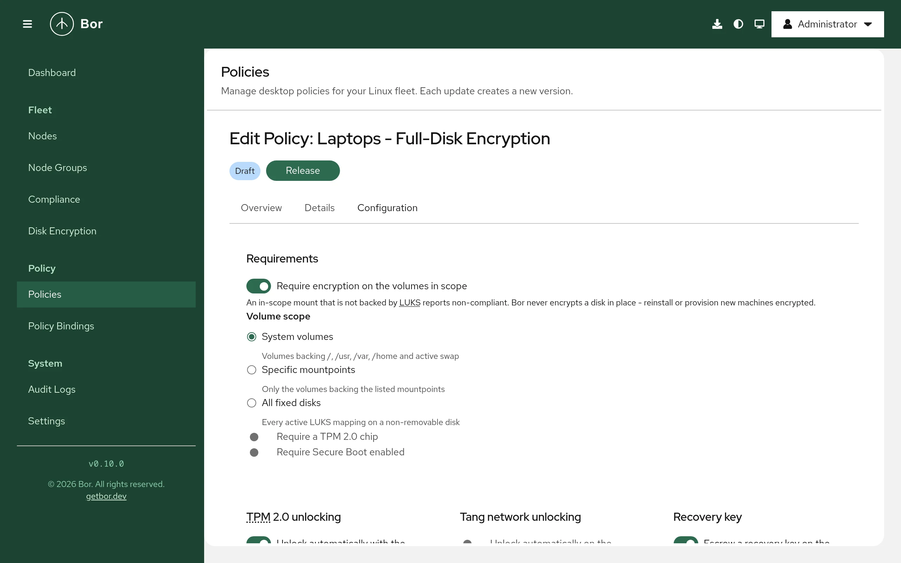
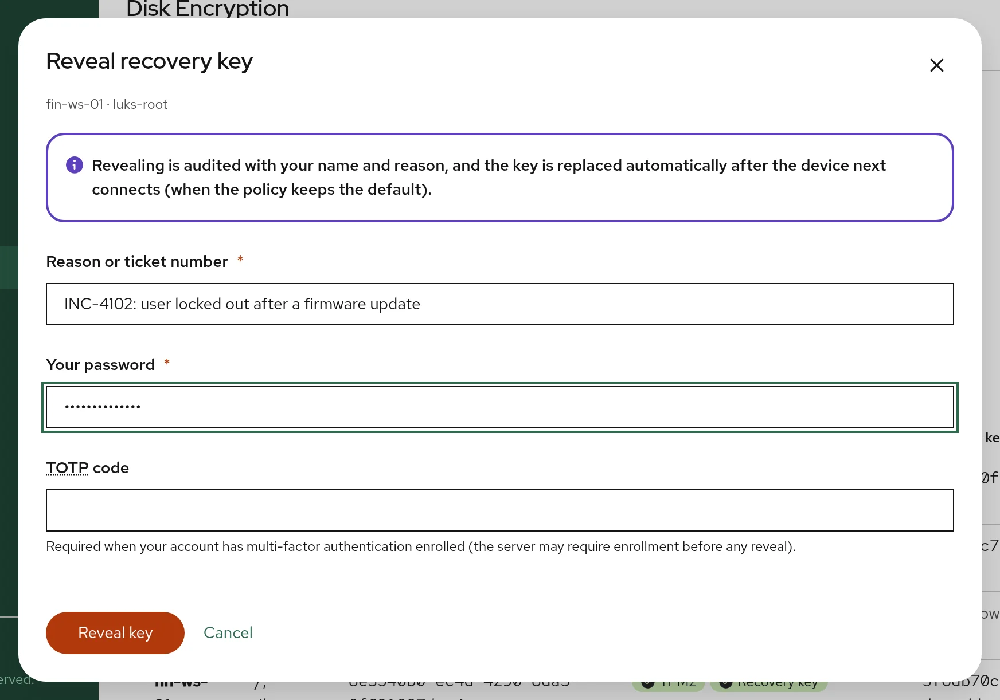
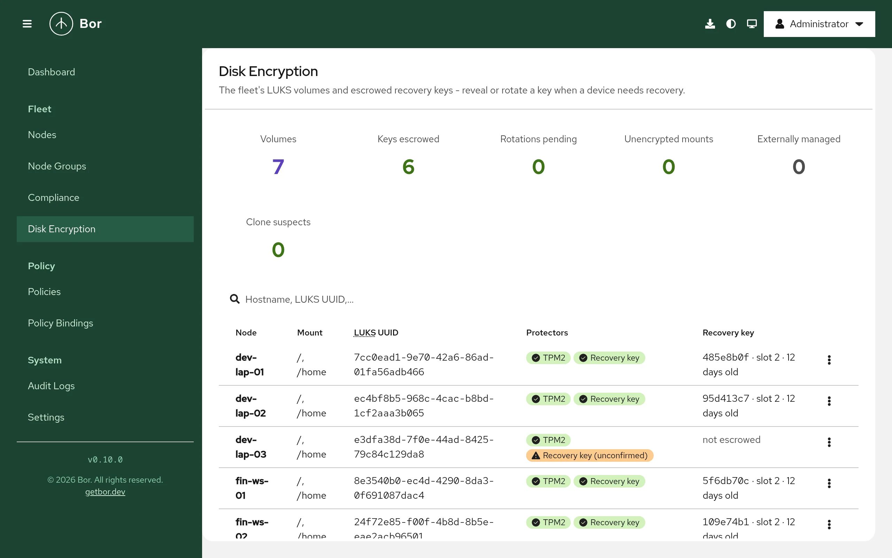

# Disk encryption (LUKS)

The **Disk encryption** policy type (technical name `DiskEncryption`, shown
as LUKS) manages LUKS2 full-disk encryption across your fleet. It checks that
the volumes in scope are encrypted, enrolls automatic unlocking through the
**TPM 2.0** chip and/or **Tang** network servers, and escrows a per-volume
**recovery key** on the Bor server. The help desk can reveal that key from the
**Disk Encryption** page, with its own permission, re-authentication and a full
audit trail.

This page covers the server setup (escrow key, Tang servers, permissions), the
policy editor, what the agent does on the endpoint, adoption of existing
machines, the help-desk recovery procedure, key rotation and retention, and
troubleshooting.

!!! warning "Bor never converts a disk"
    Requiring encryption does not encrypt anything. An unencrypted volume is
    reported as non-compliant; the remedy is reinstalling with encryption
    (see [Provision new machines](#provision-new-machines)).

## Concepts

LUKS2 encrypts a volume with a random **volume key**. Up to 32 **keyslots**
each hold a copy of that key, encrypted under a different credential; any one
keyslot unlocks the disk. **Tokens** in the LUKS2 header tell the boot tooling
how a keyslot is unlocked. Each keyslot that Bor manages is called a
**protector**:

| Protector | Unlocks when | Managed with |
|---|---|---|
| **TPM 2.0** | The measured boot state (PCRs) matches the enrollment, i.e. firmware, Secure Boot configuration and boot chain are unchanged | `systemd-cryptenroll` (dracut-based systems) |
| **Tang** | The machine can reach the configured Tang server(s) at boot | `clevis luks bind` with a pinned, admin-confirmed signing key |
| **Recovery key** | Someone types the recovery key at the boot prompt | Generated by the agent, escrowed on the Bor server |
| **User passphrase** | The user types it | Not managed; left in place |

A typical managed system volume looks like this:

```text
LUKS2 volume luks-3f2a9c1e-...  (backs /)
  slot 0  systemd-tpm2      TPM 2.0, PCR 7     unattended boot on an intact boot chain
  slot 1  clevis (tang)     tang1.example.com  unattended boot on the office network
  slot 2  systemd-recovery  Bor recovery key   typed at the prompt when both fail
  slot 3  password          user passphrase    untouched by Bor
```

Three design rules matter for operators:

1. **The Bor server is never in the boot path.** Unlocking at boot is done by
   the initramfs (TPM, Clevis/Tang, or a typed key). A Bor server outage never
   stops a machine from booting.
2. **Bor orchestrates, standard tools do the cryptography.** The agent runs
   `cryptsetup`, `systemd-cryptenroll` and `clevis` with fixed arguments;
   secrets are passed on stdin or a pipe, never on a command line or in a
   file. The only secret Bor generates is the recovery key, in the same
   format as `systemd-cryptenroll --recovery-key`.
3. **Escrow first.** A new recovery key is stored on the server *before* its
   keyslot is created, and an old keyslot is wiped only *after* the server has
   confirmed the new one. There is never a Bor recovery slot whose key the
   server does not hold.

## Endpoint prerequisites

| Component | Needed for | Notes |
|---|---|---|
| `cryptsetup` (2.4 or later) | Everything | Without it the policy reports **Error**: `cryptsetup is not installed on this node`. The `bor-agent` package recommends it. |
| `systemd-cryptenroll` | TPM2 protector | Only on dracut-based systems (initramfs generator detected as `dracut`). Elsewhere the TPM2 item is inapplicable. |
| `tpm2-tools` and the dracut `tpm2-tss` module | TPM2 unlocking at boot | Checked by the initramfs verification. |
| `clevis` with `clevis-luks` and `clevis-dracut` | Tang protector | Missing Clevis under a Tang policy is **non-compliant** (a required control is absent), not inapplicable. |
| `lsinitrd` (dracut) | Initramfs verification | Used to inspect the current initramfs. |
| `systemd-ask-password` | `bor-agent luks adopt` | Used to read the passphrase. |

The `bor-agent` package suggests `clevis-luks`, `clevis-dracut` and
`tpm2-tools`. On systems that do not use dracut (for example Debian or
Ubuntu with initramfs-tools), recovery-key escrow works, while TPM2 and the
initramfs checks report inapplicable.

## Agent configuration

Optional keys in `/etc/bor/config.yaml` under `disk_encryption:`:

| Key | Default | Purpose |
|---|---|---|
| `state_file` | `/var/lib/bor/agent/luks-state.json` | Crash-recovery progress of rotations. Never contains keys. |
| `bootstrap_dir` | `/etc/bor/luks-bootstrap` | One-time provisioning credentials (`<luks-uuid>.key`). |
| `run_dir` | `/run/bor/luks` | Root-only tmpfs work directory (Clevis temporary files, lock shared with `bor-agent luks adopt`). |
| `cryptsetup` | `cryptsetup` | Binary, resolved through `PATH`. |
| `cryptenroll` | `systemd-cryptenroll` | Binary, resolved through `PATH`. |
| `clevis` | `clevis` | Binary, resolved through `PATH`. |

## Server setup

### 1. Configure the escrow key (KEK)

Escrowed recovery keys are envelope-encrypted: each record has its own
AES-256-GCM data key, which is wrapped by a key-encryption key (KEK) read
from a file **outside the database**. Without a KEK, escrow refuses to
operate and the policy editor shows
`Recovery-key escrow is not configured on the server: set BOR_ESCROW_KEK_FILE.`

1. Create a KEK of exactly 32 random bytes, readable only by the `bor` user:

    ```bash
    sudo sh -c 'head -c 32 /dev/urandom > /etc/bor/escrow.kek'
    sudo chown bor:bor /etc/bor/escrow.kek
    sudo chmod 0600 /etc/bor/escrow.kek
    ```

    The file may hold the 32 bytes raw or base64-encoded. The server refuses
    to start if the file is group- or world-readable or has the wrong size.

2. Point the server at it, in `/etc/bor/server.yaml`:

    ```yaml
    disk_encryption:
      escrow_kek_file: /etc/bor/escrow.kek
    ```

    or in `/etc/bor/server.env` as `BOR_ESCROW_KEK_FILE=/etc/bor/escrow.kek`.

3. Restart the server and check the log:

    ```bash
    sudo systemctl restart bor-server
    sudo journalctl -u bor-server | grep -i escrow
    ```

    It logs `Recovery-key escrow enabled (KEK "file-1" from /etc/bor/escrow.kek)`.

!!! danger "Back up the KEK separately from the database"
    A database backup without the KEK file cannot decrypt any recovery key,
    and the KEK alone is useless without the database. Back them up to
    different places, and never lose the KEK: without it, every escrowed key
    is unrecoverable. See [Backup](../operations/backup.md).

#### Server settings

| Environment variable | YAML key under `disk_encryption:` | Default | Purpose |
|---|---|---|---|
| `BOR_ESCROW_KEK_FILE` | `escrow_kek_file` | (escrow disabled) | Current KEK file. |
| `BOR_ESCROW_KEK_ID` | `escrow_kek_id` | `file-1` | Label stored on records wrapped with the current KEK. |
| `BOR_ESCROW_KEK_PREVIOUS_FILES` | `escrow_kek_previous_files` | (none) | Old KEKs as comma-separated `id=path` entries, kept readable during KEK rotation. |
| `BOR_ESCROW_REQUIRE_MFA` | `require_mfa_for_reveal` | `true` | Require a second factor when revealing a key. |
| `BOR_ESCROW_RETIRED_RETENTION_DAYS` | `retired_retention_days` | `30` | How long rotated-away keys stay revealable. |
| `BOR_ESCROW_ORPHAN_RETENTION_DAYS` | `orphan_retention_days` | `90` | How long keys of a deleted node are kept. |

#### Rotate the KEK

1. Create a new KEK file as above, for example `/etc/bor/escrow-2.kek`.
2. Set it as the current KEK with a new ID, and list the old one as previous:

    ```yaml
    disk_encryption:
      escrow_kek_file: /etc/bor/escrow-2.kek
      escrow_kek_id: file-2
      escrow_kek_previous_files:
        - file-1=/etc/bor/escrow.kek
    ```

3. Restart the server. The hourly maintenance job rewraps every record's data
   key under the new KEK (recovery keys themselves are not re-encrypted).
4. Once all records are rewrapped, remove the previous entry and restart
   again.

### 2. Register Tang servers (optional)

Only needed for the Tang protector. Open **Settings -> Tang Servers** and
click **Add Tang server**:

1. Enter a **Name** and the **URL** (for example
   `http://tang1.example.com`) and click **Probe**. Bor fetches the server's
   advertisement and lists its **Signing keys** (thumbprints).
2. On the Tang host, run `tang-show-keys` and compare the output with the
   thumbprints shown. Check only the keys that match.
3. Click **Add server**.

Agents bind only to keys an administrator confirmed; Bor never lets Clevis
skip thumbprint verification. The server re-checks every Tang advertisement
every 6 hours. When a Tang server advertises a new key, its status becomes
**New key advertised**; open it with **Confirm new key...**, compare with
`tang-show-keys`, and confirm. A server referenced by a policy cannot be
deleted.

**Tang key rotation**: rotate the keys on the Tang host (keeping the old keys
available), confirm the new thumbprint in Bor, and update the policies that
use the server. Agents bind to the new key, verify the binding and only then
remove the stale one. The tab shows how many volumes are bound to each key;
delete the old key on the Tang host only when its count reaches zero.

### 3. Review who may reveal keys

| Permission | Allows | Granted by default to |
|---|---|---|
| `disk_encryption:view` | The **Disk Encryption** page and key *metadata* | Every role that has `node:view` |
| `disk_encryption:reveal` | Revealing a recovery key | **Super Admin** only |
| `disk_encryption:rotate` | **Rotate now** | **Super Admin** only |
| `tang_server:view`, `create`, `edit`, `delete` | **Settings -> Tang Servers** | Roles with `settings:manage` |

Grant `reveal` to a help-desk role deliberately (see
[Users and roles](../user-guide/users-and-roles.md) and
[Permissions](../reference/permissions.md)). Keep
`BOR_ESCROW_REQUIRE_MFA=true` so revealing always needs a second factor
(see [MFA](../configuration/mfa.md)).

## Create a disk encryption policy

{ loading=lazy }

Open **Policies**, click **Create a policy** and choose **Disk encryption**.
New policies start with: require encryption, system volumes, TPM2 on with the
Secure Boot profile and auto-reseal, recovery-key escrow on with 180-day
rotation, replace after reveal, server-assisted rotation, and **Verify only**
initramfs handling. The editor shows a **Resulting keyslot layout** preview.

### Requirements

| Setting | Meaning |
|---|---|
| **Require encryption on the volumes in scope** | Every in-scope mount not backed by encryption is non-compliant. |
| **Volume scope** | **System volumes** (volumes backing `/`, `/usr`, `/var`, `/home` and active swap), **Specific mountpoints** (list them under **Mountpoints**, up to 32 absolute paths), or **All fixed disks** (every active LUKS mapping on a non-removable disk). |
| **Require a TPM 2.0 chip** | Node-level requirement. |
| **Require Secure Boot enabled** | Node-level requirement, read from efivars. |
| **Minimum volume key size (bits, 0 = default 512)** | Compliance floor for the volume key. 512 bits corresponds to AES-256-XTS. |

The allowed cipher list (`allowedCiphers`, default `aes-xts-plain64`) can be
set in the policy JSON. Swap on plain dm-crypt with a random key counts as
encrypted. LUKS1 volumes are non-compliant until converted offline with
`cryptsetup convert --type luks2`.

### TPM2 - unattended boot on an intact chain

**Unlock automatically with the TPM** enrolls a TPM2 keyslot with
`systemd-cryptenroll` bound to a PCR profile:

| **PCRs** option | PCRs | Behavior |
|---|---|---|
| **Secure Boot (PCR 7)** (default) | 7 | Unseals while the Secure Boot configuration is unchanged; survives ordinary kernel and OS updates. |
| **Secure Boot + shim (PCR 7 + 14)** | 7, 14 | Also bound to the shim/MOK certificates. |
| **Custom PCR list** | Your list, for example `7, 14` | PCRs 0 and 2 change with firmware updates and need **Allow firmware PCRs (0 and 2)**. |

**Re-enroll automatically after PCR changes** (on by default): when the TPM
no longer unseals (for example after a firmware or Secure Boot update), the
machine falls back to Tang or the recovery key at the next boot, and once it
is up the agent re-enrolls the TPM, at most once per boot (audited as
`luks.tpm_reseal`).

TPM enrollments owned by another full-disk-encryption stack (snapd,
`sdbootutil`, systemd-pcrlock or signed-PCR setups) are detected and reported
inapplicable as `TPM enrollment managed by ...`; Bor never competes with them.

### Tang network unlocking

**Unlock automatically on the corporate network** binds the volume with
Clevis to the **Servers** you pick from the registry (1 to 4). Their
confirmed thumbprints are copied into the policy, so the policy is
self-contained and exportable. With several servers, **Servers required to
unlock (threshold)** sets how many must be reachable at boot.

!!! warning "Tang trusts the network"
    A stolen device still unlocks while it can reach a Tang server. Keep Tang
    servers reachable only from networks where unattended unlocking is
    acceptable.

### Recovery key - escrowed, typed when all else fails

| Setting | Default | Meaning |
|---|---|---|
| **Escrow a recovery key on the Bor server** | on | The agent generates a recovery key, escrows it, then adds the keyslot. |
| **Rotate every (days, 0 = never)** | 180 | 0, or 30 to 730. |
| **Replace the key after every reveal** | on | A revealed key is rotated as soon as the node next connects. |
| **Allow server-assisted rotation** | on | See below. |

**Server-assisted rotation**: to add a new keyslot the agent needs an
existing credential. If it has no other one, the server may release the
current recovery key to the node that owns the volume, but only while a
rotation is pending for it, at most once per 24 hours, and only to be
replaced in the same run. A release that is not followed by a confirmed
rotation within 15 minutes raises a `recoverykey.release_unconfirmed` audit
event. Turn this off if keys must never leave the server except through a
human reveal.

### Advanced

- **Initramfs handling**:
    - **Verify only** (default): the agent checks that the initramfs can
      unlock with the configured protectors and reports what is missing. It
      never modifies the system.
    - **Manage (dracut)**: the agent writes
      `/etc/dracut.conf.d/90-bor-disk-encryption.conf` (adds the `tpm2-tss`
      dracut module for TPM2, and `hostonly_cmdline="yes"` when Tang protects
      a system volume so `rd.neednet=1` is added), appends
      `tpm2-device=auto` to the managed volumes' `/etc/crypttab` entries, and
      rebuilds the initramfs with `dracut -f --regenerate-all` (at most once
      every 10 minutes). The editor warns: **Manage mode rebuilds the
      initramfs on every node this policy reaches. Roll it out to a pilot
      group first.**
- **Adopt matching existing enrollments** (on by default): existing TPM2 and
  Tang keyslots that already match the policy count as managed; mismatching
  ones are replaced only after the new slot verifies. Keyslots of unknown
  types are never touched.

The user passphrase keyslot is always kept.

## Setting reference

Policy content is the `DiskEncryptionPolicy` message as JSON.

| Field | Description |
|---|---|
| `requireEncryption`, `requireTpm2`, `requireSecureBoot` | Requirements. |
| `volumeScope` | `LUKS_VOLUME_SCOPE_SYSTEM` (default), `LUKS_VOLUME_SCOPE_MOUNTPOINTS`, `LUKS_VOLUME_SCOPE_ALL_FIXED`. |
| `mountpoints` | Only with the mountpoints scope. |
| `minVolumeKeyBits` | 0 = 512; otherwise 128-4096. |
| `allowedCiphers` | Empty = `["aes-xts-plain64"]`. |
| `tpm2` | `enabled`, `pcrProfile` (`TPM_PCR_PROFILE_SECURE_BOOT`, `TPM_PCR_PROFILE_SECURE_BOOT_SHIM`, `TPM_PCR_PROFILE_CUSTOM`), `pcrs`, `autoReseal` (default true), `allowFirmwarePcrs`. |
| `tang` | `enabled`, `servers[]` (`url`, `thumbprint`, `acceptedThumbprints`), `threshold` (0 = 1). |
| `recovery` | `escrow`, `rotationIntervalDays` (unset = 180, 0 = never), `rotateAfterReveal` (default true), `serverAssistedRotation` (default true). |
| `initramfsMode` | `INITRAMFS_MODE_VERIFY_ONLY` (default) or `INITRAMFS_MODE_MANAGE`. |
| `adoptExisting` | Default true. |

The schema also contains fields reserved for later releases (`tpm2.backend`
Clevis, `tpm2.withPin`, `tang.borResponder`, `tang.requireTpm2Too`,
`passphraseMode` remove). The server rejects or the agent reports them as not
available; do not rely on them.

A policy must require encryption or enable at least one protector. Every
Tang server needs a confirmed thumbprint.

### Example: laptops - TPM2 plus escrowed recovery key

```json
{
  "requireEncryption": true,
  "volumeScope": "LUKS_VOLUME_SCOPE_SYSTEM",
  "requireSecureBoot": true,
  "tpm2": { "enabled": true, "pcrProfile": "TPM_PCR_PROFILE_SECURE_BOOT", "autoReseal": true },
  "recovery": { "escrow": true, "rotationIntervalDays": 180, "rotateAfterReveal": true, "serverAssistedRotation": true },
  "initramfsMode": "INITRAMFS_MODE_VERIFY_ONLY"
}
```

### Example: office desktops - Tang on the office network

```json
{
  "requireEncryption": true,
  "tang": {
    "enabled": true,
    "servers": [
      { "url": "http://tang1.example.com", "thumbprint": "<43-character thumbprint confirmed in Settings>" },
      { "url": "http://tang2.example.com", "thumbprint": "<43-character thumbprint confirmed in Settings>" }
    ],
    "threshold": 1
  },
  "recovery": { "escrow": true },
  "initramfsMode": "INITRAMFS_MODE_MANAGE"
}
```

In practice, pick the servers in the editor so the thumbprints are copied for
you.

### Example: compliance only - report encryption, change nothing

```json
{
  "requireEncryption": true,
  "volumeScope": "LUKS_VOLUME_SCOPE_ALL_FIXED",
  "minVolumeKeyBits": 512,
  "allowedCiphers": ["aes-xts-plain64"]
}
```

No protectors are enrolled and no keys are escrowed; nodes report whether
their fixed disks are encrypted with AES-256-XTS.

## Merge behavior

A node has one effective disk encryption configuration. When several policies
are bound:

- `requireEncryption`, `requireTpm2`, `requireSecureBoot` and
  `recovery.escrow` are **OR-ed**.
- `recovery.rotationIntervalDays` takes the **smallest non-zero** value.
- Every other setting comes from the **highest-priority** policy that sets it.
- **Tang server lists are not merged**: the highest-priority list wins
  entirely, because a union would silently widen who can unlock the disk.

## How the agent applies the policy

Each sync has two phases:

1. **Inventory (read-only).** The agent discovers dm-crypt volumes from the
   mount table, swap and sysfs (through LVM and MD layers), reads each LUKS2
   header with `cryptsetup luksDump --dump-json-metadata`, classifies every
   keyslot, collects platform facts (TPM presence, Secure Boot state,
   initramfs generator, tool versions) and reports them to the server. The
   response carries pending tasks, such as a requested rotation.
2. **Enforcement.** For each in-scope volume: find an unlock credential,
   escrow or rotate the recovery key, enroll or re-seal TPM2, reconcile Tang
   bindings (bind new, verify, remove stale), retire a used bootstrap slot,
   handle the initramfs, then re-read the headers and report the final state
   and compliance.

While a policy is bound, the agent re-reads the headers every 15 minutes (so
server-side drift detection stays current) and runs a full sync every 6
hours. A **Rotate now** request reaches a connected agent immediately.

### Escrow-first rotation

Every escrow, initial or rotation, follows the same sequence. Progress (never
key material) is saved in the state file so a crash resumes cleanly.

```text
agent: generate a new 256-bit recovery key K (memory only)
agent -> server: escrow K                      server stores it as PENDING
agent: cryptsetup luksAddKey (existing credential on stdin, K on a pipe) -> slot N
agent: import the systemd-recovery token, verify slot N opens with K
agent -> server: confirm (slot N, fingerprint)  PENDING -> ACTIVE, old ACTIVE -> SUPERSEDED
agent: wipe the old Bor recovery slot, unlocking with K
agent -> server: next inventory                 superseded key retired once its slot is gone
```

A pending key that never gets a slot expires on the server after 24 hours.

### Drift and clone detection

Every keyslot has a fingerprint derived from the volume UUID, slot index and
the slot's random salt. The server compares the fingerprint of each active key
with every inventory report. If it disappears (someone re-keyed the slot, or
restored an old header), the escrowed key no longer opens the disk: the server
raises a `luks.drift` audit event and schedules a rotation. Two nodes
reporting the same LUKS UUID (a cloned golden image, sharing one volume key)
raise `luks.clone_suspected` and are flagged in the UI; the only real fix is
re-encrypting one machine.

## Adopt existing machines

Adding a keyslot requires an existing credential. The agent tries, in order:

1. an existing **TPM2** enrollment that unseals in the current PCR state;
2. an existing **Clevis/Tang** binding (existing NBDE fleets adopt with no
   interaction);
3. a **bootstrap key file** `/etc/bor/luks-bootstrap/<luks-uuid>.key`;
4. **server-assisted rotation** (only when a key was escrowed before and a
   rotation is pending);
5. an administrator running `bor-agent luks adopt` on the machine.

Until one works, the volume reports `luks:adoption` as non-compliant
(`adoption required - no unlock credential`).

### Interactive adoption

On the machine, as root:

```bash
sudo bor-agent luks adopt
# or only one volume (device path, LUKS UUID or mapping name):
sudo bor-agent luks adopt --device /dev/nvme0n1p3
```

The agent must be enrolled. It asks once for the current LUKS passphrase
(through `systemd-ask-password`), checks which volumes it opens, escrows a
recovery key for each and adds the recovery keyslot. The passphrase slot stays
in place. The running daemon reports compliance on its next sync.

### Provision new machines

The preferred path for new installs: let the installer encrypt with a random
per-host bootstrap passphrase and place it in the installed system as
`/etc/bor/luks-bootstrap/<luks-uuid>.key` (mode `0600`, owned by root; a
trailing newline is ignored). Kickstart example:

```text
%pre
PASS=$(head -c 18 /dev/urandom | base64)
echo "part / --fstype=xfs --encrypted --luksversion=luks2 --passphrase=${PASS}" > /tmp/part-include
echo "${PASS}" > /tmp/bootstrap.key
%end

%include /tmp/part-include

%post --nochroot
UUID=$(blkid -s UUID -o value /dev/sda3)   # the LUKS container
install -D -m 0600 /tmp/bootstrap.key "/mnt/sysimage/etc/bor/luks-bootstrap/${UUID}.key"
%end
```

On its first sync with a bound policy, the agent escrows a recovery key,
enrolls the configured protectors, wipes the bootstrap keyslot and deletes the
file. The agent refuses a bootstrap file that is group- or world-readable. The
bootstrap slot stays (reported in `luks:bootstrap`) until a recovery key is
escrowed.

## Recover a machine (help desk)

{ loading=lazy }

1. The user reads the volume identifier from the boot prompt (on Fedora/RHEL
   the mapping name is `luks-<UUID>`).
2. Open **Fleet -> Disk Encryption** and search by **Hostname, LUKS UUID,
   key ID or mapping name**.
3. In the volume's actions, choose **Show recovery key...**.
4. Enter a **Reason or ticket number** (stored in the audit event), then
   re-authenticate: **Your password**, plus your TOTP code when your account
   has a second factor enrolled. Click **Reveal key**. This step-up yields a
   single-use token valid for 5 minutes; a logged-in browser session alone is
   not enough.
5. Read the key to the user. It is hidden again after two minutes.
6. When the machine next connects, the key is rotated automatically (with the
   default **Replace the key after every reveal**), so a key that was spoken
   aloud does not stay valid.

The same actions are available in the **Disk encryption** section of a node's
details on the [Nodes](../user-guide/nodes.md) page. **Rotate now**
requests an immediate rotation.

With `BOR_ESCROW_REQUIRE_MFA=true` (default), a user without an enrolled
second factor cannot reveal keys. The reveal response is sent with
`Cache-Control: no-store`.

## Recovery-key lifecycle and retention

```mermaid
--8<-- "diagrams/recovery-key-lifecycle.mmd"
```

Rotations are triggered by the policy interval, a reveal, **Rotate now**,
drift detection, or a server-assisted release. An hourly maintenance job on
the server expires stale pending keys, alerts on unconfirmed releases,
schedules due rotations, rewraps keys after a KEK change, and destroys keys
past retention. Destroying a key is crypto-shredding: the ciphertext and
wrapped data key are deleted.

- **Retired keys** stay revealable for 30 days by default
  (`BOR_ESCROW_RETIRED_RETENTION_DAYS`), because a disk restored from an
  older header backup needs its older key.
- **Keys outlive node deletion.** Deleting a node orphans its volumes instead
  of deleting their keys (the disk may still be in a drawer). Orphaned keys
  are destroyed after 90 days by default (`BOR_ESCROW_ORPHAN_RETENTION_DAYS`).

## The Disk Encryption page

{ loading=lazy }

**Fleet -> Disk Encryption** (requires `disk_encryption:view`) lists every
reported LUKS volume with its **Node**, **Mount**, **Protectors** and
**Recovery key** state, and summary cards such as **Volumes**, **Keys
escrowed**, **Rotations pending**, **Unencrypted mounts**, **Clone suspects**
and **Externally managed**.

## Compliance

All bound disk encryption policies on a node report the merged result. Items
appear on the [Compliance](../user-guide/compliance.md) page:

| Item | Non-compliant when | Inapplicable when |
|---|---|---|
| `luks:encryption` | A mount in scope is not encrypted, or is LUKS1 | Encryption not required |
| `luks:cipher` | Cipher not allowed, or volume key below the minimum | - |
| `luks:recovery` | - (Compliant once a key is escrowed; **Error** when escrow fails, for example when escrow is not configured on the server) | - (not reported when escrow is off) |
| `luks:tpm2` | Enrollment missing, wrong PCRs, or stale and not re-sealed | No TPM (unless required); externally managed; non-dracut system |
| `luks:tang` | Binding missing or stale, or Clevis not installed | Tang off |
| `luks:initramfs` | Boot-time unlock support missing | No automatic protector; non-dracut system |
| `luks:bootstrap` | The provisioning slot still exists | No bootstrap key used |
| `luks:adoption` | No unlock credential available | - |
| `platform:tpm2`, `platform:secureboot` | Requirement not met | Not required |

**Error** means the check or operation itself failed (unreadable header,
enrollment failure, escrow not configured on the server) and carries the
underlying message.

## Tamper protection

In **Manage (dracut)** mode, `/etc/dracut.conf.d/90-bor-disk-encryption.conf`
and `/etc/crypttab` are watched. An external edit is restored and recorded as
a `tamper_detected` event in the [audit log](../user-guide/audit-log.md). The
initramfs rebuild stays rate-limited, so a tamper loop cannot cause a rebuild
storm. LUKS headers are not files; header changes are detected by the
fingerprint comparison described above.

## Unbind and delete

Unbinding or deleting the policy **removes no protection**. TPM2 and Tang
enrollments, recovery keyslots and escrowed keys all stay. The agent only
removes its dracut drop-in; the `tpm2-device=auto` crypttab options stay,
because removing them could leave a TPM-only volume stuck at the boot prompt.
The periodic re-check stops.

## Verify on the endpoint

```bash
# Bor's view: platform facts, volumes and keyslots
sudo bor-agent luks status

# The LUKS header directly
sudo cryptsetup luksDump /dev/nvme0n1p3

# TPM2 and recovery enrollments
sudo systemd-cryptenroll /dev/nvme0n1p3

# Tang bindings
sudo clevis luks list -d /dev/nvme0n1p3

# Manage mode artifacts
cat /etc/dracut.conf.d/90-bor-disk-encryption.conf
grep tpm2-device /etc/crypttab

# Agent log
sudo journalctl -u bor-agent | grep -i -e "disk encryption" -e luks
```

`bor-agent luks status` prints the TPM, Secure Boot and initramfs facts, then
each volume with its cipher, volume key size and keyslots (for example
`tpm2 (PCRs [7])`, `clevis (tang [...])`, `bor_recovery (escrow ...)`). It
never prints secrets.

## Troubleshooting

| Symptom | Cause and fix |
|---|---|
| Editor shows **Recovery-key escrow is not configured on the server**; `luks:recovery` is Error | Set `BOR_ESCROW_KEK_FILE` and restart; check the server log for KEK errors (permissions, size). |
| `cryptsetup is not installed on this node` | Install `cryptsetup`. |
| `luks:adoption` non-compliant | No usable credential. Run `sudo bor-agent luks adopt` once, or provision a bootstrap key. |
| `luks:tpm2` inapplicable: `TPM enrollment managed by ...` | Another FDE stack owns the TPM. This is by design. |
| `luks:tpm2` non-compliant after a firmware update | The PCRs changed and auto-reseal is off or already ran this boot. Enable **Re-enroll automatically after PCR changes**, or reboot. |
| `luks:tang`: `clevis is not installed; install clevis-luks and clevis-dracut` | Install them on the node. |
| `luks:tang`: `only N bytes left in the LUKS2 metadata area` | The header has no room for another token; it must be re-formatted with a larger metadata area. |
| `luks:initramfs` non-compliant in verify mode | The message names the missing piece (`tpm2-tss` dracut module, Clevis module, `tpm2-device=auto` crypttab option, `rd.neednet=1`). Fix it manually or switch to **Manage (dracut)**. |
| `initramfs rebuild rate-limited` | A rebuild ran less than 10 minutes ago; the next sync retries. |
| Reveal is denied | Missing `disk_encryption:reveal`, wrong password or code, or MFA required but not enrolled. |
| A rotation stays pending | The node is offline or waiting at a boot prompt; the rotation runs on its next connect. |
| Tang server shows **New key advertised** | The Tang keys were rotated; confirm the new thumbprint against `tang-show-keys`. |

## Security considerations

- **Server compromise does not unlock machines at boot.** The server is not in
  the boot path; an attacker gains at most the escrowed recovery keys, and only
  with both the database and the KEK file.
- **Rotating a keyslot is not revocation.** Anyone who copied the LUKS header
  and knew an old key, or extracted the volume key from a running system,
  keeps access. True revocation requires re-encrypting the volume.
- **Tang trusts the network.** Combine it with network placement that matches
  where unattended unlocking is acceptable.
- **Cloned images share a volume key.** Bor detects and flags them; it cannot
  fix them.
- **Forward the audit log.** Recovery-key events (`recoverykey.reveal`,
  `recoverykey.reveal_denied`, `recoverykey.escrow`, `recoverykey.confirm`,
  `recoverykey.release`, `recoverykey.release_unconfirmed`,
  `recoverykey.rotate_request`, `recoverykey.destroy`) and `luks.*` events
  should be forwarded off the server for tamper evidence; see
  [Audit log](../user-guide/audit-log.md).
- **Metrics**: `bor_luks_volumes_total`,
  `bor_luks_recovery_keys_overdue_total`,
  `bor_luks_escrow_operations_total` and
  `bor_luks_recovery_key_reveals_total` (see
  [Monitoring](../operations/monitoring.md)).
- **Cryptography**: recovery keys come from the kernel CSPRNG; escrow uses
  AES-256-GCM envelope encryption; volume encryption is whatever LUKS is
  configured with, and the compliance default demands `aes-xts-plain64` with
  512-bit keys.
