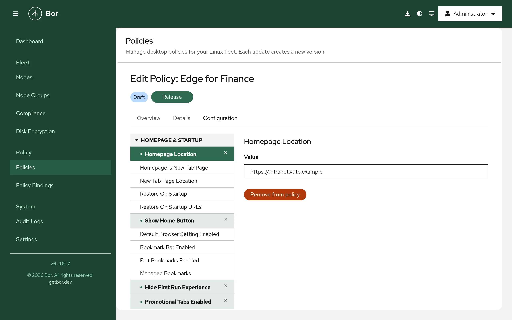

# Microsoft Edge

The **Microsoft Edge** policy type manages Microsoft Edge for Linux through
its managed-policy directory. Edge on Linux uses the same JSON policy
mechanism as Chromium, so the type works the same way as the
[Chrome](chrome.md) type, with an Edge-specific catalogue: Bor includes the
policies that apply to Linux and leaves out Windows-only categories
(Internet Explorer mode, Application Guard, Windows Hello and kiosk mode).

## What it controls

| Group | Examples |
|---|---|
| Homepage & Startup | **Homepage Location**, **Homepage Is New Tab Page**, **Restore On Startup**, **Restore On Startup URLs**, **Show Home Button**, **Managed Bookmarks**, first-run experience |
| New Tab Page | New tab page content, quick links, managed quick links, background types |
| Extensions | **Extension Install Forcelist**, **Extension Install Blocklist**, **Extension Install Allowlist**, install sources, allowed types, **Extension Settings** |
| Privacy & Security | SmartScreen, Safe Browsing, **URLBlocklist**, **URLAllowlist**, minimum TLS version, certificate error overrides, enhanced security mode |
| Tracking & Privacy | **Tracking Prevention**, Bing ads suppression |
| Content Settings | Default and per-site settings for cookies, JavaScript, pop-ups, geolocation, notifications, images, clipboard |
| Identity & Sign-in | **Browser Signin**, **Sync Disabled**, **Personalization Reporting Enabled**, experimentation service control |
| Edge Features | Shopping assistant, sidebar, collections, workspaces, Microsoft Rewards, games menu and other Edge-specific features |
| Search, Managed Search & Favorites | Default search provider, managed favorites and search engines, SafeSearch enforcement |
| Password & Autofill, Network & Proxy, Downloads, Printing, Authentication, Developer Tools, Sleeping Tabs, Miscellaneous | Password manager, proxy and DNS-over-HTTPS, download directory, printing, HTTP authentication, developer tools, sleeping tabs, telemetry and more |

Setting names match the official Microsoft Edge policy names; Microsoft's
Edge policy reference documents what each one does.

## Files on the endpoint

| Browser | File | Agent config key |
|---|---|---|
| Microsoft Edge (stable, beta and dev channels) | `/etc/opt/edge/policies/managed/bor_managed.json` | `edge.edge_policies_path` |

All Edge channels read this directory. The directory is created if needed,
the file is written atomically with mode `0644`, and other files in the
directory are left alone. When no Edge policy applies anymore,
`bor_managed.json` is deleted.

Bor writes no separate Flatpak copy for Edge. A Flatpak build of Edge only
sees the policy if its sandbox has access to the host's
`/etc/opt/edge/policies` directory.

To use a different directory, or to disable the type on a node, set the key
in `/etc/bor/config.yaml` (an empty value disables it) and restart the
agent:

```yaml
edge:
  edge_policies_path: /etc/opt/edge/policies/managed
```

## Create an Edge policy

{ loading=lazy }

1. Go to **Policies** and click **Create a policy**.
2. Choose **Microsoft Edge** on the **Type** step and enter a **Name** on
   the **Details** step.
3. On the **Configuration** step pick settings from the tree on the left.
   A selected setting is previewed until you change it or click
   **Add to policy**. **Remove from policy** drops it again.
4. Review, create and release the policy, then bind it to a node group.

The value editors are the same as for Chrome: switches for booleans,
drop-down lists for numbered options (the list shows the number and a short
description), one item per line for lists, and a JSON text field for
object settings such as **Extension Settings**, **Managed Bookmarks** or
**Proxy Settings**.

## Examples

### Home page and Edge features

| Group | Setting | Value |
|---|---|---|
| Homepage & Startup | **Homepage Location** | `https://intranet.example.com/` |
| Homepage & Startup | **Show Home Button** | Enabled |
| Edge Features | **Edge Shopping Assistant Enabled** | Disabled |
| Edge Features | **Show Microsoft Rewards** | Disabled |

```json
{
  "EdgeShoppingAssistantEnabled": false,
  "HomepageLocation": "https://intranet.example.com/",
  "ShowHomeButton": true,
  "ShowMicrosoftRewards": false
}
```

### Strict tracking prevention and reduced data sharing

| Group | Setting | Value |
|---|---|---|
| Tracking & Privacy | **Tracking Prevention** | `3` (strict) |
| Identity & Sign-in | **Personalization Reporting Enabled** | Disabled |

```json
{
  "PersonalizationReportingEnabled": false,
  "TrackingPrevention": 3
}
```

### Block all sites except the intranet

| Group | Setting | Value |
|---|---|---|
| Privacy & Security | **URLBlocklist** | `*` |
| Privacy & Security | **URLAllowlist** | `intranet.example.com` |

The patterns use the same URL filter format as Chrome.

## How multiple Edge policies are merged

Edge policies are merged exactly like [Chrome policies](chrome.md#how-multiple-chrome-policies-are-merged):
objects are merged key by key, lists are concatenated, and when two
policies set the same single value differently the outcome is not defined.
Binding priority is not used. Keep each setting in one policy.

## What users see

Open `edge://policy` to see every applied policy with its source and
status, and click **Reload policies** to re-read the files. Edge shows
"Your browser is managed by your organization" in the settings, and managed
options are locked. Some policies require an Edge restart; the agent can
notify users (**Settings -> Agent Notifications**, **Microsoft Edge policy
notification message**).

## Verify on the node

```bash
sudo cat /etc/opt/edge/policies/managed/bor_managed.json
python3 -m json.tool /etc/opt/edge/policies/managed/bor_managed.json > /dev/null && echo OK
sudo journalctl -u bor-agent | grep -i edge
```

The agent logs `Edge policies synced (N policies)` and reports the policy
as **Compliant** with the message `Deployed`.

## Troubleshooting

**Compliant, but `edge://policy` shows nothing.** Compliance only confirms
the file was written. Check that `edge.edge_policies_path` points to
`/etc/opt/edge/policies/managed` and that Edge was restarted or policies
were reloaded.

**A policy shows an error in `edge://policy`.** The installed Edge version
may not support it, or the value has the wrong type (for example invalid
JSON structure in an object setting).

**Edits to `bor_managed.json` are reverted.** That is tamper protection; see
the `tamper_detected` entries in the [audit log](../user-guide/audit-log.md).

**Non-compliant with "failed to sync Edge policies".** The message contains
the file system error; check `sudo journalctl -u bor-agent`.
