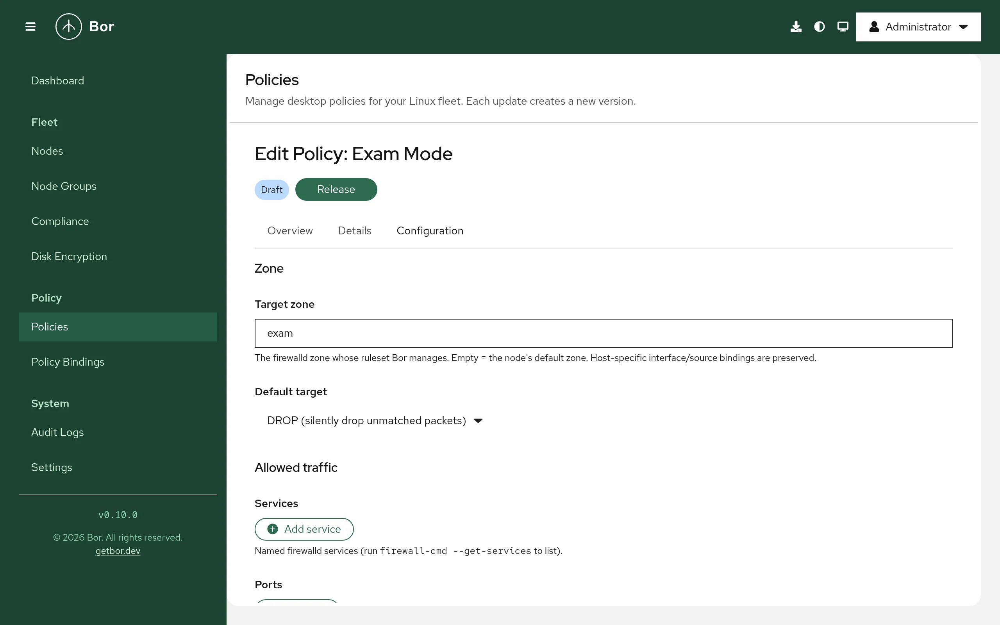

# Firewall (firewalld)

The **Firewall** policy type (technical name `Firewalld`) manages the permanent
ruleset of a firewalld zone on your nodes: allowed services, ports and
protocols, ICMP handling, masquerading, port forwarding, rich rules and the
zone's default target. This page explains what the agent changes on the
endpoint, how to build a policy in the editor, how several policies are merged,
and how to verify and troubleshoot the result.

!!! note "Zones, not firewalld policy objects"
    Bor manages firewalld **zones**. firewalld "policy objects" (rules for
    traffic between zones) are not managed by this policy type.

## What it controls

For every zone targeted by at least one bound policy, the agent renders a
complete zone definition into `/etc/firewalld/zones/<zone>.xml`, validates the
permanent configuration with `firewall-cmd --check-config` and then runs
`firewall-cmd --reload` to make it active.

The generated file replaces the zone's ruleset with the merged ruleset from
Bor. Some parts of an existing zone file are preserved because they are
host-specific:

| Preserved from the existing zone file | Replaced by Bor |
|---|---|
| `<short>` and `<description>` labels | Zone target |
| `<interface name="...">` bindings | Services, ports, source ports, protocols |
| `<source address/mac/ipset="...">` bindings | ICMP blocks and ICMP block inversion |
| | Masquerade, forward ports, rich rules |

This means you can keep assigning interfaces and source networks to zones
locally (or with NetworkManager), while Bor decides what each zone allows.

Every file Bor writes starts with the comment
`<!-- This file is managed by Bor. Do not edit manually. -->`.

## Endpoint prerequisites

- **firewalld** must be installed (the `firewall-cmd` binary must be on the
  agent's `PATH`) and the `firewalld` service must be running.
- No other packages are needed.

If `firewall-cmd` is missing, the policy is reported as **inapplicable** with
the message `firewalld is not installed on this node`. If firewalld is installed
but stopped, the policy is reported as inapplicable with
`firewalld is installed but not running`. The agent does not install, enable
or start firewalld for you.

To prepare a node:

=== "Fedora / RHEL"

    ```bash
    sudo dnf install firewalld
    sudo systemctl enable --now firewalld
    ```

=== "Debian / Ubuntu"

    ```bash
    sudo apt install firewalld
    sudo systemctl enable --now firewalld
    ```

=== "openSUSE"

    ```bash
    sudo zypper install firewalld
    sudo systemctl enable --now firewalld
    ```

!!! warning "Only one firewall manager"
    Do not run firewalld together with another firewall frontend (for example
    `ufw` on Ubuntu) on the same node. Disable the other frontend first.

## Agent configuration

The agent reads one key for this policy type from `/etc/bor/config.yaml`:

| Key | Default | Description |
|---|---|---|
| `firewalld.zones_dir` | `/etc/firewalld/zones` | Directory where the agent writes managed zone XML files. Only change this if your firewalld uses a non-standard configuration directory. |

```yaml
firewalld:
  zones_dir: /etc/firewalld/zones
```

## Create a firewall policy

{ loading=lazy }

1. Open **Policies** and click **Create a policy**.
2. Choose the **Firewall** tile and enter a name and description.
3. Fill in the editor (see below) and save the policy.
4. Click **Release**. Only released policies are delivered to agents.
5. Bind the policy to one or more node groups on the
   [bindings](../user-guide/bindings.md) page.

See [Policies](../user-guide/policies.md) for the general policy lifecycle.

The editor rejects an empty policy: configure at least one setting before
saving.

### Editor sections

**Zone**

- **Target zone** - the firewalld zone whose ruleset Bor manages. Leave it
  empty to use the node's default zone (as reported by
  `firewall-cmd --get-default-zone` on each node). Zone names may contain
  letters, digits, `_` and `-`, and are at most 17 characters long.
- **Default target** - what happens to packets that match no rule in the zone:

    | Option | Meaning |
    |---|---|
    | **default (firewalld zone default)** | firewalld's built-in default behavior (no `target` attribute is written) |
    | **ACCEPT (accept unmatched packets)** | Accept everything not otherwise matched |
    | **REJECT (reject with ICMP error)** | Reject unmatched packets with an ICMP error |
    | **DROP (silently drop unmatched packets)** | Drop unmatched packets without a reply |

**Allowed traffic**

- **Services** - named firewalld services such as `ssh`, `http` or
  `https`. Run `firewall-cmd --get-services` on a node to list them.
- **Ports** - a port (`443`) or range (`5000-6000`) plus a protocol: `tcp`,
  `udp`, `sctp` or `dccp`. Ports must be between 1 and 65535.
- **Protocols** - IP protocol names from `/etc/protocols`, for example `gre`,
  `esp` or `ah`.
- **Source ports** - allowed source ports, same format as **Ports**.

**ICMP & NAT**

- **ICMP blocks** - ICMP types to block, for example `echo-request`. Run
  `firewall-cmd --get-icmptypes` to list them.
- **ICMP block inversion** - when checked (**Accept only the listed ICMP
  types; block all others**), the meaning of the list is inverted: only the
  listed ICMP types are accepted.
- **Masquerade (NAT)** - **Enable IP masquerading for this zone**.

**Port forwarding**

- **Forward ports** - each entry has a source port or range, a protocol, an
  optional destination port (**to port (optional)**, defaults to the source
  port) and an optional destination IP address (**to address (optional)**) for
  forwarding to another host.

**Rich rules**

- **Rich rules** - firewalld rich-language rules for cases the fields above do
  not cover. Each rule must begin with `rule`. The agent converts each rule to
  the zone XML form; rules it cannot parse, and rules that firewalld rejects
  during `firewall-cmd --check-config`, make the whole policy fail (see
  [Troubleshooting](#troubleshooting)).

## Setting reference

Policy content is stored as JSON (the `FirewalldPolicy` message). Field names
use camelCase.

| Field | Type | Description |
|---|---|---|
| `zone` | string | Target zone. Empty = node's default zone. |
| `target` | string | `default`, `ACCEPT`, `REJECT` or `DROP`. Empty = `default`. |
| `services` | list of strings | Allowed services. |
| `ports` | list of `{port, protocol}` | Allowed ports. |
| `sourcePorts` | list of `{port, protocol}` | Allowed source ports. |
| `protocols` | list of strings | Allowed IP protocols. |
| `icmpBlocks` | list of strings | ICMP types to block. |
| `icmpBlockInversion` | boolean | Invert ICMP block handling. |
| `masquerade` | boolean | Enable masquerading. |
| `forwardPorts` | list of `{port, protocol, toPort, toAddr}` | Port forwards. |
| `richRules` | list of strings | Raw rich-language rules. |
| `ensureEnabled` | boolean | Present in the schema but not enforced yet; the agent never starts firewalld. |

### Example: SSH and a remote-support port on the default zone

```json
{
  "services": ["ssh"],
  "ports": [
    { "port": "5900", "protocol": "tcp" }
  ]
}
```

### Example: a locked-down office zone

Drop everything that is not explicitly allowed in the `work` zone, allow
HTTPS and a printer, and block ping:

```json
{
  "zone": "work",
  "target": "DROP",
  "services": ["https", "ipp"],
  "ports": [
    { "port": "9100", "protocol": "tcp" }
  ],
  "icmpBlocks": ["echo-request"]
}
```

### Example: SSH only from a management network

Use a rich rule to restrict a service to a source network:

```json
{
  "zone": "public",
  "richRules": [
    "rule family=\"ipv4\" source address=\"192.0.2.0/24\" service name=\"ssh\" accept"
  ]
}
```

## Merge behavior

When several firewall policies are bound to the same node, the agent groups
them by target zone (an empty zone resolves to the node's default zone) and
merges each group into one zone file:

- **Lists** (services, ports, source ports, protocols, ICMP blocks, forward
  ports, rich rules) are **unioned**, with duplicates removed.
- **Booleans** (`masquerade`, `icmpBlockInversion`) are **OR-ed**: if any
  policy turns them on, they are on.
- **Target** is taken from the policy with the **highest binding priority**
  that sets a target other than `default`.

Because lists are unioned, one policy cannot remove a service that another
policy allows. To restrict a zone, make sure no other bound policy allows the
traffic.

Policies that target different zones produce separate zone files.

## Tamper protection

Every zone file Bor manages is watched by the agent. If someone edits or
deletes it, the agent immediately re-renders the zone, validates, reloads
firewalld and records a `tamper_detected` event in the
[audit log](../user-guide/audit-log.md), including the processes that held
the file open when it could identify them.

!!! note "Runtime-only changes"
    Tamper protection watches the zone **files**. A runtime-only change made
    with `firewall-cmd` without `--permanent` does not touch the file and is
    not detected, but it is discarded on the next sync, because every sync
    ends with `firewall-cmd --reload`.

## Backups, unbind and delete

Before writing a zone file for the first time, the agent saves the original
as `<zone>.xml.bor-backup` in the same directory. If no file existed (for
example, the zone was only defined by the distribution in
`/usr/lib/firewalld/zones/`), an empty backup is written as a marker.

- When a policy no longer targets a zone (it was unbound, deleted, or its
  zone changed), the agent restores that zone from its backup: the original
  file is put back, or the managed file is removed if there was no original,
  so firewalld falls back to the distribution default. The backup is then
  deleted.
- When no firewall policies apply to the node any more, all managed zones are
  restored this way and firewalld is reloaded if it is running.

The presence of a `.bor-backup` file is how the agent recognizes zones it
manages.

## Verify on the endpoint

```bash
# Is firewalld running, and what is the default zone?
sudo firewall-cmd --state
sudo firewall-cmd --get-default-zone

# Which zone files does Bor manage? (each has a .bor-backup marker)
ls -l /etc/firewalld/zones/

# Inspect the generated file
sudo cat /etc/firewalld/zones/public.xml

# Show the active ruleset of a zone
sudo firewall-cmd --zone=public --list-all

# Check the agent's log
sudo journalctl -u bor-agent | grep -i firewalld
```

After each sync the agent logs a line starting with
`Firewalld policies synced (N policies):` followed by the resulting
compliance status (for example `COMPLIANCE_STATUS_COMPLIANT`) and message.
The node's compliance status for each policy is also shown in the web UI (see
[Compliance](../user-guide/compliance.md)).

## Troubleshooting

| Symptom | Cause and fix |
|---|---|
| Inapplicable: `firewalld is not installed on this node` | Install the `firewalld` package. |
| Inapplicable: `firewalld is installed but not running` | Run `sudo systemctl enable --now firewalld`. |
| Error: `check-config failed: ...` | firewalld rejected the generated configuration, usually because of an unknown service, ICMP type or protocol name, or an invalid rich rule. The agent restores the zone files it just wrote and does not reload, so the previous firewall stays active. Fix the policy; the message contains firewalld's explanation. |
| Error: `rich rule "...": unrecognised token ...` | The agent could not convert a rich rule. Check the syntax against `man firewalld.richlanguage`. |
| Error: `invalid zone name` | Zone names are limited to letters, digits, `_` and `-`, 17 characters at most. |
| Saving the policy fails with `invalid port` or `invalid forward to_addr` | Ports must be `N` or `N-M` within 1-65535 with protocol `tcp`, `udp`, `sctp` or `dccp`; `toAddr` must be an IP address. |
| An interface is in the wrong zone | Bor does not manage interface or source bindings. Assign them locally, for example with `nmcli connection modify <conn> connection.zone work`. |

## Security considerations

- A firewall policy with target `DROP` or `REJECT` and no `ssh` service can
  lock remote administrators out of a node. Test new policies on a small
  node group first.
- The agent never passes policy content as command-line arguments: rules go
  into the zone XML file and the only dynamic value, the zone name, is
  validated before it is used as a file name.
- Because lists are unioned, the effective ruleset is the most permissive
  combination of all bound policies. Review all policies bound to a node
  group together.
- Configuration is validated with `firewall-cmd --check-config` before it is
  activated, so an invalid policy does not leave a node with a broken
  firewall.
