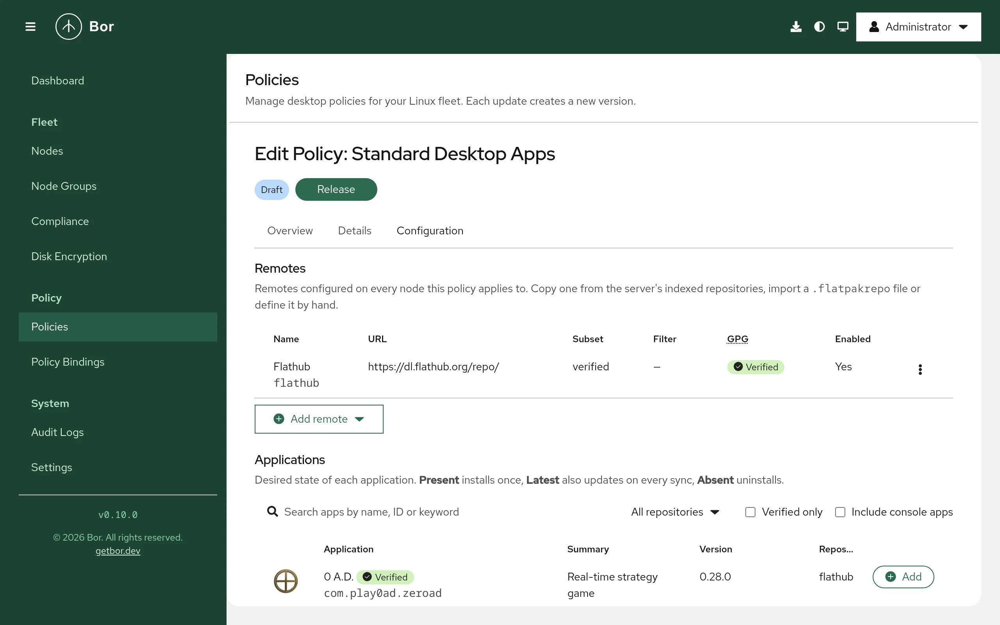

# Flatpak apps

The **Flatpak apps** policy type (technical name `Flatpak`) manages Flatpak on
your nodes: which remotes (repositories) are configured, which applications
must be installed, kept up to date or removed, and how updates are handled.
The Bor server keeps a searchable application catalog (Flathub out of the
box) so you pick applications by name instead of typing IDs.

This page covers the policy editor, the server-side catalog under
**Settings -> Flatpak Repositories**, what the agent does on the endpoint, and
how to verify and troubleshoot it.

## What it controls

- **Remotes** in the node's system Flatpak installation (or a named system
  installation): URL, title, GPG key, subset, priority, enabled state, local
  allow/deny filter, and app-store visibility.
- **Applications**: installed (**Present**), installed and updated on every
  sync (**Latest**), or removed (**Absent**).
- **Updates and cleanup**: an optional periodic `flatpak update` and
  `flatpak uninstall --unused`.

Typical uses: a standard desktop where Firefox and LibreOffice come from
Flathub and stay current; a lab where only an allow-list of applications can
be installed; removing an application from an entire fleet.

## Endpoint prerequisites

- The `flatpak` package. Nodes without it report the policy as
  **inapplicable** (`flatpak is not installed on this node`). The agent does
  not install Flatpak for you.
- Network access from the node to each remote's URL (for Flathub,
  `dl.flathub.org`), directly or through a proxy configured with
  `flatpak.proxy_url`.
- Only the **system** installation (`/var/lib/flatpak`) or a named system
  installation is enforced. Application entries with the **User** scope are
  accepted by the server but reported as inapplicable by the agent.

## Agent configuration

These keys go in `/etc/bor/config.yaml` under `flatpak:`. All are optional.

| Key | Default | Description |
|---|---|---|
| `flatpak.binary` | `flatpak` | The flatpak executable, resolved through `PATH`. |
| `flatpak.state_dir` | `/etc/bor/flatpak` | Where the agent writes the managed remote definitions (`.flatpakrepo`, `.filter`, `.gpg`). |
| `flatpak.state_file` | `/var/lib/bor/agent/flatpak-state.json` | Records which remotes Bor created or adopted, so removal can undo exactly what Bor did. |
| `flatpak.proxy_url` | (empty) | HTTP(S) proxy exported to `flatpak` as `http_proxy`/`https_proxy` for downloads. |

```yaml
flatpak:
  proxy_url: http://proxy.example.com:3128
```

## How the agent applies a policy

The agent runs as root and drives the `flatpak` command line with fixed,
validated arguments. Every value that reaches a command line or a file name
(remote names, application IDs, branches, filter refs) is validated on the
server and again on the agent. Commands run with `--noninteractive` and
`--assumeyes`.

Each sync runs in two phases and never blocks other policy types:

1. **Remotes.** For each remote, the agent writes
   `/etc/bor/flatpak/<name>.flatpakrepo`, plus `<name>.filter` when a filter
   is configured and `<name>.gpg` when a key is supplied. A missing remote
   is added with `flatpak remote-add --if-not-exists --from <name> <file>`.
   An existing remote is **adopted**: the agent records its original settings
   in the state file and applies only the `flatpak remote-modify` flags
   needed to reach the desired state (for example `--subset`, `--filter`,
   `--prio`, `--enable`/`--disable`, `--gpg-import`). A distribution's
   pre-configured `flathub` remote is therefore adopted rather than
   duplicated. The remote results are reported immediately.
2. **Applications.** The agent reads installed applications with
   `flatpak list --app` and runs only what is needed:
   `flatpak install` for **Present**, `flatpak install --or-update` for
   **Latest**, `flatpak uninstall` (with `--delete-data` if requested) for
   **Absent**. It then re-checks the result and reports compliance again.
   If **Remove unused runtimes** is on, `flatpak uninstall --unused` runs
   afterwards.

Each install, update or uninstall is limited by the **Operation timeout**
(default 30 minutes). Only one Flatpak sync runs at a time.

**Auto update.** When any bound policy enables it, the agent runs
`flatpak update` on the configured interval (default every 24 hours), then
`flatpak uninstall --unused` if enabled, re-checks the applications and
reports compliance.

!!! note "Agent restarts"
    The `bor-agent` unit gives running operations up to 120 seconds
    (`TimeoutStopSec=120`) to stop cleanly. An interrupted install is retried
    on the next sync.

## Create a Flatpak policy

{ loading=lazy }

1. Open **Policies**, click **Create a policy** and choose **Flatpak apps**.
2. Add remotes, applications and options as described below. The policy
   needs at least one remote or one application.
3. Save, **Release** and bind the policy to node groups (see
   [Policies](../user-guide/policies.md) and
   [Bindings](../user-guide/bindings.md)).

### Remotes

Under **Remotes**, click **Add remote** and choose:

- **From server repository...** - copies a repository from the server catalog
  (URL, GPG key, subset and so on) into the policy.
- **From .flatpakrepo URL...** - fetches and parses a `.flatpakrepo` file,
  including its GPG key.
- **Custom...** - enter every field yourself.

The remote dialog contains:

| Field | Description |
|---|---|
| **Remote name** | The name on the node, for example `flathub`. Letters, digits, `.`, `_`, `-`; up to 64 characters; must start with a letter or digit. |
| **Repository URL** | `https://` or `oci+https://` only. |
| **Title** | Display name. |
| **Subset** | **All apps**, `verified`, `floss`, `verified_floss`, or **Custom subset...** Flathub publishes these subsets to restrict what the remote offers. |
| **GPG** | Upload the key file or paste the base64 `GPGKey=` value. **Disable GPG verification for this remote (not recommended)** turns verification off and is permanently reported as non-compliant. |
| **Key fingerprint (optional)** | 40 hexadecimal characters. |
| **Local filter** | **No filter**, **Allow list** (deny everything except runtimes and the listed refs) or **Deny list** (allow everything except the listed refs). Add refs such as `app/org.gnome.*` or `org.signal.Signal/*/stable`. |
| **Priority** | Flatpak remote priority (`--prio`), 0-1000; 0 means Flatpak's default. Higher wins when several remotes offer the same ref. |
| **Enabled** | **Remote is enabled on the node**. Unchecked keeps the remote configured but disabled. |
| **Advanced** | **Default branch**, **Collection ID**, **Homepage**, **Comment**, **Hide from app stores (no-enumerate)**, **Do not use for runtime dependencies (no-use-for-deps)**. |

!!! tip "Allow lists never block the policy itself"
    In **Allow list** mode the agent writes `deny *` and `allow runtime/*`,
    then one `allow` line per listed ref, and automatically adds an `allow`
    line for every **Present** or **Latest** application in the policy that
    uses this remote.

### Applications

Under **Applications**, search the catalog by name, ID or keyword (filter by
repository, **Verified only**, **Include console apps**) and add the results.
Applications from remotes the server does not index can be added by ID
(**Add by ID, e.g. com.example.App**). Each row has:

- **State** - **Present** (install if missing), **Latest** (install and
  update on every sync) or **Absent** (uninstall). With **Absent**, **Also
  delete app data** removes the application's data as well.
- **Remote** - the remote to install from. Name it whenever more than one
  remote could provide the application; in non-interactive mode Flatpak does
  not choose between ambiguous remotes.
- **Branch** - empty for the remote's default branch.
- **Scope** - **System**. Entries with the user scope (possible in JSON) are reported inapplicable.
- **Optional** - an application that its remote does not offer is reported
  as inapplicable instead of non-compliant.

### Options

- **Update installed Flatpak apps automatically** and **Update interval
  (hours)** (1-168, default 24).
- **Remove unused runtimes after changes and updates**.
- **Advanced** -> **Installation name**: a named system installation from
  `/etc/flatpak/installations.d`; nodes without it report the policy as
  inapplicable. **Operation timeout (minutes)**: 5-240, default 30.

## Setting reference

Policy content is the `FlatpakPolicy` message as JSON (camelCase field
names, enum values as strings).

| Field | Description |
|---|---|
| `remotes[]` | `name`, `url`, `title`, `enabled`, `gpgVerify`, `gpgKeyData` (base64, max 64 KiB), `gpgKeyId`, `subset`, `defaultBranch`, `priority`, `filterMode` (`FLATPAK_FILTER_MODE_NONE`, `_ALLOWLIST`, `_DENYLIST`), `filterRefs`, `noEnumerate`, `noUseForDeps`, `collectionId`, `homepage`, `comment` |
| `apps[]` | `appId`, `remote`, `branch`, `state` (`FLATPAK_APP_STATE_PRESENT`, `_LATEST`, `_ABSENT`), `scope` (`FLATPAK_SCOPE_SYSTEM`, `FLATPAK_SCOPE_USER`), `optional`, `deleteData` |
| `installation` | Named system installation; empty = default system installation. |
| `autoUpdate`, `autoUpdateIntervalHours` | Periodic update; interval 1-168 hours, 0 = 24. |
| `uninstallUnused` | Run `flatpak uninstall --unused` after changes and updates. |
| `operationTimeoutMinutes` | 5-240, 0 = 30. |

If `gpgVerify` is true the remote must include `gpgKeyData`.

The schema also contains fields that the server accepts but agents do **not**
enforce yet: `maskUpdates` and `commit` on applications, and
`removeUnmanagedRemotes`, `removeUnlistedApps`, `languages`,
`extraLanguages`, `ensureFlatpakInstalled`, `restrictLocalAdminChanges` and
`reportOsInfo` on the policy. Do not rely on them.

### Example: standard desktop applications, kept current

```json
{
  "remotes": [
    {
      "name": "flathub",
      "url": "https://dl.flathub.org/repo/",
      "title": "Flathub",
      "enabled": true,
      "gpgVerify": true,
      "gpgKeyData": "<base64 keyring copied from the server catalog>",
      "subset": "verified"
    }
  ],
  "apps": [
    { "appId": "org.mozilla.firefox", "remote": "flathub", "state": "FLATPAK_APP_STATE_LATEST" },
    { "appId": "org.libreoffice.LibreOffice", "remote": "flathub", "state": "FLATPAK_APP_STATE_LATEST" }
  ],
  "autoUpdate": true,
  "autoUpdateIntervalHours": 24,
  "uninstallUnused": true
}
```

In practice, add the remote with **From server repository...** so the key is
filled in for you.

### Example: locked-down lab with an allow list

Same `flathub` remote, plus:

```json
{
  "filterMode": "FLATPAK_FILTER_MODE_ALLOWLIST",
  "filterRefs": ["app/org.gimp.GIMP/*/*", "app/org.inkscape.Inkscape/*/*"]
}
```

With these applications set to **Present**, nothing else from Flathub can be
installed system-wide on the node. Combine this with a
[Polkit](polkit.md) policy (see [Security considerations](#security-considerations)).

### Example: remove an application fleet-wide

```json
{
  "apps": [
    { "appId": "com.example.LegacyTool", "state": "FLATPAK_APP_STATE_ABSENT", "deleteData": true }
  ]
}
```

No remote is needed. Nodes without Flatpak report inapplicable; all others
remove the application on the next sync.

## Merge behavior

When several Flatpak policies apply to one node, they are processed in order
of binding priority:

- Remotes are deduplicated by **name**; the entry from the higher-priority
  policy wins.
- Applications are deduplicated by **application ID and scope**; the
  higher-priority entry wins (so a higher-priority **Absent** overrides a
  lower-priority **Present**).
- **Auto update** and **Remove unused runtimes** are on if any policy enables
  them.
- **Installation name**, **Update interval** and **Operation timeout** come
  from the highest-priority policy that sets them.

## Compliance

The agent reports one item per remote (schema `flatpak:remote`) and one per
application (`flatpak:app`); the policy status is the roll-up of all items.
Expand the node row on the [Compliance](../user-guide/compliance.md) page to
see them.

| Status | Typical causes |
|---|---|
| Compliant | Every remote is configured and every application is in its desired state. |
| Non-compliant | An application is missing from its remote (and not optional); a remote has GPG verification disabled (message `GPG verification disabled`, persists on purpose); a remote is marked no-enumerate locally and Flatpak cannot clear it; an operation succeeded but the state did not change. |
| Inapplicable | `flatpak` is not installed; the named installation does not exist; user scope; an optional application is not offered by its remote. |
| Error | An install, uninstall or remote operation failed (network, GPG, lock, timeout). The message carries the last line of Flatpak's output, for example `flatpak install timed out after 30m0s`. |

## Tamper protection

While Flatpak policies are active, the files in `/etc/bor/flatpak/` are
watched. If one is edited or deleted, the agent re-runs the Flatpak sync,
which rewrites the files and re-applies the remote settings, and records a
`tamper_detected` event in the [audit log](../user-guide/audit-log.md).

Flatpak's own configuration (`/var/lib/flatpak/repo/config`) is deliberately
not watched. A local change made with `flatpak remote-modify` is corrected
on the next sync (the next policy change, agent reconnect, or tamper event).

## Unbind and delete

When the last Flatpak policy stops applying to a node:

- Remotes that Bor **created** are deleted with `flatpak remote-delete`. If
  installed applications still depend on a remote, Flatpak refuses and the
  agent logs `could not remove remote ... (apps may still use it)`.
- Remotes that Bor **adopted** get their original URL, title, subset, filter,
  priority, enabled state and GPG verification back.
- All files in `/etc/bor/flatpak/` and the state file are removed, and
  auto-update stops.
- **Installed applications are left in place.** To remove applications,
  use an **Absent** entry before unbinding.

When a single remote is dropped from the policies while others remain, the
same undo is applied to that remote only.

## Server catalog: Settings -> Flatpak Repositories

The catalog is a server setting, separate from policies. It feeds the
application search in the editor and provides ready-made remote definitions.
Open **Settings** and select the **Flatpak Repositories** tab.

- **Flathub** is built in. It is indexed from
  `https://dl.flathub.org/repo/appstream/<arch>/appstream.xml.gz` and cannot
  be deleted, only disabled.
- **Add repository** accepts **Import from .flatpakrepo URL**, a preset
  (**Flathub Beta**), or manual fields: **Name** (the remote name suggested to
  policies), **Title**, **Repository URL**, GPG key, **Subset**,
  **Architectures**, **Refresh interval (hours)**, **AppStream URL override**,
  and **Index this repository's applications**. A repository is indexed from
  `<url>/appstream/<arch>/appstream.xml.gz` unless you give an override
  (use `{arch}` as a placeholder).
- Each repository row has **Refresh now**, **Upload catalog...**, **Edit** and
  **Delete** actions.
- Repositories are refreshed automatically at their refresh interval
  (default 24 hours, minimum 1 hour).

Policies stay self-contained: adding a remote from a server repository copies
its URL, key and subset into the policy, so agents never contact the Bor
server's catalog and exported policies carry everything they need.

### Air-gapped servers

Set `BOR_FLATPAK_CATALOG_REFRESH=false` (or `flatpak_catalog.refresh_enabled:
false` in `/etc/bor/server.yaml`) to disable all outbound catalog downloads.
The tab then shows a notice, and you import catalogs by hand:

1. On a machine with internet access, download
   `https://dl.flathub.org/repo/appstream/x86_64/appstream.xml.gz` (or the
   file for your repository and architecture).
2. In **Settings -> Flatpak Repositories**, open the repository's actions and
   choose **Upload catalog...**.
3. Select the **Architecture**, choose the **Catalog file (appstream.xml.gz)**
   and click **Upload and index**. Uploads are limited to 64 MiB.

### Catalog server settings

| Setting (env / YAML) | Default | Description |
|---|---|---|
| `BOR_FLATPAK_CATALOG_REFRESH` / `flatpak_catalog.refresh_enabled` | `true` | Enables outbound catalog downloads. |
| `BOR_FLATPAK_CATALOG_MAX_DOWNLOAD_MB` / `flatpak_catalog.max_download_mb` | `64` | Maximum size of a downloaded catalog. |
| `BOR_FLATPAK_CATALOG_ALLOW_PRIVATE_NETWORKS` / `flatpak_catalog.allow_private_networks` | `false` | Allow fetching from private-network addresses (an internal mirror). |

Catalog fetches only use `https://` URLs with a host name or IPv4 address,
follow at most 5 redirects and only to allowed hosts, and refuse loopback,
link-local (including cloud metadata endpoints) and multicast addresses
regardless of these settings.

### Permissions

Managing catalog repositories requires `flatpak_repo:view`, `create`,
`edit`, `delete`, and `refresh` (which also covers catalog upload).
Searching the catalog from the policy editor needs only `policy:view`. See
[Permissions](../reference/permissions.md).

## Verify on the endpoint

```bash
# Remotes in the system installation, with Bor's settings
flatpak remotes --system --columns=name,url,subset,filter,priority,options

# Installed applications
flatpak list --system --app --columns=application,origin,branch,version

# Bor's rendered remote definitions and state
ls -l /etc/bor/flatpak/
sudo cat /var/lib/bor/agent/flatpak-state.json

# Agent log
sudo journalctl -u bor-agent | grep -i flatpak
```

After each sync the agent logs `Flatpak policies synced (...)` with the
number of policies, remotes and applications and the resulting status.

## Troubleshooting

| Symptom | Cause and fix |
|---|---|
| Inapplicable: `flatpak is not installed on this node` | Install the `flatpak` package. |
| Error: `flatpak is installed but unusable: ...` | `flatpak --version` failed. Run it as root on the node to see why. |
| Application reports `not found in remote` | Check the application ID, branch and the remote's **Subset** and filter. Mark the entry **Optional** if some nodes legitimately cannot get it. |
| Error: `flatpak install timed out after ...` | Slow link or large runtime. Raise **Operation timeout (minutes)**; the next sync resumes. |
| Remote not removed after unbinding | Installed applications still use it. Remove the applications (an **Absent** entry) or delete the remote manually. |
| **Refresh now** fails or `Refresh failed` | The server cannot reach the repository, or the URL is refused (private address, non-https). For an internal mirror set `BOR_FLATPAK_CATALOG_ALLOW_PRIVATE_NETWORKS=true`, or upload the catalog. |

## Security considerations

- Keep **GPG verification** on. A remote without verification is reported
  non-compliant permanently as a reminder.
- Prefer the `verified` subset for Flathub on managed desktops.
- Flatpak's polkit actions gate system-wide changes. To require an
  administrator password for local installs and remote changes, add a
  [Polkit](polkit.md) policy that returns `auth_admin` for actions such as
  `org.freedesktop.Flatpak.app-install`,
  `org.freedesktop.Flatpak.runtime-install`,
  `org.freedesktop.Flatpak.app-uninstall`,
  `org.freedesktop.Flatpak.modify-repo` and
  `org.freedesktop.Flatpak.configure-remote`.
- Users can still install into their own per-user installation
  (`~/.local/share/flatpak`); Bor does not manage that in this release.
- The catalog fetcher is hardened against server-side request forgery (see
  above); keep `allow_private_networks` off unless you need an internal
  mirror.
