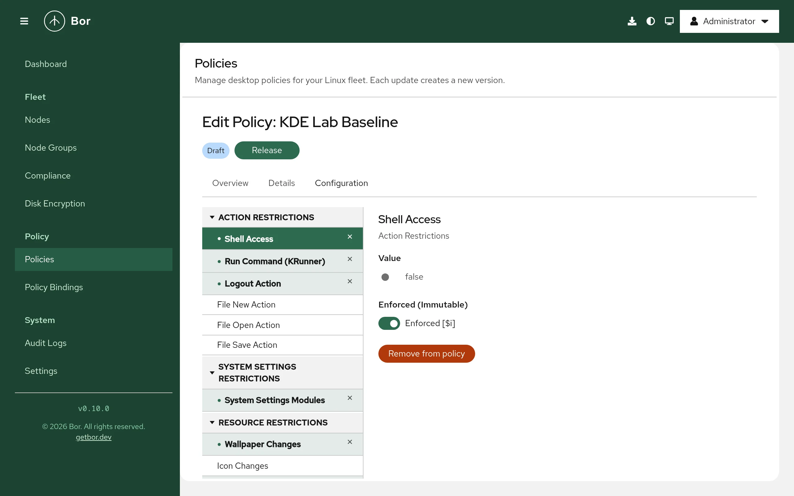

# KDE Plasma (Kconfig)

The **KDE Plasma** policy type (technical name *Kconfig*) manages KDE Plasma
5 and 6 desktops through KDE's Kiosk framework. Bor writes system-wide KDE
configuration files, optionally marked immutable with KDE's `[$i]` marker,
so users cannot override them in their own `~/.config` files. This page
explains the settings, the files on the endpoint, the editor, merging and
how to check the result on a Plasma desktop.

## What it controls

| Group (in the editor) | Settings | KDE file and group written |
|---|---|---|
| Action Restrictions | **Shell Access**, **Run Command (KRunner)**, **Logout Action**, **File New Action**, **File Open Action**, **File Save Action** | `kdeglobals`, `[KDE Action Restrictions]` keys `shell_access`, `run_command`, `action/logout`, `action/file_new`, `action/file_open`, `action/file_save` |
| System Settings Restrictions | **System Settings Modules** | `/etc/kde5rc` and `/etc/kde6rc`, `[KDE Control Module Restrictions]` |
| Resource Restrictions | **Wallpaper Changes**, **Icon Changes**, **Autostart Changes**, **Color Scheme Changes**, **Cursor Theme Changes** | `kdeglobals`, `[KDE Resource Restrictions]` keys `wallpaper`, `icons`, `autostart`, `colors`, `cursors` |
| Window Manager | **Borderless Maximized Windows** | `kwinrc`, `[Windows]` |
| Desktop | **Unlock Desktop Widgets**, **Configure When Locked** | `plasmarc`, `[General]` keys `plasmoidUnlockedDesktop`, `allow_configure_when_locked` |
| Screen Lock | **Auto Lock**, **Lock on Resume**, **Lock Timeout (seconds)** | `kscreenlockerrc`, `[Daemon]` keys `AutoLock`, `LockOnResume`, `Timeout` |
| Appearance | **Icon Theme**, **Wallpaper Plugin**, **Wallpaper Image Path**, **Wallpaper Fill Mode**, **Wallpaper Background Color** | `kdeglobals` `[Icons]`; `plasma-org.kde.plasma.desktop-appletsrc` |
| Security | **URL Restrictions** | `kdeglobals`, `[KDE URL Restrictions]` |

Boolean settings are written exactly as you set them (`true` or `false`).
In KDE Kiosk, setting an action or resource key to `false` **restricts**
it: `shell_access=false` removes terminal access, `run_command=false`
disables KRunner's command execution, `wallpaper=false` stops users from
changing the wallpaper.

!!! note "Screen lock timeout"
    The value of **Lock Timeout (seconds)** is written unchanged as
    `Timeout=` in `kscreenlockerrc`. KDE interprets that key in minutes, so
    enter the number of minutes after which the screen should lock.

!!! warning "Wallpaper image"
    The **Wallpaper Image Path** setting does not currently take effect
    reliably on Plasma desktops. Do not rely on it to brand desktops; the
    **Wallpaper Changes** restriction works as expected.

## Files on the endpoint

| Path | Content | Config key |
|---|---|---|
| `/etc/bor/xdg/<file>` (for example `kdeglobals`, `kwinrc`, `plasmarc`, `kscreenlockerrc`) | System-wide KDE settings from all KDE Plasma policies | `kconfig.config_path` (default `/etc/bor/xdg`) |
| `/etc/profile.d/99-bor.sh` | Puts the Bor directory first in `XDG_CONFIG_DIRS` | Follows `kconfig.config_path` |
| `/etc/kde5rc`, `/etc/kde6rc` | System Settings module restrictions (same content in both) | Fixed |

The profile script contains:

```bash
export XDG_CONFIG_DIRS=/etc/bor/xdg:${XDG_CONFIG_DIRS:-/etc/xdg}
readonly XDG_CONFIG_DIRS
```

KDE searches `XDG_CONFIG_DIRS` for system-wide configuration, so the files
in `/etc/bor/xdg` take precedence over distribution defaults in `/etc/xdg`.
The variable is set at login, so **users must log out and back in** once
after the first KDE Plasma policy reaches a node.

Every file written by the agent starts with a header:

```text
# This file is managed by Bor. Do not edit manually.
# Changes will be overwritten by policy enforcement.
```

**Backups.** Before writing a file for the first time, the agent copies
any existing file to `<file>.bor-backup` (an empty backup means the file
did not exist). The backup files are also how the agent remembers which
files it manages. When a file is no longer needed, or the last KDE Plasma
policy is removed, the original is restored or the file is deleted. The
profile script stays in place.

## Create a KDE Plasma policy

{ loading=lazy }

1. Go to **Policies** and click **Create a policy**, then pick **KDE
   Plasma** on the **Type** step.
2. Enter a **Name** and **Description** on the **Details** step.
3. On the **Configuration** step pick a setting from the tree on the left.
   For a plain setting the right side shows:
    - **Value**: a switch for booleans, a text or number field, a
      drop-down for the fill mode, or a color picker (stored as `R,G,B`).
    - **Enforced (Immutable)**: when on (**Enforced [$i]**), the entry is
      written with KDE's immutability marker and users cannot override
      it. When off (**Not enforced**), the value is only a system default
      that users may change. New settings start as enforced.
    - **Add to policy** / **Remove from policy**.
4. **System Settings Modules** has its own editor: pick modules from
   **Add module** (each entry shows its description and module ID, for
   example `Autostart Applications (kcm_autostart)`), or open **Add custom
   modules** and enter module IDs separated by commas or new lines, then
   click **Add**.
5. **URL Restrictions** has a rule editor: click **+ Add Rule** and set
   **Action** (`open`, `list` or `redirect`), **Protocol**, **Host**,
   **Path** and **Access** (**Allow** or **Deny**). Blank fields match
   everything. **Referrer Matching (advanced)** restricts the rule to
   requests coming from a given protocol, host or path.
6. Review, create and release the policy, then bind it to a node group.

URL restrictions and System Settings module restrictions are always
written as enforced.

## Examples

### Disable terminal access and KRunner commands

| Setting | Value | Enforced |
|---|---|---|
| **Shell Access** | `false` | Enforced [$i] |
| **Run Command (KRunner)** | `false` | Enforced [$i] |

`/etc/bor/xdg/kdeglobals` then contains:

```text
[KDE Action Restrictions][$i]
run_command=false
shell_access=false
```

When every entry in a group is enforced, the whole group is marked `[$i]`;
otherwise only the enforced keys are marked (`shell_access[$i]=false`).

### Prevent wallpaper changes

| Setting | Value | Enforced |
|---|---|---|
| **Wallpaper Changes** | `false` | Enforced [$i] |

```text
[KDE Resource Restrictions][$i]
wallpaper=false
```

### Hide System Settings modules

**System Settings Modules**: add `kcm_autostart` (Autostart Applications),
`kcm_kded` (Background Services) and `kcm_krdpserver` (Remote Desktop).

`/etc/kde5rc` and `/etc/kde6rc` then contain:

```text
[KDE Control Module Restrictions][$i]
kcm_autostart=false
kcm_kded=false
kcm_krdpserver=false
```

The modules disappear from System Settings and cannot be opened with
`kcmshell`.

### Deny browsing Windows shares

**URL Restrictions**, **+ Add Rule**: **Action** `list`, **Protocol**
`smb`, **Host** and **Path** blank, **Access** **Deny**. Bor writes:

```text
[KDE URL Restrictions][$i]
rule_1=list,,,,smb,,,false
rule_count=1
```

## How multiple KDE Plasma policies are merged

All KDE Plasma policies that apply to a node are written into the same set
of files:

- Settings from different policies are combined into their files and
  groups.
- URL restriction rules from all policies are collected and renumbered
  (`rule_1`, `rule_2`, ...), with one `rule_count`.
- System Settings module lists are combined.
- Binding priority is **not** used. If two policies set the same key, both
  values end up in the file and which one KDE uses is not defined. Set
  each key in one policy only.

## What users see

- Restricted actions disappear or are disabled (for example the terminal
  shortcut or KRunner command execution), and restricted System Settings
  modules are hidden.
- Enforced settings are locked: the corresponding controls in System
  Settings are disabled or missing, and edits to the user's own config
  files have no effect.
- After a change, the agent asks KWin, the Plasma shell and the screen
  locker to reload their configuration, and can show a desktop
  notification (default text: "Desktop policies have been updated. Please
  log out and log back in for all changes to take effect."). Configure it
  under **Settings -> Agent Notifications**.

Some settings are only read when Plasma starts; log out and back in to be
sure everything applies.

## Verify on the node

```bash
# Files written by the agent and their backups
ls -la /etc/bor/xdg/
sudo cat /etc/bor/xdg/kdeglobals
cat /etc/kde6rc

# The search path a new login shell gets
bash -lc 'echo $XDG_CONFIG_DIRS'

# Read a value as KDE sees it (run as the desktop user, inside the session)
kreadconfig6 --file kdeglobals --group "KDE Action Restrictions" --key shell_access
```

On Plasma 5 use `kreadconfig5`. In the web UI the policy is reported
**Compliant** with the message `Deployed` once the files are written.

## Troubleshooting

**Nothing changes on the desktop.**

- Make sure the user logged in again after the first policy arrived, so
  that `/etc/profile.d/99-bor.sh` set `XDG_CONFIG_DIRS`. Check with
  `echo $XDG_CONFIG_DIRS` in a terminal of the session (if one is
  allowed), or `cat /proc/<pid-of-plasmashell>/environ | tr '\0' '\n'`.
- Display managers or session wrappers that do not source
  `/etc/profile.d` do not see the Bor directory.
- Compliance for this type only confirms the files were written.

**A setting is shown but users can still change it.** Turn on **Enforced
(Immutable)** for that setting. Non-enforced values are defaults only.

**System Settings still shows a restricted module.** Check that the module
ID is correct (it must match the module's ID, for example `kcm_autostart`)
and that `/etc/kde5rc` / `/etc/kde6rc` contain it. Restart System Settings.

**Files were changed back after editing them.** Files under `/etc/bor/xdg`,
`/etc/kde5rc` and `/etc/kde6rc` are tamper-protected. The agent restores
them and records a `tamper_detected` event in the
[audit log](../user-guide/audit-log.md).
