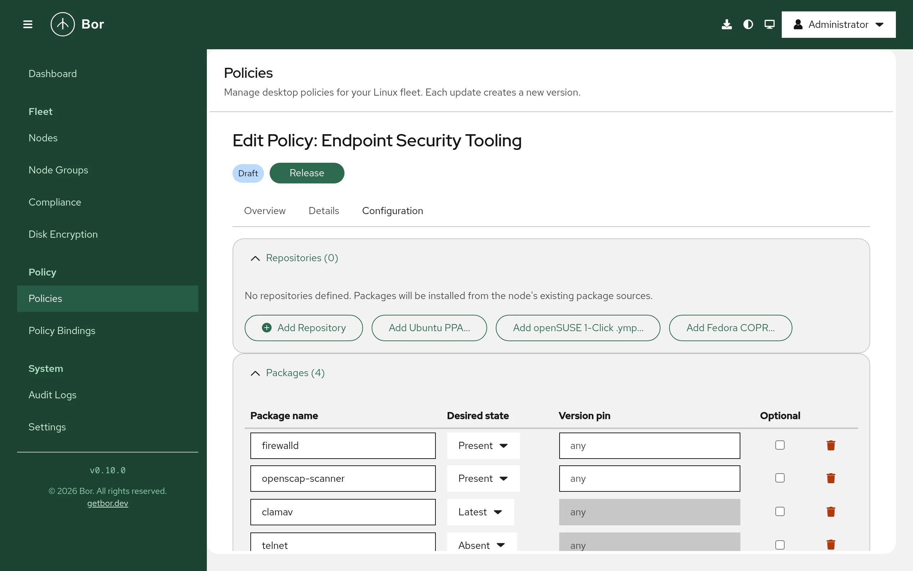

# Packages and repositories

The **Package** policy type manages software repositories and system
packages on your nodes: it writes repository definitions and signing keys for
APT, DNF and Zypper, and installs, upgrades or removes packages through
PackageKit. The editor can also import Ubuntu PPAs, Fedora COPR projects and
openSUSE 1-Click `.ymp` files.

This page explains what the agent does on the endpoint, how to fill in the
editor, how policies are merged, and how to verify and troubleshoot the
result.

## What it controls

- **Repositories**: one file per repository entry, plus its GPG key when one
  is supplied.

    | Node package manager | Repository file | GPG key file |
    |---|---|---|
    | APT (Debian, Ubuntu) | `/etc/apt/sources.list.d/bor-<id>.sources` (deb822) | `/etc/apt/trusted.gpg.d/bor-<id>.gpg` |
    | DNF / YUM (Fedora, RHEL family) | `/etc/yum.repos.d/bor-<id>.repo` | `/etc/pki/rpm-gpg/bor-<id>.gpg` |
    | Zypper (openSUSE, SLE) | `/etc/zypp/repos.d/bor-<id>.repo` | `/etc/pki/rpm-gpg/bor-<id>.gpg` |

    Every repository file starts with
    `# This file is managed by Bor. Do not edit manually.`

- **Packages**: installed (**Present**), installed and upgraded to the newest
  available version (**Latest**), or removed (**Absent**).

## Endpoint prerequisites

- A supported package manager. The agent detects the format once at startup:
  `/usr/bin/apt-get` or `/usr/bin/apt` selects APT; `/usr/bin/dnf`,
  `/usr/bin/dnf5` or `/usr/bin/yum` selects DNF; `/usr/bin/zypper` selects
  Zypper. On other systems repository entries fail with
  `no supported package manager detected on this node`.
- **PackageKit** for package operations. The agent talks to PackageKit over
  the system D-Bus (`org.freedesktop.PackageKit`); the service may be running
  or D-Bus activatable. Without it, the package part of the policy is
  reported as **inapplicable** with
  `PackageKit service not available on this node`. Repository files are
  still written.

=== "Debian / Ubuntu"

    ```bash
    sudo apt install packagekit
    ```

=== "Fedora / RHEL"

    ```bash
    sudo dnf install PackageKit
    ```

=== "openSUSE"

    ```bash
    sudo zypper install PackageKit
    ```

There are no agent configuration keys for this policy type.

## How the agent applies a policy

Each sync runs in two phases, in the background so it never delays other
policy types. Only one package sync runs at a time.

1. **Repositories.** All repository entries from all bound policies are
   merged and rendered in the node's own format. Files are written
   atomically with mode `0644`. Any other `bor-*` file in the repository and
   key directories that is no longer wanted is deleted. If **Refresh package
   cache** is on, the agent then asks PackageKit to refresh its metadata
   (`RefreshCache`, comparable to `apt-get update`). Repository compliance
   is reported immediately.
2. **Packages.** For each package entry the agent resolves the name with
   PackageKit and:
    - **Present**: installs the package if it is missing. If a version pin
      is set and the installed version differs, the entry is reported
      non-compliant (`version mismatch: expected ..., installed ...`).
    - **Latest**: installs the package if missing, otherwise updates it when
      a newer version is available.
    - **Absent**: removes the package if it is installed. Dependent packages
      are not removed automatically and no autoremove is performed.

   Installs and updates use PackageKit's "only trusted" flag, so packages
   that fail signature verification are not installed. The whole package
   phase is limited to 10 minutes per sync.

After a sync with at least one package policy, logged-in users may receive a
desktop notification
(`Package policies have been updated. Some system packages may have been installed, removed, or updated.`),
depending on the agent notification settings (see
[Settings](../user-guide/settings.md)).

!!! warning "Repositories are rendered in the node's format"
    The agent writes every repository entry in the format of the node's own
    package manager, regardless of the entry's **Type**. An APT entry bound
    to a Fedora node fails with `baseurl or mirrorlist is required`, and so
    on. Bind repository entries only to node groups of the matching
    distribution family, for example one Package policy per family. Package
    entries (names only) can be shared when the package names match.

## Create a package policy

{ loading=lazy }

1. Open **Policies**, click **Create a policy** and choose **Package**.
2. Add repositories and packages. The policy needs at least one of either.
3. Set the options, save, **Release**, and bind the policy to node groups
   (see [Policies](../user-guide/policies.md) and
   [Bindings](../user-guide/bindings.md)).

### Repositories

Click **Add Repository** for a manual entry, or use one of the importers
described below. Each repository has:

| Field | Applies to | Description |
|---|---|---|
| **ID** | all | Unique within the policy; used in the file name `bor-<id>`. Lowercase letters, digits, `_` and `-`; must start with a letter or digit. |
| **Name** | all | Human-readable label (written as `name=` for DNF/Zypper). |
| **Type** | all | **APT (deb822)**, **DNF / YUM** or **Zypper**. |
| **Enabled** | all | When off, the file is kept but the repository is disabled (`Enabled: no` or `enabled=0`), so it is easy to re-enable. |
| **URI**, **Suites**, **Components**, **Architectures** | APT | URI, distribution suite (for example `bookworm` or `noble`), components (for example `main`), optional space-separated architectures (for example `amd64 arm64`; empty = all). |
| **Base URL**, **Mirror list**, **Metadata expire (s)** | DNF | Exactly one of base URL or mirror list. Metadata expiry in seconds (empty uses the default). |
| **Base URL**, **Priority** | Zypper | Base URL; priority 1 (highest) to 99 (lowest), default 99. |
| **GPG check** | all | Require signature verification. Requires a GPG key. Turning it off is permanently reported as non-compliant. |
| **GPG key file** | all | Binary or ASCII-armored public key (`.gpg`, `.asc`, `.key`). For DNF/Zypper it is referenced as `gpgkey=file:///etc/pki/rpm-gpg/bor-<id>.gpg`; for APT as `Signed-By:`. |

The schema also has a `gpgKeyId` field for the 40-character key fingerprint.
The server checks its format only; the agent does not compare it with the
key.

### Import an Ubuntu PPA

1. Click **Add Ubuntu PPA...**.
2. Enter the **PPA address** as `ppa:owner/name` and pick the **Ubuntu
   codename** (or a custom one).
3. Click **Add PPA**.

The Bor server looks up the PPA's signing key fingerprint on
`api.launchpad.net`, downloads the key from `keyserver.ubuntu.com` and
converts it to binary form. The result is an APT repository with URI
`https://ppa.launchpadcontent.net/<owner>/<name>/ubuntu`, the selected
suite, component `main`, the key attached and **GPG check** on. If the key
cannot be fetched, the entry is added without it and a warning is shown;
attach a key before relying on it.

### Import a Fedora COPR project

1. Click **Add Fedora COPR...**.
2. Enter the **COPR address** as `copr:owner/project` or `@group/project`
   and select a **Chroot** such as `fedora-42-x86_64` or `epel-10-x86_64`
   (or enter a custom one).
3. Click **Add**.

The server queries the COPR API on `copr.fedorainfracloud.org` for the
repository URL of that chroot and downloads the project's `pubkey.gpg` from
`download.copr.fedorainfracloud.org`. The result is a DNF repository with
that base URL and the key attached (GPG check on). If the project publishes
no key, a warning is shown and GPG check is off.

### Import an openSUSE 1-Click .ymp file

1. Click **Add openSUSE 1-Click .ymp...** and choose the `.ymp` file
   (up to 1 MiB).
2. If the file contains several distribution versions, a dialog opens:
   choose the one that matches your nodes and click **Import selected**.
   A file with a single version is imported directly. Packages that are
   already in the policy are skipped.

The file is parsed on the server. Its repositories become Zypper entries and
its packages become package entries. `.ymp` files carry no signing keys, so
imported repositories have **GPG check** off; add the key and turn GPG check
on to make them compliant.

All three importers require only `policy:view` and are made from the Bor
server, so the server needs outbound HTTPS to those hosts. Redirects are
followed only to the listed hosts.

### Packages

Click **Add Package** and set:

- **Package name** - as known to the node's package database, for example
  `google-chrome-stable` or `vim`.
- **Desired state** - **Present** (install if not present), **Absent**
  (remove if installed) or **Latest** (install or upgrade to latest).
- **Version pin** - only with **Present**. The agent does not install a
  specific version; it reports non-compliance when the installed version
  differs from the pin.
- **Optional** - a package not found in any enabled repository is reported
  as inapplicable instead of non-compliant. Useful when one policy targets
  several distributions.

### Options

- **Refresh package cache** - **Refresh repository metadata after writing
  repo files (equivalent to apt-get update)**. On by default.
- **Allow downgrade** - **Allow downgrading packages when installing a
  pinned version**.

## Setting reference

Policy content is the `PackagePolicy` message as JSON (camelCase, enums as
strings).

| Field | Description |
|---|---|
| `repositories[]` | `id`, `name`, `type` (`REPOSITORY_TYPE_APT_DEB822`, `REPOSITORY_TYPE_DNF`, `REPOSITORY_TYPE_ZYPPER`), `enabled`, `aptUri`, `aptSuites`, `aptComponents`, `aptArchitectures`, `baseurl`, `mirrorlist`, `metadataExpire`, `zypperPriority`, `gpgCheck`, `gpgKeyId`, `gpgKeyData` (base64) |
| `packages[]` | `name`, `state` (`PACKAGE_STATE_PRESENT`, `PACKAGE_STATE_ABSENT`, `PACKAGE_STATE_LATEST`), `version`, `optional` |
| `updateCache` | Refresh PackageKit metadata after writing repositories. |
| `allowDowngrade` | Allow PackageKit to downgrade. |

Server-side validation rejects duplicate repository IDs or package names, a
DNF entry with both or neither of base URL and mirror list, `gpgCheck`
without `gpgKeyData`, and a version pin with a state other than **Present**.

### Example: vendor repository on Debian/Ubuntu nodes

```json
{
  "repositories": [
    {
      "id": "google-chrome",
      "name": "Google Chrome",
      "type": "REPOSITORY_TYPE_APT_DEB822",
      "enabled": true,
      "aptUri": "https://dl.google.com/linux/chrome/deb/",
      "aptSuites": "stable",
      "aptComponents": "main",
      "aptArchitectures": "amd64",
      "gpgCheck": true,
      "gpgKeyData": "<base64 of the binary key>"
    }
  ],
  "packages": [
    { "name": "google-chrome-stable", "state": "PACKAGE_STATE_LATEST" }
  ],
  "updateCache": true
}
```

The agent writes `/etc/apt/sources.list.d/bor-google-chrome.sources`:

```text
# This file is managed by Bor. Do not edit manually.
# Generated: 2026-10-15T08:00:00Z

Types: deb
URIs: https://dl.google.com/linux/chrome/deb/
Suites: stable
Components: main
Architectures: amd64
Enabled: yes
Signed-By: /etc/apt/trusted.gpg.d/bor-google-chrome.gpg
```

### Example: internal repository on Fedora/RHEL nodes

```json
{
  "repositories": [
    {
      "id": "corp-tools",
      "name": "Corporate tools",
      "type": "REPOSITORY_TYPE_DNF",
      "enabled": true,
      "baseurl": "https://repo.example.com/$releasever/$basearch",
      "gpgCheck": true,
      "gpgKeyData": "<base64 of the key>",
      "metadataExpire": 3600
    }
  ],
  "packages": [
    { "name": "corp-vpn-client", "state": "PACKAGE_STATE_PRESENT" }
  ]
}
```

### Example: remove unwanted packages everywhere

```json
{
  "packages": [
    { "name": "telnet", "state": "PACKAGE_STATE_ABSENT" },
    { "name": "gnome-mines", "state": "PACKAGE_STATE_ABSENT", "optional": true }
  ]
}
```

A policy without repositories works on every supported distribution.

## Merge behavior

All Package policies bound to a node are sorted by binding priority and
merged:

- Repositories are deduplicated by **ID**; the entry from the
  higher-priority policy wins.
- Packages are deduplicated by **name**; the higher-priority entry wins for
  state, version and optional (so a higher-priority **Absent** overrides a
  lower-priority **Present**).
- **Refresh package cache** and **Allow downgrade** are taken from the
  highest-priority policy.

## Compliance

The agent reports one item per repository and package. A repository is
compliant when its file on disk matches what the policy renders. The policy
status rolls up the items: any error makes it **Error**, any non-compliant
item makes it **Non-compliant**, and only inapplicable items make it
**Inapplicable**. See [Compliance](../user-guide/compliance.md).

| Message | Meaning |
|---|---|
| `GPG verification is disabled for this repository (security risk)` | Persistent reminder while **GPG check** is off. |
| `repo file content does not match policy` | The file was changed and not yet restored. |
| `package "x" not found in any enabled repository` | Non-compliant, or inapplicable when **Optional**. |
| `version mismatch: expected A, installed B` | Version pin not met. |
| `PackageKit RefreshCache failed: ...` | Metadata refresh failed (network, repository, key). |
| `removal requested but package still detected as installed` | PackageKit reported success but the package remains. |

## Tamper protection

The `bor-*` files in `/etc/apt/sources.list.d`, `/etc/apt/trusted.gpg.d`,
`/etc/yum.repos.d`, `/etc/zypp/repos.d` and `/etc/pki/rpm-gpg` are watched.
If one is edited or deleted, the agent re-runs the package sync to restore
it and records a `tamper_detected` event in the
[audit log](../user-guide/audit-log.md).

!!! warning "The bor- prefix is reserved"
    The agent treats every file starting with `bor-` in those directories as
    its own and deletes the ones no policy asks for. Do not name your own
    repository or key files `bor-*`.

## Unbind and delete

When a repository is no longer in any bound policy, its `bor-<id>` file and
key are deleted on the next sync. When no Package policy applies any more,
all `bor-*` repository and key files are removed.

**Installed packages are not removed** when a policy is unbound or deleted.
To remove software, release a policy with **Absent** entries first.

## Verify on the endpoint

```bash
# Managed repository and key files
ls -l /etc/apt/sources.list.d/bor-* /etc/apt/trusted.gpg.d/bor-* 2>/dev/null
ls -l /etc/yum.repos.d/bor-* /etc/zypp/repos.d/bor-* /etc/pki/rpm-gpg/bor-* 2>/dev/null

# Package state, using PackageKit's CLI
pkcon resolve google-chrome-stable

# Or the native tools
apt policy google-chrome-stable       # Debian / Ubuntu
dnf repolist; rpm -q corp-vpn-client  # Fedora / RHEL
zypper repos; rpm -q vim              # openSUSE

# Agent log
sudo journalctl -u bor-agent | grep -i "package"
```

After each sync the agent logs
`Package policies synced (N policies, N repos, N packages)`.

## Troubleshooting

| Symptom | Cause and fix |
|---|---|
| Inapplicable: `PackageKit service not available on this node` | Install PackageKit (see above). |
| `no supported package manager detected on this node` | The node has none of apt, dnf/yum, zypper. |
| `failed to render repo file: baseurl or mirrorlist is required` (or `apt_uri is required`) | A repository entry of another distribution family reached this node. Split the policy by family. |
| Package not found right after adding its repository | Keep **Refresh package cache** on so the new repository's metadata is downloaded first. Check that the repository's key is correct. |
| Install fails with a signature or trust error | The repository's key is missing or wrong. The agent only installs trusted packages. |
| A package keeps flipping between versions | Two policies disagree; check binding priorities. |
| PPA or COPR import shows a warning | The key could not be fetched. Retry later or attach the key manually. |

## Security considerations

- Always supply the repository's GPG key and keep **GPG check** on. Keys are
  scoped per repository (`Signed-By:` for APT, `gpgkey=` for DNF/Zypper).
- Packages run maintainer scripts as root. Only add repositories you trust.
- Prefer **Present** over **Latest** for software where unplanned upgrades
  are a risk; use **Latest** for security-sensitive software such as
  browsers.
- The PPA, COPR and `.ymp` helpers run on the Bor server and contact only
  fixed hosts (`api.launchpad.net`, `keyserver.ubuntu.com`,
  `copr.fedorainfracloud.org`, `download.copr.fedorainfracloud.org`); user
  input is validated before it is placed in a URL.
