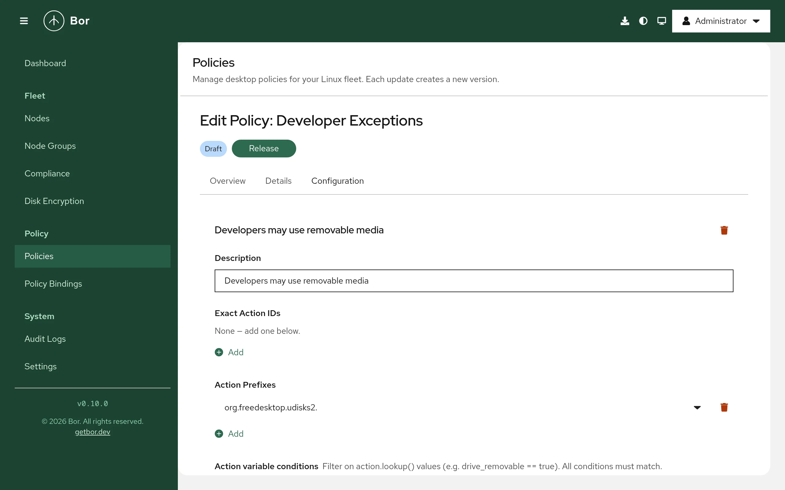

# Polkit

The **Polkit** policy type controls who may perform privileged actions on a
desktop: mounting drives, managing network connections, installing
software, rebooting and anything else that goes through polkit. Each Bor
polkit policy becomes one JavaScript rules file in
`/etc/polkit-1/rules.d/`. This page explains the rule model, how the
binding priority decides which rules win, the editor, worked examples and
how to test rules on a node.

## How polkit decisions work

Applications ask polkit whether a user may perform an **action**,
identified by an action ID such as
`org.freedesktop.udisks2.filesystem-mount`. polkitd evaluates the rules
files in `/etc/polkit-1/rules.d/` and `/usr/share/polkit-1/rules.d/` in
lexical order of their file names. Inside a file, rules run in the order
they appear. The **first rule that returns a result wins**; if no rule
matches, the action's built-in default applies.

## What a rule contains

| Field (editor label) | Meaning | Generated JavaScript |
|---|---|---|
| **Description** | Free text, written as a comment above the rule | `// <description>` |
| **Exact Action IDs** | Action IDs that match exactly; several are combined with OR | `action.id === "..."` |
| **Action Prefixes** | Action ID prefixes, for example `org.freedesktop.NetworkManager.`; combined with OR | `action.id.indexOf("...") === 0` |
| **Action variable conditions** | Extra checks on action details (`action.lookup()`), with **==** or **!=**; all must hold | `if (action.lookup("k") !== "v") { return; }` |
| **Group** | **Everyone**, **In group [...]** or **NOT in group [...]** a Unix group | `subject.isInGroup("...")` or `!subject.isInGroup("...")` |
| **Specific user** | Only this user name (empty = any user) | `subject.user === "..."` |
| **Session requirements** | **Require local console session**, **Require active session** | `subject.local === true`, `subject.active === true` |
| **System unit** | Only callers running in this systemd unit, for daemon-to-daemon calls | `subject.system_unit === "..."` |
| **Result** | What polkit returns when the rule matches | `return polkit.Result.<RESULT>;` |

Every rule needs at least one exact action ID or prefix. All subject
fields that are set must match (AND). Results:

| Result in the editor | polkit result | Effect |
|---|---|---|
| **Allow (always grant)** | `YES` | Allowed without a password |
| **Deny (always block)** | `NO` | Refused |
| **Ask user to authenticate** | `AUTH_SELF` | The user enters their own password |
| **Ask user to authenticate (cached)** | `AUTH_SELF_KEEP` | Same, remembered for a short time |
| **Ask administrator to authenticate** | `AUTH_ADMIN` | An administrator must authenticate |
| **Ask administrator to authenticate (cached)** | `AUTH_ADMIN_KEEP` | Same, remembered for a short time |

## Files on the endpoint

Each policy that applies to the node is written to its own file:

```text
/etc/polkit-1/rules.d/<priority>-bor-<id>.rules
```

- `<priority>` is the policy's binding priority, zero-padded to three
  digits (`010`, `050`, `100`).
- `<id>` is the first eight alphanumeric characters of the policy ID.

The file starts with a header that marks it as Bor-managed and records the
generation time:

```text
// This file is managed by Bor. Do not edit manually.
// Changes will be overwritten by policy enforcement.
// Generated: 2026-10-15T08:00:00Z
```

polkitd notices changes in its rules directories by itself, so no reload
is needed. When a policy no longer applies, or its priority changes, the
agent deletes the old file (and writes the new one). The agent recognizes
its files by the header, so files you create yourself in the same
directory are never touched.

There are no agent configuration keys for this type; the directory is
fixed.

## Priority and evaluation order

Because the file name starts with the binding priority, **a lower priority
number is evaluated earlier and therefore wins**. This is the opposite of
[Dconf](dconf.md), where the higher number wins.

| Binding priority | File name | Evaluated |
|---|---|---|
| 10 | `010-bor-a1b2c3d4.rules` | Before the files below |
| 50 | `050-bor-e5f6a7b8.rules` | After 10 |
| 90 | `090-bor-c9d0e1f2.rules` | After 50 |

Points to keep in mind:

- If a policy is bound to several node groups of a node, the highest of
  those binding priorities is used for its file name.
- Use priorities from 0 to 999. Other values do not produce three-digit
  names and break the intended ordering.
- polkitd sorts file names as text, not as numbers, and also includes the
  distribution's rule files (for example `49-*.rules` or
  `50-default.rules`). A Bor file named `050-...` sorts before `49-...`,
  while `500-...` sorts after `50-default.rules`. Check the combined order
  with the command in [Verify on the node](#verify-on-the-node).
- Two policies with the same priority are ordered by their IDs. Avoid
  equal priorities for policies that match the same actions.
- Within one policy, rules run in the order they appear in the editor.
  Putting an allow rule and the matching deny rule into the **same**
  policy is the most predictable way to build "allow these users, deny
  everyone else".

## Create a Polkit policy

{ loading=lazy }

1. Go to **Policies**, click **Create a policy**, choose **Polkit** on the
   **Type** step and enter a **Name** on the **Details** step.
2. On the **Configuration** step click **Add Rule**. A new rule starts with
   the result **Deny (always block)**.
3. Fill in **Exact Action IDs** and/or **Action Prefixes**. Both fields
   offer type-ahead suggestions from the server's action catalogue, and you
   can type any ID or prefix. The catalogue combines a built-in list of
   common actions with the actions agents discover on their nodes (with
   `pkaction --verbose`).
4. Optionally restrict the subject (**Group**, **Specific user**,
   **Session requirements**, **System unit**) and add **Action variable
   conditions** with **Add condition**.
5. Choose the **Result**.
6. Click **Preview JavaScript** to see the generated rules exactly as they
   will be written.
7. Review, create and release the policy, then bind it to a node group and
   set the binding **Priority**.

## Examples

### Allow only developers to mount USB storage

One policy with two rules, in this order:

| | Rule 1 | Rule 2 |
|---|---|---|
| **Description** | Developers may mount removable drives | Nobody else may mount removable drives |
| **Exact Action IDs** | `org.freedesktop.udisks2.filesystem-mount` | `org.freedesktop.udisks2.filesystem-mount` |
| **Group** | In group [...] `developers` | Everyone |
| **Result** | Allow (always grant) | Deny (always block) |

Generated rules:

```text
// Developers may mount removable drives
polkit.addRule(function(action, subject) {
  if (
    action.id === "org.freedesktop.udisks2.filesystem-mount" &&
    subject.isInGroup("developers")
  ) {
    return polkit.Result.YES;
  }
});

// Nobody else may mount removable drives
polkit.addRule(function(action, subject) {
  if (
    action.id === "org.freedesktop.udisks2.filesystem-mount"
  ) {
    return polkit.Result.NO;
  }
});
```

To limit the rule to removable drives only, add the action variable
condition `drive_removable` **==** `true` to both rules.

### Require an administrator for all software management

| Field | Value |
|---|---|
| **Description** | Software changes need an administrator |
| **Action Prefixes** | `org.freedesktop.packagekit.` |
| **Group** | Everyone |
| **Result** | Ask administrator to authenticate (cached) |

This covers every PackageKit action (install, remove, update, repository
changes), so GNOME Software, Discover and other PackageKit front ends ask
for an administrator password.

### Let a helpdesk group manage network connections

| Field | Value |
|---|---|
| **Description** | Helpdesk manages network connections |
| **Action Prefixes** | `org.freedesktop.NetworkManager.` |
| **Group** | In group [...] `helpdesk` |
| **Session requirements** | Require active session |
| **Result** | Allow (always grant) |

## How multiple Polkit policies combine

Polkit policies are not merged. Each one keeps its own file, and the
evaluation order follows the file names as described in
[Priority and evaluation order](#priority-and-evaluation-order). The
first matching rule across all files wins.

## Compliance

After writing a file the agent compares it with the expected content rule
by rule. The [compliance page](../user-guide/compliance.md) shows one entry
per rule:

| Result | Meaning |
|---|---|
| Compliant | The rule block is present in the file unchanged. |
| Non-compliant | The file is missing or unreadable, or the rule block was changed ("rule block missing or modified in ..."). |
| Error | The rules could not be generated or written, for example a rule without action IDs. |

Compliance confirms the file content, not that polkitd loaded it. A
JavaScript or permission problem shows up in the polkit log instead (see
below).

## Verify on the node

```bash
# Bor's rules files and the combined evaluation order
sudo ls /etc/polkit-1/rules.d/
sudo ls /etc/polkit-1/rules.d/ /usr/share/polkit-1/rules.d/ | grep '\.rules$' | sort

# Show the generated rules
sudo cat /etc/polkit-1/rules.d/*-bor-*.rules

# Look up an action and its built-in defaults
pkaction --action-id org.freedesktop.udisks2.filesystem-mount --verbose

# Check whether the current shell's user is authorized (run as that user)
pkcheck --action-id org.freedesktop.udisks2.filesystem-mount --process $$ \
  && echo authorized

# polkitd messages, including rule loading errors
sudo journalctl -u polkit --since "10 min ago"
```

`pkaction` shows the action's defaults from its XML description, not the
effect of rules; use `pkcheck` or the real application to test the
outcome.

## Troubleshooting

**The rule has no effect.** Another rule matched first. List the combined
file order (above) and look for distribution or local rules with earlier
names that return a result for the same action. Lower the binding
priority number of your policy, or adjust the conflicting rule.

**polkitd logs a JavaScript error.** Check `journalctl -u polkit`. The
generated syntax is fixed, but values such as group names or action IDs
are taken literally; make sure they are correct.

**The node uses an old polkit.** JavaScript rules in
`/etc/polkit-1/rules.d/` require a polkit version with JavaScript rules
support. Very old releases that only read `.pkla` files ignore Bor's rules.

**Files were restored after manual edits.** Bor-managed rules files are
tamper-protected; the agent restores them and records a `tamper_detected`
event in the [audit log](../user-guide/audit-log.md). Put local exceptions
into your own file with a different name instead.

**Flatpak applications.** Sandboxed applications usually do not call polkit
directly, so host rules do not change what happens inside a sandbox.
