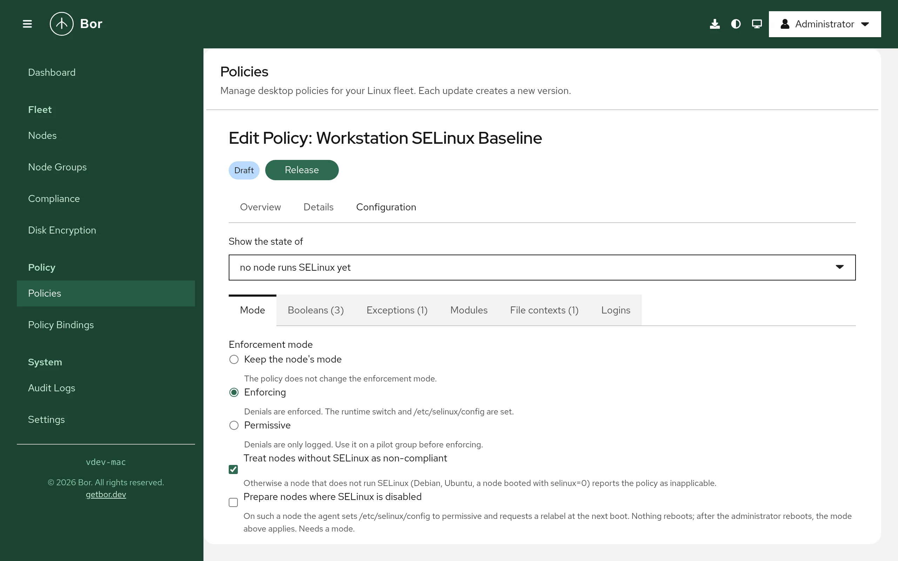

# SELinux

The **SELinux** policy type (technical name `Selinux`) manages the
mandatory access control layer of nodes that run SELinux: Fedora, RHEL and
its rebuilds, SLES 16, openSUSE Leap 16 and new Tumbleweed installs. A
policy sets the enforcement mode, boolean values, per-domain permissive
exceptions, the enabled state of policy modules, Bor-deployed policy
modules written in CIL, file contexts and login mappings. This page
explains what the agent changes on the endpoint, how to build a policy in
the editor, how several policies are merged, and how to verify and
troubleshoot the result.

!!! note "One type per mandatory access control system"
    Nodes that run AppArmor (Ubuntu, Debian, SLES 15) are managed by the
    [AppArmor](apparmor.md) type. An SELinux policy bound to such a node
    reports **inapplicable**, unless it requires SELinux. A mixed fleet
    binds one policy of each type to the same group.

## What it controls

For every bound policy the agent brings these things in line, in this
order, and reports one compliance item per entry:

- **Mode** - **Enforcing** or **Permissive**, applied to the running kernel
  (what `setenforce` does) and to `SELINUX=` in `/etc/selinux/config` so it
  survives a reboot. Bor never writes `disabled`.
- **Booleans** - the policy's own switches (`deny_ptrace`,
  `use_nfs_home_dirs`, the `xguest_*` kiosk switches), set persistently and
  at runtime with one `setsebool -P` call per sync.
- **Exceptions** - domains that run permissive while the rest of the
  system stays enforcing, the safe alternative to switching a whole group
  to permissive when one application misbehaves. Rendered into the Bor
  module `bor-permissive`.
- **Modules** - enabling or disabling modules of the node's policy store
  (`semodule -e` / `-d`), and **custom modules** written in CIL that Bor
  installs as `bor-<name>` at its own priority (450 by default), so they
  never replace a distribution or administrator module.
- **File contexts** - rules that label files matching a path expression,
  as `semanage fcontext` would, rendered into the module
  `bor-filecontexts`; `restorecon` applies them to existing files when
  asked.
- **Logins** - mappings of named accounts or groups to a confined SELinux
  user (`user_u`, `staff_u`), for kiosks and shared desktops. Needs
  `semanage` on the node. The `__default__` and `root` mappings are never
  changed by a policy.

Two switches shape what the policy means on nodes without SELinux:
**Treat nodes without SELinux as non-compliant** turns an inapplicable
result into a red one, which is what a hardening benchmark expects;
**Prepare nodes where SELinux is disabled** sets the configuration file to
permissive and requests a relabel at the next boot (`/.autorelabel`), so
that an administrator's reboot brings the node to the mode the policy
wants. The agent never reboots a node.

Everything the agent changes is recorded in
`/var/lib/bor/agent/selinux-state.json` the first time it is touched, and
restored when the key leaves every policy: the mode, each boolean's value,
each module's enabled flag, each login mapping, and the Bor modules.

## Endpoint prerequisites

- **SELinux active.** The agent checks that `selinux` is in the kernel's
  LSM list and that `/sys/fs/selinux` is mounted. On a node booted with
  `selinux=0`, or with `SELINUX=disabled` in the configuration, the policy
  is inapplicable (or non-compliant when it requires SELinux); the
  **Prepare** switch is the only thing the agent can do there.
- **The C tools of every SELinux installation**: `setsebool` and
  `getsebool`, `semodule`, `restorecon` (`policycoreutils`,
  `libselinux-utils`). Nothing else is needed for modes, booleans,
  exceptions, modules and file contexts.
- **`semanage`** (`policycoreutils-python-utils`) for login mappings
  only; without it those entries are inapplicable. Fedora and RHEL
  Workstation install it; minimal installs may not.
- **`audit2allow`** (same package) and `checkmodule` (`checkpolicy`) for
  the module proposal on the node page; without them the proposal says so.
- **`journalctl`** for the denial summary; the records are read from the
  journal's audit transport, so auditd is not required.

The agent does not add packages; a missing tool shows up as an
inapplicable item that names it.

## Agent configuration

| Key | Default | Description |
|-----|---------|-------------|
| `selinux.config_path` | `/etc/selinux/config` | The configuration file whose `SELINUX=` line the mode setting rewrites. Tamper-protected while a policy applies. |
| `selinux.modules_dir` | `/etc/bor/selinux` | Where Bor writes the CIL sources of its modules before `semodule` installs them. Tamper-protected. |
| `selinux.module_priority` | `450` | The `semodule -X` priority of Bor modules; keeps them apart from the distribution's (100) and the administrator's (400). |
| `selinux.state_path` | `/var/lib/bor/agent/selinux-state.json` | Record of every original value, restored when it leaves every policy. |
| `selinux.reconcile_interval` | `5m` | Interval of the pass that re-asserts the mode, booleans and modules while a policy applies; `0` disables it. |
| `selinux.allow_mode_change` | `true` | Let policies switch the node between enforcing and permissive. With `false` mode entries are inapplicable. |
| `selinux.allow_custom_modules` | `true` | Install Bor modules (custom modules, exceptions, file contexts). With `false` those entries are inapplicable and modules installed earlier are removed. |
| `selinux.follow_audit` | `true` | Follow the audit records so a manual `setenforce`, `setsebool` or `semodule` is reconciled within seconds; the periodic pass remains the backstop. |
| `selinux.tool_timeout` | `5m` | Maximum run time of one `semodule` or `setsebool` call. |
| `mac.inventory_interval` | `1h` | How often the node re-sends its status, booleans, modules and denial summary while connected. |
| `mac.denial_window` | `24h` | How far back the denial summary looks. |
| `mac.collect_denials` | `true` | Read the journal's audit records for the denial summary. |
| `mac.allow_actions` | `true` | Answer proposal requests from the node page (holders of `mac:operate`). |

## Create an SELinux policy

1. Go to **Policies -> Create a policy** and choose **SELinux** in the
   **System & security** group.
2. Pick a node from **Show the state of** at the top of the editor to see
   what that node does now next to every boolean and module; without a
   node the editor shows the union of what every node reported.
3. Fill the tabs described below, review the summary and save. Release
   the policy and bind it to a node group; start with a pilot group when
   the policy changes the mode or process-hardening booleans.

{ loading=lazy }

### Editor sections

**Mode**
:   Keep the node's mode, **Enforcing** or **Permissive** (the editor asks
    for a confirmation before permissive, because it disables enforcement
    on every bound node). Below it the two switches for nodes without
    SELinux: treat them as non-compliant, and prepare disabled nodes.

**Booleans**
:   Search what nodes reported plus the server's curated list of the
    booleans that matter on desktops, grouped (process hardening, users
    and logins, home directories and shares, desktop services, identity,
    developer workstations). Adding a boolean proposes its hardened value
    when the list knows one. Each row has the value switch and an optional
    note. Values that can lock users out or break desktop applications
    (`unconfined_login` off, `deny_execmem` on, `selinuxuser_execstack`
    off, any `xguest_*` change, turning network home directories off) are
    marked. **Add a template** adds a group in one click: *Process
    hardening*, *Network home directories (NFS)* and *(Samba)*, *Kiosk and
    guest accounts*, *Developer workstation*.

**Exceptions**
:   The domains that run permissive. With a node selected, the domains
    denied on that node recently are offered as one-click additions, so
    the exception is for a domain that is actually failing.

**Modules**
:   Existing modules from the node's store with an enable/disable switch,
    and custom modules: a name (installed as `bor-<name>`), a note and the
    CIL source. **Insert a template** adds a commented skeleton: allow a
    domain to read a directory, allow a connection to a port type, or
    silence a harmless denial. The server checks the source for balanced
    parentheses and a statement allowlist; `semodule` on the node reports
    anything else.

**File contexts**
:   A path expression (`/opt/corpapp(/.*)?`), the SELinux type, the file
    kind, and whether to relabel the literal prefix at once. Expressions
    that would relabel a system directory as a whole are refused.

**Logins**
:   A login or `%group`, the SELinux user and an optional range.

## Setting reference

| Setting | Field | Values | What the agent does |
|---|---|---|---|
| Mode | `mode` | `SELINUX_MODE_ENFORCING`, `SELINUX_MODE_PERMISSIVE` | writes `/sys/fs/selinux/enforce` and `SELINUX=` in the configuration file |
| SELinux required | `requireActive` | bool | a node without SELinux is non-compliant instead of inapplicable |
| Prepare disabled nodes | `prepareDisabledNodes` | bool (needs a mode) | on a disabled node: `SELINUX=permissive` and `/.autorelabel` |
| Boolean | `booleans[].name`, `.value` | name, bool | `setsebool -P name=on|off`, one call per sync |
| Exception | `permissiveDomains[]` | `<domain>_t` | `(typepermissive <domain>)` in `bor-permissive` |
| Module | `modules[].name`, `.enabled` | name, bool | `semodule -e` / `-d` |
| Custom module | `customModules[].name`, `.cil` | name, CIL text (64 KiB) | `semodule -X 450 -i bor-<name>.cil` |
| File context | `fileContexts[].pathRegex`, `.type`, `.kind`, `.restorecon` | regex, type, kind, bool | `(filecon ...)` in `bor-filecontexts`, then `restorecon -R <prefix>` |
| Login | `logins[].login`, `.seuser`, `.range` | login or `%group`, SELinux user, range | `semanage login -a/-m -s <seuser> [-r <range>] <login>` |

Protected: the boolean `secure_mode_policyload` cannot be set by a policy
(it would lock the policy against every later change, including Bor's);
modules named `bor-*` are not managed through the module switches; the
`__default__` and `root` login mappings cannot be changed.

### Example: enforcing baseline

```json
{
  "mode": "SELINUX_MODE_ENFORCING",
  "requireActive": true,
  "booleans": [
    {"name": "selinuxuser_execstack", "value": false, "description": "No executable stack for user programs"},
    {"name": "deny_ptrace", "value": true, "description": "No ptrace for anyone"}
  ]
}
```

### Example: network homes and an exception

```json
{
  "booleans": [{"name": "use_nfs_home_dirs", "value": true}],
  "permissiveDomains": ["corpvpn_t"],
  "fileContexts": [{"pathRegex": "/opt/corpapp(/.*)?", "type": "bin_t", "restorecon": true}]
}
```

## Merge behavior

Several SELinux policies bound to one node are merged per key by binding
priority (the highest priority among the enabled bindings that reach the
node). The highest priority wins every key. On equal priority:

- the **mode**: enforcing beats permissive;
- **booleans, module switches, custom modules, file contexts and
  logins** with different values are a conflict: neither is applied and
  both policies show an **error** item naming the other, until one binding
  gets a higher priority;
- **exceptions** are a union: a domain listed by any policy is permissive.

An entry a higher-priority policy decided differently is reported as
**inapplicable** ("overridden by policy ...") for the losing policy.

## What the agent changes on the node

| Path or state | Written by | Watched |
|---|---|---|
| `/sys/fs/selinux/enforce` | the mode | reconciled |
| `/etc/selinux/config` (`SELINUX=` line only) | the mode | yes |
| booleans (`setsebool -P`) | booleans | reconciled |
| the policy store, modules `bor-permissive`, `bor-filecontexts`, `bor-<name>` at priority 450 | exceptions, file contexts, custom modules | reconciled |
| `/etc/bor/selinux/*.cil` | the module sources | yes |
| `/var/lib/bor/agent/selinux-state.json` | every original value | yes |
| `/.autorelabel` | the prepare switch | no (consumed by the next boot) |

Every CIL file Bor writes starts with the line `; Managed by Bor - changes
are overwritten`.

A policy rebuild (`semodule`) takes about six seconds on a desktop; the
agent batches every module operation of a sync into one `semodule` call
and runs it off the policy stream. `setsebool -P` takes about one second.
A commit that finds the policy store locked (a package installing its
policy at the same time) is retried with a short back-off before the item
turns into an error.

On image-based systems (Fedora Kinoite and Silverblue) the policy store
is under `/etc/selinux` rather than `/var/lib/selinux`; the agent follows
`store-root` in `semanage.conf`, and everything works the same.

## Drift handling

- **Files** Bor writes (the configuration file, the module sources, the
  state file) are guarded by the tamper watcher: an edit is reverted at
  once and reported as a tamper event.
- **State that is not a file** (the runtime mode, booleans, the enabled
  flag of modules, login mappings) is re-asserted by the reconcile pass
  every `selinux.reconcile_interval`, and within seconds when
  `selinux.follow_audit` is on: the agent follows the audit records
  `MAC_STATUS` (a `setenforce`), `MAC_CONFIG_CHANGE` (a `setsebool`) and
  `MAC_POLICY_LOAD` (a `semodule`) and reconciles. Each correction is a
  tamper event on the node's timeline with the resource `selinux:mode`,
  `selinux:boolean:<name>`, `selinux:module:<name>`, `selinux:custom:<name>`
  or `selinux:login:<login>`, attributed to the login user the audit record
  names.

## Removal and restore

When a policy is unbound, archived or deleted, the agent restores what it
recorded: the mode the node had, each boolean's former value, each
module's former enabled flag, each login mapping (removed when Bor
created it), removes the Bor modules and their sources, and relabels the
paths the file contexts covered. As with every Bor type, unbinding a
hardening policy re-enables what it hardened; bind a successor first when
that is not wanted.

## The node details

The **Mandatory access control** section of a node shows what it runs
(SELinux and its mode, the policy type and version, the numbers of
booleans and modules, whether the policy is locked or a relabel is
pending), the booleans and modules it reported with their current values,
and the **denials** of the last report window grouped by domain, class
and target, with counts and one redacted example record. Holders of
`mac:operate` can ask the node for a **module proposal**: the agent runs
`audit2allow` over that domain's recent denials and returns the Type
Enforcement source and, when `checkmodule` and the policy tools are
present, its CIL translation, ready to review and paste into a custom
module. Nothing is applied by the proposal.

## Compliance

One compliance item per entry, with the schema id naming its kind
(`selinux:mode`, `selinux:boolean`, `selinux:permissive`,
`selinux:module`, `selinux:custom`, `selinux:fcontext`, `selinux:login`,
`selinux:active`):

| State | Meaning |
|---|---|
| Compliant | the node shows the value the entry asks for |
| Non-compliant | the value differs (a manual change not yet reconciled, or a disabled node under a policy that requires SELinux) |
| Inapplicable | SELinux is not active, the boolean or module does not exist in this node's policy, a higher-priority policy decided otherwise, the agent configuration disables the feature, or `semanage` is missing for a login mapping |
| Error | an equal-priority conflict, or a tool failed (the message carries `semodule`'s or `setsebool`'s last line) |

The policy's status is inapplicable only when every item is; otherwise an
error wins over non-compliant, which wins over compliant.

## Verify on the endpoint

```bash
# Mode and configuration
getenforce; grep ^SELINUX= /etc/selinux/config

# Booleans the policy sets
getsebool deny_ptrace use_nfs_home_dirs

# Bor's modules and the store
semodule --list-modules=full | grep '^450 '
ls /etc/bor/selinux/

# Original values the agent will restore
cat /var/lib/bor/agent/selinux-state.json

# Denials and state changes
journalctl --since -1h _TRANSPORT=audit -o cat | grep -E 'avc:|MAC_STATUS|MAC_CONFIG_CHANGE'

# The agent's log
journalctl -u bor-agent | grep -i selinux
```

## Troubleshooting

**Every item is inapplicable with "SELinux is not active".**
The node runs AppArmor or was booted with `selinux=0`. Check
`/sys/kernel/security/lsm` and `/proc/cmdline`. For a node with
`SELINUX=disabled`, enable **Prepare nodes where SELinux is disabled**
and reboot it once; the policy then applies.

**A boolean is "does not exist in this node's policy".**
Boolean names differ between policy versions and distributions; check
`getsebool -a | grep <name>` on the node.

**A custom module shows an error from `semodule`.**
The message is the tool's last line, usually an unknown type or class.
Types must exist in the node's policy; `seinfo -t` (package
`setools-console`) lists them, or use the proposal on the node page as a
starting point.

**"policy locked".**
`secure_mode_policyload` is on; no policy change is possible until the
node reboots. Bor never sets it.

## Security considerations

- Custom modules, file contexts, login mappings and exceptions are
  administrator-authored policy text. Saving, releasing or importing a
  policy that carries them is audited as `policy.mac_custom` with the
  module names and a SHA-256 of each source; a node can refuse them with
  `selinux.allow_custom_modules: false` and mode changes with
  `selinux.allow_mode_change: false`.
- Denial records are aggregated on the node before they are reported:
  user ids and names are dropped and home directories collapsed to
  `/home/*`; the server keeps only the latest summary per node.
- A proposal runs `audit2allow` on the node and reads its audit records;
  it needs the `mac:operate` permission, is audited as `mac.action`, and
  applies nothing.
