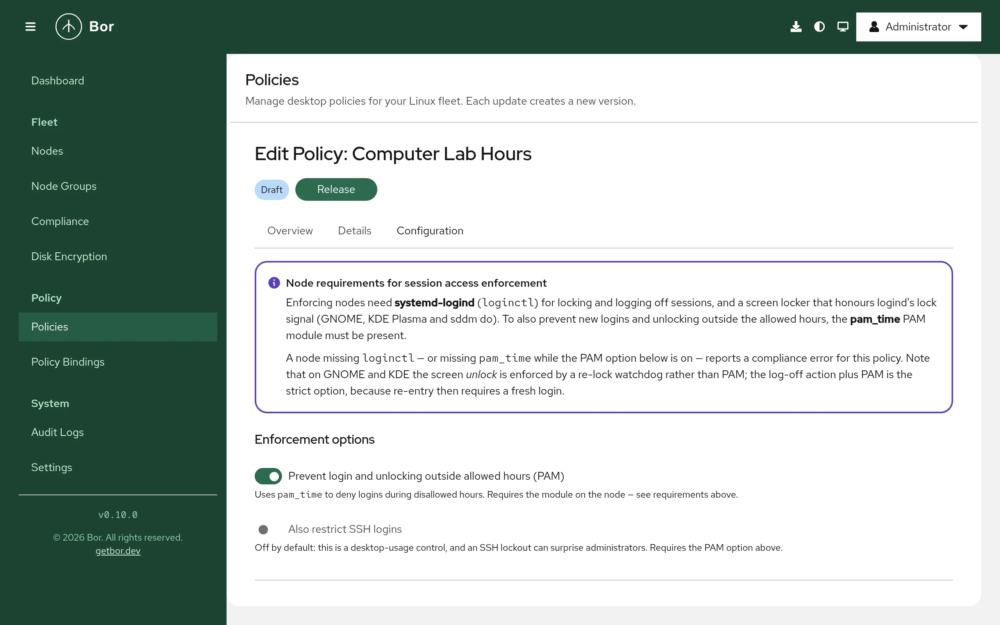

# Session Access

The **Session Access** policy type controls *when* selected users or groups
may use a desktop session. Outside their allowed hours the agent locks the
screen or logs the user off, and, where the PAM integration is available,
blocks new logins.

Typical uses: a computer lab usable only during school hours, a shared kiosk
restricted to opening hours, or contractor accounts limited to their shift.

This page explains the two enforcement layers, the editor, the files the
agent changes, and how to verify, troubleshoot and recover.

## How enforcement works

Enforcement has two independent layers.

### Layer 1: logind actions (always on)

A loop in the agent checks every active graphical session against the
schedules bound to the node. It runs every 60 seconds, and every 5 seconds
when a window boundary is less than 5 minutes away.

- **Warnings** - as an allowed period nears its end, the user receives a
  desktop notification at each threshold (default 30, 15 and 5 minutes
  before the end). The final warning is sent with critical urgency.
- **At the boundary** - the session is **locked** (`loginctl lock-session`;
  applications keep running) or **logged off**
  (`loginctl terminate-session`), as configured in the rule.
- **Re-lock watchdog** - outside the allowed hours, a targeted session that
  is unlocked is locked again immediately. This is what keeps a user out of
  a locked session on GNOME and KDE Plasma.

### Layer 2: pam_time (optional, blocks new logins)

When **Prevent login and unlocking outside allowed hours (PAM)** is enabled,
the agent adds the standard `pam_time` module to the PAM account stack and
writes the schedule into `/etc/security/time.conf`. PAM then refuses a fresh
login outside the user's allowed hours.

The block in `time.conf` contains the full weekly schedule, so it keeps
working while the agent is stopped (for example during boot).

!!! warning "PAM does not block screen unlock"
    On GNOME (GDM) and KDE Plasma, unlocking the lock screen does not honor
    the PAM account phase, so `pam_time` cannot block an *unlock*. Layer 1's
    watchdog does that. PAM blocks *fresh* logins: the display manager, the
    text console and, optionally, SSH. For the strongest restriction, use the
    **Log off** end action together with PAM: after the log-off, coming back
    requires a fresh login, which PAM refuses outside the allowed hours.

## Endpoint prerequisites

| Requirement | Needed for | Notes |
|---|---|---|
| systemd-logind (`loginctl`) | Layer 1 | Present on any systemd desktop. Without it, compliance is **Error**. |
| A screen locker that honors logind's lock request | **Lock the screen** | GNOME and KDE Plasma do. On a bare window manager without a locker, use **Log off**. |
| `pam_time.so` | Layer 2 | Part of Linux-PAM. Looked up in `/lib/security`, `/lib64/security`, `/usr/lib/security`, `/usr/lib64/security` and `/usr/lib/*/security`. |
| `pam-auth-update` | Layer 2 | Debian and Ubuntu family. |

**Debian and Ubuntu**: the agent installs the profile
`/usr/share/pam-configs/bor-session-access` and runs
`pam-auth-update --package --enable bor-session-access`, which adds
`pam_time.so` as `required` to the account stack
(`/etc/pam.d/common-account`).

**Fedora, RHEL and other authselect systems**: the PAM stack is owned by
authselect, and Bor does not modify it. On these nodes Bor does not write
`time.conf` either; only Layer 1 enforces, and compliance is reported as
**Non-compliant** with the note
`PAM layer requires a one-time admin step on this node (Layer 1 still enforced)`.
To get a compliant status on such nodes, turn off the PAM option in the
policies bound to them. The same applies to any other PAM stack the agent
cannot identify.

There are no agent configuration keys for this policy type.

## Create a Session Access policy

{ loading=lazy }

1. Open **Policies**, click **Create a policy** and choose **Session
   Access**.
2. Read the **Node requirements for session access enforcement** box at the
   top of the editor.
3. Under **Enforcement options**, set:
    - **Prevent login and unlocking outside allowed hours (PAM)** - Layer 2.
      On by default.
    - **Also restrict SSH logins** - adds `sshd` to the PAM services checked
      for restricted users. Off by default, because an SSH lockout surprises
      administrators. Only effective with the PAM option.
4. Under **Rules**, click **Add rule**. Each rule has:
    - **Description** - free text, for example `Computer lab weekday hours`.
    - **Users** and **Groups** - the accounts it restricts (**Add user**,
      **Add group**). At least one user or group is required. Groups are
      resolved on each node. `root` is never restricted and is rejected as
      a user.
    - **Allowed periods** - **Add period**, choose the days and the **From**
      and **Until** times. Times use the node's local clock. A period whose
      end is at or before its start crosses midnight (for example
      `22:00`-`02:00`). Periods within one rule must not overlap; they may
      touch.
    - **When an allowed period ends** - **Lock the screen** (applications keep
      running) or **Log off** (the session ends and unsaved work is lost).
    - **Warn before the end (minutes)** - comma-separated, strictly
      descending, each between 1 and 1440. Empty means `30, 15, 5`.
5. Save, **Release**, and bind the policy to node groups (see
   [Policies](../user-guide/policies.md) and
   [Bindings](../user-guide/bindings.md)).

User and group names may contain letters, digits, `.`, `_`, `-` and a
non-leading `@` (so SSSD names such as `alice@corp.example` work). A leading
`@` is rejected because `pam_time` reads it as a netgroup. Limits per policy:
200 rules; per rule 500 users, 100 groups, 100 periods and 10 warning
thresholds.

## Setting reference

Policy content is the `SessionAccessPolicy` message as JSON.

| Field | Description |
|---|---|
| `rules[]` | List of rules (at least one). |
| `rules[].description` | Free text. |
| `rules[].users`, `rules[].groups` | Targets. |
| `rules[].windows[]` | `days` (`mon` ... `sun`), `start` and `end` as `HH:MM` (24-hour). |
| `rules[].endAction` | `SESSION_END_ACTION_LOCK` (default) or `SESSION_END_ACTION_LOGOUT`. |
| `rules[].warnMinutes` | Warning thresholds, strictly descending. Empty = `[30, 15, 5]`. |
| `enforcePam` | Layer 2 on/off. Default `true` when not set. |
| `includeSsh` | Also gate `sshd`. Default `false`. |

### Example: computer-lab hours

Students may use the lab on weekdays from 08:00 to 17:30. Outside those
hours the screen locks after warnings at 15 and 5 minutes, and fresh logins
are refused.

```json
{
  "rules": [
    {
      "description": "Students - weekdays during school hours",
      "groups": ["students"],
      "windows": [
        { "days": ["mon", "tue", "wed", "thu", "fri"], "start": "08:00", "end": "17:30" }
      ],
      "endAction": "SESSION_END_ACTION_LOCK",
      "warnMinutes": [15, 5]
    }
  ],
  "enforcePam": true,
  "includeSsh": false
}
```

### Example: evening shift that crosses midnight

```json
{
  "rules": [
    {
      "description": "Night shift contractors",
      "users": ["contractor1", "contractor2"],
      "windows": [
        { "days": ["mon", "tue", "wed", "thu"], "start": "22:00", "end": "06:00" }
      ],
      "endAction": "SESSION_END_ACTION_LOGOUT"
    }
  ],
  "enforcePam": true,
  "includeSsh": true
}
```

The Monday window runs from Monday 22:00 to Tuesday 06:00.

### Example: kiosk accounts on two blocks per day

```json
{
  "rules": [
    {
      "description": "Library kiosk opening hours",
      "groups": ["kiosk"],
      "windows": [
        { "days": ["mon", "tue", "wed", "thu", "fri"], "start": "09:00", "end": "12:00" },
        { "days": ["mon", "tue", "wed", "thu", "fri"], "start": "13:00", "end": "18:00" },
        { "days": ["sat"], "start": "10:00", "end": "14:00" }
      ]
    }
  ]
}
```

## Merge behavior

A user's allowed time is the **union** of every rule that targets them,
directly or through a group, across all bound Session Access policies. Adding
a rule can only grant more time, never less. Users not targeted by any rule
are not restricted.

PAM enforcement (Layer 2) is applied if any bound policy has it enabled.

## Files and commands on the endpoint

| Item | Purpose |
|---|---|
| `loginctl lock-session` / `loginctl terminate-session` | Layer 1 actions. |
| `/etc/security/time.conf` | Bor's block between `# BEGIN bor-managed (session access) - managed by Bor, do not edit` and `# END bor-managed (session access)`. Content outside the markers is preserved. |
| `/usr/share/pam-configs/bor-session-access` | pam-auth-update profile (Debian/Ubuntu). |
| `/etc/pam.d/common-account` | Gets the `pam_time.so` line via pam-auth-update. |

Each generated `time.conf` line covers the services `login`,
`gdm-password`, `sddm`, `lightdm` and `xdm` (plus `sshd` with **Also restrict
SSH logins**) for one restricted user. Other PAM services, such as `cron` or
`sudo`, are not affected.

!!! warning "Enabling pam_time activates the whole time.conf"
    Adding `pam_time` to the account stack also activates any rules that were
    already in `/etc/security/time.conf`, not only Bor's block. The stock file
    contains only comments, but review it if your nodes carry custom rules.

## Compliance

All bound Session Access policies on a node report the same status. The
message names the number of Layer 1 rules and the PAM state, for example
`layer 1 (logind) enforcing 2 rule(s); PAM applied`.

| Status | Meaning |
|---|---|
| Compliant | Layer 1 is active; the PAM layer is applied or intentionally off. |
| Non-compliant | A configuration issue was skipped (for example a window that could not be compiled, or a user left without valid windows), or the PAM layer is unsupported on this node (authselect or unknown stack). Layer 1 still enforces. |
| Error | `loginctl` is unavailable, `pam_time` is not installed while PAM enforcement is enabled, or applying PAM failed. |

Possible PAM states in the message: `disabled`, `applied`,
`applied (no restricted users)`, `missing: pam_time`,
`unsupported: authselect`, `unsupported: unknown pam stack`, `error: ...`.

Locks, log-offs and warnings are events, not state: they are written to the
agent log, not to compliance. See [Compliance](../user-guide/compliance.md).

## Tamper protection

While Bor manages a block in `/etc/security/time.conf`, the file is watched.
An edit is detected, the managed block is restored, and a `tamper_detected`
event is recorded in the [audit log](../user-guide/audit-log.md).

## Unbind and delete

When the last policy requesting PAM enforcement is gone (or PAM cannot be
managed on the node), the agent removes its artifacts in fail-open order:
first it strips the managed block from `time.conf`, then it runs
`pam-auth-update --package --remove bor-session-access` and deletes the
profile. Layer 1 stops restricting users who are no longer targeted
immediately.

## Verify on the endpoint

```bash
# Sessions and their lock state
loginctl list-sessions
loginctl show-session <ID> -p Name -p LockedHint

# Bor's pam_time block
sudo sed -n '/BEGIN bor-managed/,/END bor-managed/p' /etc/security/time.conf

# pam_time in the account stack (Debian/Ubuntu)
grep pam_time /etc/pam.d/common-account

# Agent log: syncs and enforcement actions
sudo journalctl -u bor-agent | grep -i session
```

After each sync the agent logs
`SessionAccess policies synced (N policies, N rules): ...` with the
compliance status and message.

## Troubleshooting

| Symptom | Cause and fix |
|---|---|
| Error: `logind (loginctl) unavailable` | The node is not running systemd-logind. Session Access cannot work there. |
| Error: `pam_time module not installed but PAM enforcement is enabled` | Install the Linux-PAM modules package for your distribution, or turn PAM off. |
| Non-compliant with `PAM layer requires a one-time admin step` | authselect-managed node (Fedora/RHEL). Layer 1 still enforces. Turn PAM off for these nodes to clear the status. |
| A group member is not restricted at login | Groups expand to secondary members (`getent group`) plus users whose primary group it is (`getent passwd`). Directory services often disable enumeration, so a directory user whose only link to the group is the primary group is not found by the PAM layer. Make such users secondary members. |
| The screen does not lock | No locker that honors logind. Use **Log off**. |
| A user gets an extra hour once a year | Daylight-saving fall-back: times are local wall-clock time. Avoid boundaries between 01:00 and 03:00 if this matters. |
| `managed block has a BEGIN marker but no END marker; refusing to rewrite` | `time.conf` was damaged by hand. Repair the file (remove the partial block) and the agent rewrites it. |

## Recovery and security considerations

- **Break-glass.** Generated rules never match `root`, so a root login always
  works. To undo PAM enforcement by hand, remove the block between the
  `BEGIN bor-managed` and `END bor-managed` markers from
  `/etc/security/time.conf` and, on Debian/Ubuntu, run
  `sudo pam-auth-update --package --remove bor-session-access`. Booting into
  single-user mode also bypasses `pam_time`. While the policy is still bound,
  the agent restores the block, so unbind the policy first.
- **SSH.** Enable **Also restrict SSH logins** only when you are sure the
  targeted accounts are not used for remote administration.
- **Clock.** A local administrator who changes the system clock defeats any
  time-based restriction. Keep time synchronized and restrict administrator
  rights on these nodes.
- **Lock vs log off.** **Lock** preserves work, and the user is kept out
  only by the Layer 1 watchdog, which needs the agent to be running.
  **Log off** with PAM is the strictest combination.
