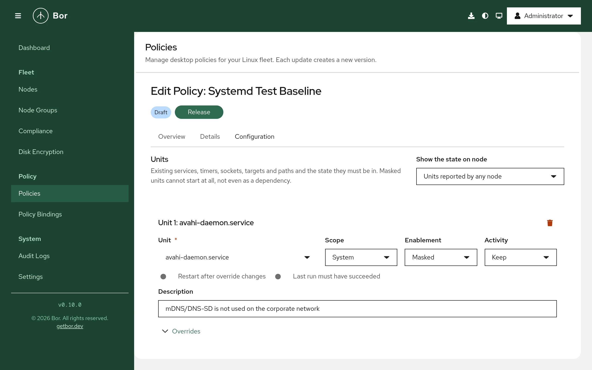

# Services & timers (systemd)

The **Services & timers** policy type (technical name `Systemd`) manages
systemd units on your nodes: whether a service, timer, socket, target or
path unit is enabled, disabled or masked, whether it is running or stopped,
overrides for a timer's schedule or a service's restart, resource and
sandboxing settings, raw directives for everything else, **scheduled
tasks** that Bor deploys as its own units, and an optional preset file
that extends enablement decisions to units installed later. This page
explains what the agent changes on the endpoint, how to build a policy in
the editor, how several policies are merged, and how to verify and
troubleshoot the result.

!!! note "Commands need a separate permission"
    A policy that deploys tasks or sets raw `Exec*` directives runs
    commands as root on every node it applies to. Creating, saving,
    importing or releasing such a policy requires the
    [`systemd:exec`](../reference/permissions.md) permission on top of the
    usual policy permissions, and is recorded in the audit log with a hash
    of every script. Per-user units (`systemctl --user`) are not managed.

## What it controls

For every unit listed in a bound policy, the agent talks to systemd over
the D-Bus system bus (`org.freedesktop.systemd1`), the same interface
`systemctl` uses, and brings three things in line with the policy:

- **Enablement** - the unit-file state: **Enabled**, **Disabled** or
  **Masked**. Enabling and disabling create or remove the symlinks the
  unit's `[Install]` section describes; masking links the unit to
  `/dev/null` so it cannot start at all, not even as a dependency of
  another unit.
- **Activity** - whether the unit is **Running** or **Stopped** right now.
  The agent re-asserts this on every sync and on every reconcile pass, so a
  service that is stopped by hand comes back.
- **Overrides** - a drop-in file
  `/etc/systemd/system/<unit>.d/90-bor.conf` with `[Timer]` settings for a
  timer (schedule, randomized delay, persistence) or `[Service]` settings
  for a service (restart policy, timeouts, environment, memory and CPU
  limits, sandboxing). The vendor unit file is never edited.

Each of the three is optional. A unit entry that sets only an enablement
leaves the activity alone, and the other way round. An entry can also
require that the **last run** of a timer or service succeeded. The drop-in
can carry **raw directives** for any `[Unit]`, `[Service]`, `[Timer]`,
`[Socket]`, `[Path]` or `[Install]` setting the typed fields do not cover.

Beyond existing units, a policy can carry:

- **Scheduled tasks** - a script (or a program with arguments) that Bor
  deploys as `bor-<name>.service`, with `bor-<name>.timer` for a schedule
  or a boot trigger instead. The `bor-` prefix is mandatory and added by
  the agent, so a task can never replace a vendor unit. Tasks run as root
  unless a user is set, are sandboxed by default, and report their last
  result (with the tail of their journal when it failed) on the compliance
  page.
- **A preset file** - `/etc/systemd/system-preset/10-bor.preset` with
  `enable` and `disable` lines for the units of the policy, so that a
  package installed next month comes up in the state the policy wants.

Every unit entry and every task has a **scope**: **System** (the default)
manages the system manager, the units of `/etc/systemd/system`; **All
users** manages the user managers, the units every user's `systemd
--user` instance runs from `/etc/systemd/user` (`pipewire.service`,
`xdg-desktop-portal.service`, a per-user sync client, a login-time
script). In the user scope, enablement is applied the way `systemctl
--global` does it, activity in the manager of every logged-in user, and a
task runs as that user. See [Units of all users](#units-of-all-users).

Beyond policies, the [node details](../user-guide/nodes.md#node-details)
show the units a node reported, with the sandboxing exposure of every
service, and let holders of `systemd:operate` start, stop or restart a
unit on that node at once (see [On-demand actions from the node
details](#on-demand-actions-from-the-node-details)).

Typical uses: the systemd half of a hardening baseline (mask `avahi-daemon`
and `cups-browsed`, disable Bluetooth, mask `ctrl-alt-del.target`), moving a
distribution's maintenance timers into a maintenance window with a
randomized delay so a fleet does not wake up at once, and keeping an agent
or monitoring service running with a restart policy and a memory limit.

Every drop-in Bor writes starts with the line
`# Managed by Bor - changes are overwritten`.

## Endpoint prerequisites

- **systemd as the init system.** The agent checks for
  `/run/systemd/system`; without it (a container, or a distribution that
  does not boot with systemd) every policy of this type is reported as
  **inapplicable** with the message
  `systemd is not the init system on this node`.
- **The D-Bus system bus.** The agent runs as root and needs to reach
  `org.freedesktop.systemd1`. If the bus cannot be reached the policies are
  reported as **error** (`cannot reach systemd on the system bus`).
- **`systemd-analyze`** (part of the systemd package on every supported
  distribution). The agent uses it to check calendar expressions before it
  writes a timer drop-in and to verify the unit files of a task before
  systemd loads them. Without it the server-side syntax check is the
  only check. The server also uses it, when installed on the server host,
  to validate expressions on release and to show the next runs in the
  editor.
- **`journalctl`** for the journal excerpt in the message of a failed
  task and for the attribution of a unit changed by hand; without it the
  message carries the result and exit status only and drift events name
  no actor.
- **`systemd-stdio-bridge`** (part of systemd) for entries scoped to
  **All users**: a user's bus admits only that user, so the agent reaches
  each logged-in user's manager through the bridge running as that user,
  the way `systemctl --user -M user@` does. Without it the enablement of
  user units is still applied on the file system, but their activity is
  neither applied nor checked and the compliance item says which user's
  manager could not be reached.
- systemd **249 or newer** (Ubuntu 22.04, SLES 15 SP4, Debian 12, RHEL 9
  and current Fedora all qualify). The timer settings **FixedRandomDelay**,
  **OnClockChange** and **OnTimezoneChange** exist in the schema and need
  systemd 247 and 242 respectively; the editor does not offer them.

No extra packages are needed.

## Agent configuration

The agent reads these keys from `/etc/bor/config.yaml`. All are optional.

| Key | Default | Description |
|---|---|---|
| `systemd.system_dir` | `/etc/systemd/system` | Directory where the agent writes the `<unit>.d/90-bor.conf` drop-ins and the `bor-<task>.service` and `.timer` units of tasks. |
| `systemd.preset_dir` | `/etc/systemd/system-preset` | Directory of the `10-bor.preset` file. |
| `systemd.scripts_dir` | `/etc/bor/systemd` | Directory of task scripts (`<task>.sh`). The directory belongs to Bor: every file in it is managed. |
| `systemd.state_path` | `/var/lib/bor/agent/systemd-state.json` | Record of each managed unit's original state, used to restore it when the unit leaves every policy. |
| `systemd.job_timeout` | `90s` | How long the agent waits for a start, stop or restart job to finish. |
| `systemd.reconcile_interval` | `10m` | How often the agent re-checks and re-asserts the enablement and activity of every managed unit while a policy applies. `0` disables the periodic pass. |
| `systemd.watch_signals` | `true` | React within seconds to a managed unit that is started, stopped, enabled or disabled by hand, through systemd's D-Bus signals. The periodic pass remains the backstop. |
| `systemd.allow_tasks` | `true` | Deploy the tasks of bound policies. With `false` the agent reports every task as an error, writes nothing for it and removes task files it deployed earlier. Defence in depth for sites that want unit management without remote code execution. |
| `systemd.analyze_binary` | `systemd-analyze` | The executable used to validate calendar expressions and task unit files, resolved through `PATH` unless absolute. Also computes the sandboxing exposure of every loaded service for the unit inventory. |
| `systemd.user_dir` | `/etc/systemd/user` | Directory where the agent writes the drop-ins and task units of entries scoped to **All users** and creates their enablement symlinks and masks. |
| `systemd.user_preset_dir` | `/etc/systemd/user-preset` | Directory of the `10-bor.preset` file for user managers. |
| `systemd.allow_actions` | `true` | Run the start, stop and restart actions requested from the node details of the console. With `false` every action is answered with an error; policies are unaffected. |

```yaml
systemd:
  reconcile_interval: 5m
  allow_tasks: false
```

## Create a services & timers policy

{ loading=lazy }

1. Open **Policies** and click **Create a policy**.
2. Choose the **Services & timers** tile and enter a name and description.
3. Fill in the editor (see below) and save the policy.
4. Click **Release**. Only released policies are delivered to agents.
5. Bind the policy to one or more node groups on the
   [bindings](../user-guide/bindings.md) page.

See [Policies](../user-guide/policies.md) for the general policy lifecycle.

The editor rejects an empty policy: add at least one unit or task, and
give each unit at least one setting (an enablement, an activity, an
override or the last-run check). **Add template** appends the units of a
ready-made set: **Desktop hardening** (avahi, cups-browsed and
Ctrl+Alt+Del masked, Bluetooth and rpcbind disabled) or **Maintenance
window** (fstrim, man-db and the package metadata timers moved to Saturday
03:00 with a one-hour random spread); edit or remove what does not fit.

The editor states when a policy runs commands (tasks or raw `Exec*`
directives) and blocks saving when your account lacks `systemd:exec`.

!!! tip "Pilot group first"
    Stopping a display manager or masking the network stack on a whole
    node group is one release away. Bind a new policy to a small pilot
    group first, check the [compliance page](../user-guide/compliance.md),
    then widen the binding.

### Editor sections

**Units**

The editor shows one card per unit. **Add unit** appends a card; the trash
button removes one.

- **Show the state on node** - pick a node to see, under every unit name,
  what that node reports right now (**Now on lab-01: enabled, active
  (running)**), its schedule for timers and the unit's description. Nodes
  report their installed units to the server when the agent connects and
  after every sync that changed something, so the states are a few seconds
  old at most. With **Units reported by any node** the picker lists the
  union of all nodes' units instead.
- **Unit** - the full unit name with its suffix: `bluetooth.service`,
  `fstrim.timer`, `cups.socket`, `ctrl-alt-del.target`, `cups.path`.
  Typing filters the units nodes have reported (each suggestion shows the
  type and how many nodes reported it); a name no node has reported is
  accepted as typed, so you can write a policy before the package is
  installed. Names may contain letters, digits, `:`, `_`, `.`, `\`, `@`
  and `-`, must end in `.service`, `.timer`, `.socket`, `.target` or
  `.path`, and are at most 255 characters long. Template units such as
  `getty@.service` are refused; name an instance (`getty@tty2.service`)
  instead.
- **Scope** - **System** (the system manager) or **All users** (every
  user's manager). The state on a node is shown for system units only;
  a unit of all users is checked in each logged-in session. See
  [Units of all users](#units-of-all-users).
- **Enablement** - **Keep**, **Enabled**, **Disabled** or **Masked**.
  **Keep** leaves the unit-file state as it is.
- **Activity** - **Keep**, **Running** or **Stopped**. Hidden for targets,
  which are only enabled, disabled or masked. A masked unit cannot be
  running; the editor refuses the combination.
- **Restart after override changes** (services only) - restart a running
  service when its drop-in changes, so new settings take effect at once.
  Off by default, because restarting a service such as `cups.service`
  interrupts its users. Timers are always restarted after a schedule
  change; that only reschedules them.
- **Last run must have succeeded** (timers and services) - the unit's last
  run must have ended with `success` for the unit to be compliant. For a
  timer the agent looks at the service the timer activates.
- **Description** - free text shown in the policy summary.

When a unit is on the risky list (network, SSH, display managers, the
firewall, time synchronization, audit, cron; see
[Security considerations](#security-considerations)), the card shows a
warning (**<unit> can cut users or administrators off from the node**) and
the policy cannot be saved until you tick **I understand; manage <unit>
anyway**. Units on the protected list are refused outright.

If the chosen node reports a unit as `static` (no `[Install]` section), the
editor reminds you that it cannot be enabled or disabled and that you
should set an activity instead. For a service the state line also shows
the **sandboxing exposure** the node computed with `systemd-analyze
security` (`sandboxing exposure 9.6 UNSAFE`): 0 is fully sandboxed, 10 is
unrestricted, and the predicate is one of `SAFE`, `OK`, `MEDIUM`,
`EXPOSED` and `UNSAFE`. It is a hint for the service settings below, not
a compliance check.

**Overrides**

An expandable section under each unit. For a `.timer` unit it offers the
timer settings, for a `.service` unit the service settings, and for every
type the raw directives described below. Each field maps to one systemd
directive and takes the same value syntax as the unit file would.

Timer settings:

| Field | Directive | Value |
|---|---|---|
| **Schedule preset** | | Fills **OnCalendar** with one of: **Hourly** (`hourly`), **Daily at 03:00** (`*-*-* 03:00:00`), **Weekdays at 07:00** (`Mon..Fri *-*-* 07:00:00`), **Weekly, Saturday 03:00** (`Sat *-*-* 03:00:00`), **Monthly, first day 03:00** (`*-*-01 03:00:00`) or **Custom expression**. |
| **OnCalendar** | `OnCalendar=` | One or more calendar expressions (`systemd.time(7)`), at most 16. They replace the vendor schedule. |
| **OnBootSec** | `OnBootSec=` | Time span after boot. |
| **OnUnitActiveSec** | `OnUnitActiveSec=` | Time span after the last activation (a repeating interval). |
| **RandomizedDelaySec** | `RandomizedDelaySec=` | Random delay added to every trigger, to spread a fleet over a window. |
| **AccuracySec** | `AccuracySec=` | How much the trigger may be delayed to coalesce wake-ups (systemd's default is 1 minute). |
| **Persistent** | `Persistent=` | **Yes** catches up a run that was missed while the node was off; essential for laptops. |
| **WakeSystem** | `WakeSystem=` | **Yes** wakes a suspended node for the run. |

Service settings:

| Field | Directive | Value |
|---|---|---|
| **Restart** | `Restart=` | `no`, `on-success`, `on-failure`, `on-abnormal`, `on-abort`, `on-watchdog` or `always`. |
| **RestartSec** | `RestartSec=` | Time span. |
| **TimeoutStartSec**, **TimeoutStopSec** | `TimeoutStartSec=`, `TimeoutStopSec=` | Time spans. |
| **Environment** | `Environment=` | `KEY=value` entries, at most 64, added to the vendor environment. Values are stored in the policy and visible to everyone who can read it; keep secrets out. |
| **MemoryMax** | `MemoryMax=` | A size such as `512M`, a percentage of physical memory such as `20%`, or `infinity`. |
| **CPUQuota** | `CPUQuota=` | A percentage such as `50%` (more than `100%` uses several cores). |
| **TasksMax** | `TasksMax=` | A number, a percentage or `infinity`. |
| **Nice** | `Nice=` | An integer from -20 to 19. |
| **NoNewPrivileges** | `NoNewPrivileges=` | **Yes** or **No**. |
| **ProtectSystem** | `ProtectSystem=` | `no`, `yes` (read-only `/usr` and `/boot`), `full` (also `/etc`) or `strict` (whole file system). |
| **ProtectHome** | `ProtectHome=` | `no`, `yes` (inaccessible), `read-only` or `tmpfs`. |
| **PrivateTmp** | `PrivateTmp=` | **Yes** or **No**. |

**Keep** (or an empty field) leaves the directive untouched.

Time spans use systemd syntax: `90s`, `15min`, `1h 30min`, `1.5h`, a bare
number of seconds, or `infinity`. Calendar expressions use systemd syntax:
`daily`, `Sat *-*-* 03:00:00`, `Mon..Fri 07:00`, `*-*-01 00:00:00`. The
server checks the syntax of both when you release (and runs
`systemd-analyze calendar` when it runs on a systemd host); the agent runs
`systemd-analyze calendar` on the node before it writes the drop-in. Under
every calendar expression the editor shows the **next runs** as the
server's `systemd-analyze` computes them (in the server's time zone), or
the parser's message for an expression systemd does not accept; a server
without `systemd-analyze` says so and leaves the check to the node.

Raw directives:

| Field | Value |
|---|---|
| **Section** | `[Unit]`, `[Install]`, or the section of the unit's own type (`[Service]`, `[Timer]`, `[Socket]`, `[Path]`). |
| **Directive** | The systemd directive name in CamelCase, such as `IPAddressDeny`, `ReadWritePaths`, `StartLimitBurst` or `ExecStartPre`. |
| **Values** | One value per line, at most 16. The agent writes `Directive=` (a reset) followed by one line per value, so the values **replace** the vendor's rather than extending them. Leave the values empty to only reset the directive. |

Raw directives are written verbatim; the server and the agent check only
that the section, the name and the single-line values are well formed.
An `Exec*` directive runs a command as root and makes the policy
command-running (see the note at the top of this page).

**Scheduled tasks**

One card per task. Bor deploys each task as its own units, so a task
never competes with a vendor unit:

| Field | Meaning |
|---|---|
| **Name** | 1-48 lower-case letters, digits or dashes. The units are `bor-<name>.service` and, for a timer trigger, `bor-<name>.timer`; the script is `/etc/bor/systemd/<name>.sh`. Do not type the `bor-` prefix. With a node picked, the line under the name shows the sandboxing exposure the node computed for a deployed task's service. |
| **Description** | Becomes the units' `Description=`. |
| **Scope** | **System**: the units go to `/etc/systemd/system` and the task runs as root (or the user set below). **All users**: the units go to `/etc/systemd/user`, the timer is started in the manager of every logged-in user, the task runs as that user with that user's permissions, **User** and **Group** must stay empty, and the boot trigger becomes **At login** (`default.target` of the user manager). |
| **Trigger** | **On a schedule (timer)**: the schedule fields of a timer (presets, OnCalendar with the next-run preview, monotonic triggers, Persistent, RandomizedDelaySec, AccuracySec, WakeSystem). **At boot**: the service is wanted by `multi-user.target` and runs once per boot. |
| **What runs** | **A script**: written verbatim to the node, must start with an interpreter line (`#!/bin/sh`, `#!/usr/bin/python3`), at most 64 KiB. **A program with arguments**: an absolute path plus arguments, passed literally (no shell, no variable or specifier expansion). |
| **User**, **Group** | The account the task runs as; root when empty. |
| **Working directory** | Absolute path; `/` when empty. |
| **TimeoutStartSec** | The run is killed after this long; `1h` when empty. |
| **Environment** | `KEY=value` entries, stored in the policy and visible to everyone who can read it. |
| **Sandboxed** | On by default: `NoNewPrivileges=yes`, `PrivateTmp=yes`, `ProtectKernelTunables=yes`, `ProtectControlGroups=yes`, `RestrictSUIDSGID=yes`, `ProtectClock=yes`, `ProtectHostname=yes`. `ProtectSystem=` and `ProtectHome=` are left out because maintenance scripts commonly write under `/etc`, `/var` and `/home`. In the **All users** scope only `NoNewPrivileges=yes` and `RestrictSUIDSGID=yes` are set, because the namespace-based protections need privileges a user manager does not have. |
| **Last run must have succeeded** | The task is non-compliant after a run that did not end with `success`; the message carries the exit status and the last lines of the task's journal. |
| **Enabled** | On by default. Off deploys the files but leaves the timer or boot trigger disabled, for staging a task before it runs. |

Every task runs as `Type=oneshot` with `SyslogIdentifier=bor-task-<name>`,
so `journalctl -t bor-task-<name>` on the node shows its output.

**Preset file**

The switch **Also write a preset file** makes the agent write
`/etc/systemd/system-preset/10-bor.preset` with an `enable` line for every
unit the policy enables and a `disable` line for every unit it disables or
masks. Presets decide a unit's enablement when its package is installed,
so the decision holds for software installed after the policy was bound.
The `10-` prefix sorts before the distribution's own `90-` or
`99-default.preset`, and the first matching line wins. The switch needs at
least one unit with an enablement. Units scoped to **All users** go to a
second file, `/etc/systemd/user-preset/10-bor.preset`, which user managers
consult. Package scripts that call
`systemctl enable` directly instead of `systemctl preset` bypass presets;
that is common on Debian and Ubuntu, where `deb-systemd-helper` honours
them but not every maintainer script goes through it.

## Setting reference

Policy content is stored as JSON (the `SystemdPolicy` message). Field names
use camelCase; enumerations are stored by name.

| Field | Type | Description |
|---|---|---|
| `units` | list of unit entries | At most 200. A unit name appears once per policy. A policy needs at least one unit or task. |
| `tasks` | list of task entries | At most 50. A task name appears once per policy. Requires `systemd:exec`. |
| `writePresets` | boolean | Write `10-bor.preset` from the enablement decisions of `units`; needs at least one unit with an enablement. |

Unit entry:

| Field | Type | Description |
|---|---|---|
| `name` | string | Full unit name with suffix. |
| `enablement` | string | `SYSTEMD_ENABLEMENT_ENABLED`, `SYSTEMD_ENABLEMENT_DISABLED` or `SYSTEMD_ENABLEMENT_MASKED`. Omitted = keep. |
| `activity` | string | `SYSTEMD_ACTIVITY_RUNNING` or `SYSTEMD_ACTIVITY_STOPPED`. Omitted = keep. Not allowed for targets; not allowed with `MASKED` and `RUNNING` together. |
| `restartOnChange` | boolean | Services only. Restart a running service after its drop-in changed. |
| `requireLastRunSuccess` | boolean | Timers and services only. The last run must have succeeded. |
| `description` | string | Free text, at most 512 characters. |
| `dropIn.timer` | object | Timer settings (`.timer` units only): `onCalendar` (list), `onBootSec`, `onStartupSec`, `onActiveSec`, `onUnitActiveSec`, `onUnitInactiveSec`, `persistent`, `randomizedDelaySec`, `accuracySec`, `wakeSystem`, `fixedRandomDelay`, `onClockChange`, `onTimezoneChange`. |
| `dropIn.service` | object | Service settings (`.service` units only): `restart`, `restartSec`, `timeoutStartSec`, `timeoutStopSec`, `environment` (list), `memoryMax`, `cpuQuota`, `tasksMax`, `nice`, `noNewPrivileges`, `protectSystem`, `protectHome`, `privateTmp`. |
| `dropIn.raw` | list of directives | At most 32 per unit. Each has `section` (`Unit`, `Service`, `Timer`, `Socket`, `Path`, `Install`; the typed sections only for the matching unit type), `key` (CamelCase) and `values` (list of single-line strings, at most 16; empty resets the directive). An `Exec*` key requires `systemd:exec`. |

Task entry:

| Field | Type | Description |
|---|---|---|
| `name` | string | `^[a-z0-9][a-z0-9-]{0,47}$`, without the `bor-` prefix. |
| `description` | string | At most 512 characters; one line in the unit. |
| `trigger` | string | `SYSTEMD_TASK_TRIGGER_TIMER` (needs `schedule`) or `SYSTEMD_TASK_TRIGGER_BOOT` (no `schedule`). |
| `schedule` | object | The timer settings object (same fields as `dropIn.timer`); at least one trigger directive. |
| `script` | string | The script, starting with `#!`, at most 64 KiB. Exactly one of `script` and `execStart`. |
| `execStart` | list of strings | Program (absolute path) and arguments, passed literally. |
| `user`, `group` | string | `^[a-z_][a-z0-9_-]{0,31}$`. |
| `workingDirectory` | string | Absolute path. |
| `environment` | list of strings | `KEY=value` entries, at most 64. |
| `timeoutStartSec` | string | Time span; `1h` when omitted. |
| `hardened` | boolean | Omitted = on. |
| `requireLastRunSuccess` | boolean | |
| `enabled` | boolean | Omitted = on. |

What **Running** means depends on the unit:

- For a service with a long-running main process, for a timer, a socket or
  a path: the unit is `active` (or on its way to it: `activating`,
  `reloading`).
- For a `Type=oneshot` service without `RemainAfterExit=`, which is never
  `active` after it ran: the service ran successfully since boot (its
  result is `success` and it has a start timestamp). The agent starts it
  when that is not the case. Prefer managing the timer that triggers such
  a service.

**Stopped** means the unit is not active (`inactive`, `failed` or
`deactivating`).

### Example: desktop hardening baseline

Mask the services a managed desktop does not need, disable Bluetooth, and
make Ctrl+Alt+Del do nothing:

```json
{
  "units": [
    { "name": "avahi-daemon.service", "enablement": "SYSTEMD_ENABLEMENT_MASKED" },
    { "name": "avahi-daemon.socket", "enablement": "SYSTEMD_ENABLEMENT_MASKED" },
    { "name": "cups-browsed.service", "enablement": "SYSTEMD_ENABLEMENT_MASKED" },
    {
      "name": "bluetooth.service",
      "enablement": "SYSTEMD_ENABLEMENT_DISABLED",
      "activity": "SYSTEMD_ACTIVITY_STOPPED"
    },
    { "name": "ctrl-alt-del.target", "enablement": "SYSTEMD_ENABLEMENT_MASKED" }
  ]
}
```

Masking implies stopping: a masked unit that is active is stopped before
the mask is applied.

### Example: maintenance window

Keep the weekly TRIM job enabled and waiting, move it to Saturday 03:00 with
up to one hour of random delay so the fleet does not run it at once, catch
up a run missed while a laptop was off, and flag a node whose last run
failed:

```json
{
  "units": [
    {
      "name": "fstrim.timer",
      "enablement": "SYSTEMD_ENABLEMENT_ENABLED",
      "activity": "SYSTEMD_ACTIVITY_RUNNING",
      "requireLastRunSuccess": true,
      "dropIn": {
        "timer": {
          "onCalendar": ["Sat *-*-* 03:00:00"],
          "persistent": true,
          "randomizedDelaySec": "1h"
        }
      }
    }
  ]
}
```

The agent writes `/etc/systemd/system/fstrim.timer.d/90-bor.conf`:

```ini
# Managed by Bor - changes are overwritten
# Unit: fstrim.timer

[Timer]
OnCalendar=
OnCalendar=Sat *-*-* 03:00:00
Persistent=yes
RandomizedDelaySec=1h
```

The empty `OnCalendar=` line resets the vendor schedule, so the Bor schedule
replaces it instead of adding a second trigger. The agent restarts the timer
after the reload so the new schedule applies.

### Example: service hardening

Keep a monitoring agent running, restart it when it fails, cap its memory
and sandbox it:

```json
{
  "units": [
    {
      "name": "node-exporter.service",
      "enablement": "SYSTEMD_ENABLEMENT_ENABLED",
      "activity": "SYSTEMD_ACTIVITY_RUNNING",
      "restartOnChange": true,
      "dropIn": {
        "service": {
          "restart": "on-failure",
          "restartSec": "5s",
          "memoryMax": "256M",
          "noNewPrivileges": true,
          "protectSystem": "strict",
          "protectHome": "yes",
          "privateTmp": true
        }
      }
    }
  ]
}
```

!!! warning "Sandboxing can break a service"
    `ProtectSystem=strict` and `ProtectHome=yes` make most of the file
    system read-only or invisible to the service. A service that writes
    outside `/var` or `/run` fails to start under these settings. The
    agent reports such a unit as **error** with systemd's job result; the
    drop-in stays, so fix the policy rather than the node.

### Example: scheduled task

A nightly cleanup on lab desktops, caught up after a night the machines
were off, spread over half an hour, non-compliant when it fails:

```json
{
  "tasks": [
    {
      "name": "lab-cache-cleanup",
      "description": "Clear stale browser caches on lab desktops",
      "trigger": "SYSTEMD_TASK_TRIGGER_TIMER",
      "schedule": {
        "onCalendar": ["*-*-* 02:00:00"],
        "persistent": true,
        "randomizedDelaySec": "30min"
      },
      "script": "#!/bin/sh\nset -eu\nfind /home/*/.cache/mozilla -mindepth 1 -mtime +7 -delete\n",
      "timeoutStartSec": "30min",
      "requireLastRunSuccess": true
    }
  ]
}
```

Releasing it needs `systemd:exec`; the audit log then shows who released
it and the SHA-256 of the script.

Both `units[]` entries and `tasks[]` carry an optional `scope`:
`SYSTEMD_SCOPE_SYSTEM` (the default when absent) or `SYSTEMD_SCOPE_GLOBAL`
for the user managers. The same unit name may appear once per scope.

## Merge behavior

When several services & timers policies apply to the same node, the agent
merges them into one desired state per unit. Each part of a unit entry is
merged on its own:

- **Enablement** and **activity**: the policy with the **higher** binding
  priority wins. On equal priority the more restrictive value wins:
  masked over disabled over enabled, stopped over running. A unit that
  ends up **masked** is always **stopped**, whatever another policy says
  about its activity.
- **Timer settings** are one block: the highest-priority policy that sets
  any timer setting provides the whole block; other policies' timer
  settings for that unit are ignored.
- **Service settings** are merged **directive by directive**: for each
  directive the highest-priority policy that sets it wins. **Environment**
  entries are a union keyed by variable name, the higher priority winning
  a duplicate.
- **Raw directives** are merged **per section and directive**: for each
  `[Section] Key` the highest-priority policy that sets it wins.
- **Restart after override changes** and **Last run must have succeeded**
  are on if any policy turns them on.
- **Tasks** are merged by name: the highest-priority policy that defines
  a task name provides the whole task; the other policies report that
  task as overridden. Two policies defining the identical task are both
  compliant.
- **The preset file** is written when any policy asks for it, from the
  merged enablement of every unit.

Every policy reports its own result for every unit it lists. A policy whose
value for a unit lost reports that unit as **inapplicable** with the
message `overridden: enablement by <policy> (priority N)` (or `activity`,
`timer settings`, `service settings <directive>`), followed by the unit's
current state. Two policies that ask for the same value are both compliant.

Units are merged per scope: `syncthing.service` of all users and
`syncthing.service` of the system are two different units.

## What the agent changes on the node

Files, written atomically and recognized by their first line:

| Path | Content |
|---|---|
| `/etc/systemd/system/<unit>.d/90-bor.conf` | The unit's overrides, one file per unit, only when the unit has timer or service settings or raw directives. The `90-` prefix sorts after the usual distribution drop-ins (`10-`, `50-`), so Bor's values win. |
| `/etc/systemd/system/bor-<task>.service`, `bor-<task>.timer` | The units of a task: a `Type=oneshot` service with the script or program as `ExecStart=`, the sandboxing directives, `SyslogIdentifier=bor-task-<task>`, and `WantedBy=multi-user.target` for a boot trigger; a timer with the schedule and `WantedBy=timers.target`. Verified with `systemd-analyze verify` before the reload; a file systemd rejects is removed again. |
| `/etc/bor/systemd/<task>.sh` | The task script, mode `0755`. The directory belongs to Bor; files in it that no task owns are removed. |
| `/etc/systemd/system-preset/10-bor.preset` | `enable` and `disable` lines, only for policies with the preset switch. |
| `/var/lib/bor/agent/systemd-state.json` | The unit-file state and activity each managed unit had the first time Bor touched it (`unit_file_state`, `active`, `recorded_at`), used for the restore described below. Task units are not recorded: they are Bor's own. Removed when no unit is recorded. |

Through systemd (nothing else on disk is touched by Bor itself):

- `EnableUnitFiles` and `DisableUnitFiles` create and remove the
  `[Install]` symlinks under `/etc/systemd/system/`; `MaskUnitFiles` and
  `UnmaskUnitFiles` create and remove the `/dev/null` link. The agent never
  uses systemd's force option, so a unit whose own file lives in
  `/etc/systemd/system/` is not replaced by a mask (see
  [Troubleshooting](#troubleshooting)).
- `StartUnit`, `StopUnit` and `RestartUnit` queue a job in `replace` mode
  and the agent waits for its completion (`systemd.job_timeout`), so a
  failed start is reported with systemd's job result.
- A daemon reload (`Reload`) after any drop-in or enablement change. After
  the reload the agent reads every unit whose drop-in changed back; a unit
  that systemd now reports as `bad-setting` or `error` has its drop-in
  removed again, systemd is reloaded once more and the unit is reported
  as **error** (`systemd rejected the drop-in (load state bad-setting); it
  was removed`).

- For a task: `bor-<task>.timer` is enabled and started (restarted when
  its schedule changed), or the boot-triggered service is enabled. A task
  with **Enabled** off is stopped and disabled instead. A task that leaves
  every policy has its units stopped and disabled before its files go.

A sync runs these steps in order: drop-ins, task files and the preset
file, reload, restore of units that left every policy, enablement (with
one reload), activity, tasks, state file, then one more read of every unit
for the compliance report. Syncs run in the background, one at a time, so
a slow stop never blocks the policy stream.

With `systemd.allow_tasks: false` the agent writes nothing for tasks,
removes task files it deployed earlier (stopping their units first) and
reports every task as an error, while the rest of the policy applies.

## Drift handling

Three mechanisms keep a node in line between policy changes:

- **File watcher.** Every `90-bor.conf` the agent wrote, the task units
  and scripts, the preset file and the state file are watched. Editing or
  deleting one re-runs the sync, which rewrites the file, reloads systemd
  and records a `tamper_detected` event in the
  [audit log](../user-guide/audit-log.md).
- **Signal watcher.** While `systemd.watch_signals` is on (the default),
  the agent follows systemd's D-Bus signals for the managed units and for
  unit-file changes. A managed service stopped by hand, a timer disabled
  by hand or a unit re-enabled by hand is reconciled about two seconds
  later. The watcher ignores the changes the agent's own sync causes and
  reconnects with backoff if the bus goes away; the node then relies on
  the periodic pass.
- **Reconcile pass.** Every `systemd.reconcile_interval` (default 10
  minutes) while at least one policy applies, the agent re-reads every
  managed unit and re-asserts its enablement and activity: a service
  stopped by hand is started again, a unit re-enabled by hand is disabled
  again, a task timer stopped by hand is started again, and the compliance
  report is refreshed. The action is noted in the compliance message
  (`; started`, `; disabled`, `; timer started`).
- **Catalogue refresh.** After a sync that changed a file or a unit state,
  the agent reports its unit inventory to the server again, so the editor's
  **Show the state on node** view stays current.

A manual change to the state of a managed system unit is reported as a
tamper event when a pass undoes it: the reconcile pass (periodic, or
triggered by the signal watcher) records every correction it had to make
to a unit that was already under management (`bluetooth.service` found
`active (running)`, stopped; `cups.service` found `inactive (dead)`,
started; a unit found re-enabled, disabled again) and the agent reports
each as a `tamper_detected` event on resource `unit:<name>` with the
account of what was found and done. The agent then looks two minutes back
in the journal for who did it: a `sudo` record whose command names the
unit, or a polkit authorization for `org.freedesktop.systemd1.manage-units`
that names it, and attaches the user and process. A root shell leaves no
such record, so an event without an actor means "not attributable", not
"nobody". The first application of a policy, a policy change and a unit
newly added to a policy are not drift. Corrections to units of all users
are not reported as events; they show in the compliance message
(`started for alice`).

## Units of all users

An entry scoped to **All users** manages the unit in every user's
manager, the `systemd --user` instance each login session runs. The
agent, which runs as root, works at two levels:

- **Enablement** is applied on the file system, exactly as `systemctl
  --global` does: enabling creates the symlinks the unit's `[Install]`
  section names under `/etc/systemd/user` (`default.target.wants/`,
  `timers.target.wants/`, aliases), disabling removes them, masking links
  `/etc/systemd/user/<unit>` to `/dev/null`. The unit file itself is
  looked up in `/etc/systemd/user`, `/run/systemd/user`,
  `/usr/local/lib/systemd/user`, `/usr/lib/systemd/user` and
  `/lib/systemd/user`; a unit with no `[Install]` section is `static`
  and reports an error when the entry asks to enable or disable it. The
  decisions apply to every user, including those not logged in, at their
  next login.
- **Activity**, overrides and tasks are applied in the manager of every
  user with a running session. A user's bus admits only that user, so the
  agent connects through `systemd-stdio-bridge` running as that user (the
  mechanism behind `systemctl --user -M user@`), reloads the manager after
  it wrote a file, and starts, stops or restarts the unit there. Users
  are discovered from `/run/user/<uid>/bus`; a user who logs in later
  gets the enablement from the file system and the activity on the next
  reconcile pass.

Drop-ins of user units are written to
`/etc/systemd/user/<unit>.d/90-bor.conf`, task units to
`/etc/systemd/user/bor-<name>.service` and `.timer` (the script stays in
`/etc/bor/systemd`, world-readable and executable), a login-triggered
task is wanted by the user manager's `default.target`, and a task runs as
the user with that user's permissions and environment; **User** and
**Group** must be empty. The compliance item of a user unit is keyed
`global/<unit>` and reports the global enablement plus the activity per
user: `enabled for all users; active (running) for alice, bob`. With no
user logged in, the activity is not checked (`no user session`). The
signal watcher follows the system bus only; user units rely on the
reconcile pass.

The protected list of the system scope applies, plus the user session's
own targets (`exit.target`, `sockets.target`, `timers.target`,
`paths.target`, `graphical-session.target`,
`graphical-session-pre.target`, `xdg-desktop-autostart.target`) and
`systemd-exit.service`; the editor asks for a confirmation before a policy
touches the audio stack (`pipewire*`, `wireplumber*`, `pulseaudio*`), the
desktop portals (`xdg-desktop-portal*`), `plasma-*`, `gnome-session*`,
`gnome-shell*` and `dbus-*` in the user scope.

When a user unit leaves every policy, its enablement is restored from the
record (unmasked, enabled or disabled as it was) and its drop-in and task
files are removed; its activity in the sessions of logged-in users is
left as it is.

## On-demand actions from the node details

The **Services & timers** section of the [node
details](../user-guide/nodes.md#node-details) lists the units a node
reported and, for holders of `systemd:operate`, offers **Start**, **Stop**
and **Restart** on each service, timer, socket or path. The request goes
to the agent over its policy stream and waits for the answer; the agent
runs the job on the system manager, reports the job result and the unit's
state afterwards (the row updates), and the server records a
`systemd.unit_action` audit event with the outcome. Nothing is queued: a
node that is not connected answers `agent not connected`, and an agent
that does not answer within the job timeout answers `the agent did not
answer`, in which case the action may still complete on the node and the
unit list shows its state. Protected units and targets are refused, a
risky unit asks for a confirmation, and a unit that a bound policy keeps
in another state is put back by the policy's next pass; the result says
so (`policy "Desktop baseline" keeps this unit stopped; the next
reconcile pass stops it again`). Each node can refuse actions with
`systemd.allow_actions: false`.

Nodes report their unit inventory when the agent connects, after every
sync that changed a unit, after an action, and on **Update metadata**.
The inventory includes, for every loaded service, the **sandboxing
exposure** `systemd-analyze security` computes on the node, shown in the
node details and in the editor's state line.

## Removal and restore

The first time a sync touches a unit, the agent records the unit's
unit-file state and whether it was active in the state file. When the unit
leaves every policy (the policy was unbound, deleted, unpublished, or the
unit was removed from it), the next sync:

1. removes the unit's `90-bor.conf` and reloads systemd;
2. restores the recorded enablement: unmasks a unit Bor masked (and
   recreates the symlink in `/etc/systemd/system` that the mask replaced,
   when there was one), masks a unit that was masked before, enables or
   disables it as it was;
3. restores the recorded activity: starts a service Bor stopped if it was
   running before, stops one Bor started if it was not;
4. drops the record. The state file is deleted when it is empty.

!!! warning "Restore brings services back"
    Restore is deliberate: a unit returns to what it was before Bor touched
    it. If Bluetooth was enabled and running on a node when the baseline
    arrived, unbinding the baseline enables and starts it again. To keep a
    hardening decision after a policy is retired, replace the policy
    rather than unbinding it.

A task that leaves every policy is retired the same way: its timer and
service are stopped and disabled, then its unit files and script are
removed and systemd reloaded. The preset file is removed when no policy
asks for it any more.

When no services & timers policy applies to the node any more, every
drop-in, task file and the preset file are removed and every recorded
unit is restored this way.

## Compliance

The agent reports one item per unit, under the policy, on the
[compliance page](../user-guide/compliance.md). The item's message always
ends with the unit's current state in the form
`enabled, active (running)`; for timers it adds the next and last run,
`next Sat 2026-10-24 03:00, last Sat 2026-10-17 03:12 (success)`.

| Item state | When |
|---|---|
| Compliant | The parts of the entry that won the merge match the live state and the drop-in on disk matches the policy. The message may add what the sync did (`; stopped`, `; masked`, `; unmasked`, `; enabled`, `; restarted`). |
| Non-compliant | A state differs (`expected masked, unit file is enabled`, `expected running, unit is inactive (dead)`), the drop-in is missing or differs from the policy, systemd has not reloaded it yet, or the last run failed (`last run of fstrim.service failed (exit-code, exit status 1)`). |
| Inapplicable | The unit is not installed on the node (`unit is not installed on this node`), every part of the entry was overridden by a higher-priority policy, or a start was skipped because a condition of the unit is not met. |
| Error | The unit is protected, its name is invalid, systemd could not be queried, a job failed (`start failed (job result failed)`), the unit is `static`, `generated` or `transient` and the entry asks to enable or disable it, a mask was refused, or the drop-in was rejected. |

A unit of all users is keyed `global/<unit>`; its message gives the
global enablement and the activity per logged-in user (`enabled for all
users; active (running) for alice, bob; started for bob`) and is
**non-compliant** when any user's manager has the unit in another state
(`bob: expected running, unit is inactive (dead)`). A user whose manager
cannot be reached makes the item an **error** naming the user.

Tasks are reported as **Scheduled task** items, keyed by the task name;
the message starts with the state of the trigger unit (`timer enabled,
active (waiting), next Sun 2026-10-19 02:17, last Sat 2026-10-18 02:09
(success)`) followed by the last result of the service (`last result
success`). A task is **non-compliant** when a unit file or the script
differs from the policy, when the timer is not enabled and active (or,
for a boot trigger, the service is not enabled), or when **Last run must
have succeeded** is on and the last run failed: `last run failed
(exit-code, exit status 1); journal: ...` with the last lines the task
logged (at most 2 KiB). It is **error** when the node does not allow
tasks, when `systemd-analyze` or systemd rejected a unit file (`the task
files were removed`), or when a job failed; **inapplicable** when a
higher-priority policy defines the same task name.

A task of all users reports its trigger's global enablement and, per
logged-in user, the timer's activity and the service's last result
(`bor-cache-clean.timer enabled for all users; alice: timer active
(waiting), next ..., last result success`).

The preset file is one **Preset file** item (`10-bor.preset`; a second
item `user/10-bor.preset` covers the user managers' file when the policy
has user units with an enablement):
**compliant** when the file matches (`3 preset lines in
/etc/systemd/system-preset/10-bor.preset`), **non-compliant** when it is
missing or differs, **inapplicable** when no unit carries an enablement.

The policy's status is the roll-up of its items: any error gives
**Error**, otherwise any non-compliant item gives **Non-compliant**,
otherwise **Inapplicable** when no unit applies, otherwise **Compliant**
with the message `Deployed`.

## Verify on the endpoint

```bash
# Unit-file state and activity as systemd sees them
systemctl is-enabled bluetooth.service
systemctl is-active bluetooth.service
systemctl status fstrim.timer

# The vendor unit with Bor's drop-in appended
systemctl cat fstrim.timer

# Next and last run of every timer
systemctl list-timers --all

# What a timer's service did on its last run
journalctl -u fstrim.service -n 20

# Drop-ins Bor manages and the recorded original states
ls -l /etc/systemd/system/*.d/90-bor.conf
sudo cat /var/lib/bor/agent/systemd-state.json

# A Bor task: its units, its script, its last runs
systemctl cat bor-lab-cache-cleanup.timer bor-lab-cache-cleanup.service
cat /etc/bor/systemd/lab-cache-cleanup.sh
systemctl status bor-lab-cache-cleanup.service
journalctl -t bor-task-lab-cache-cleanup -n 20

# The preset file
cat /etc/systemd/system-preset/10-bor.preset

# Units of all users: the global enablement, and the state in one user's manager
systemctl --global is-enabled syncthing.service
ls -l /etc/systemd/user/default.target.wants/
sudo systemctl --user -M alice@ status syncthing.service

# Who touched a managed unit (what the agent attaches to a drift event)
journalctl --since=-10min _COMM=sudo + _COMM=polkitd | grep bluetooth.service

# Sandboxing exposure of every loaded service
systemd-analyze security --no-pager

# The agent's log
sudo journalctl -u bor-agent | grep -i systemd
```

The agent logs every start, stop, restart and restore it performs with the
job result (`systemd: stop bluetooth.service: done`,
`systemd: restored bluetooth.service to its original state (enabled,
active=true)`), and each sync's resulting compliance status.

## Troubleshooting

| Symptom | Cause and fix |
|---|---|
| Inapplicable: `systemd is not the init system on this node` | The node does not run systemd as PID 1 (a container, or another init). The policy type cannot apply there. |
| Error: `cannot reach systemd on the system bus` | The D-Bus system bus is down or the agent cannot connect to it. Check `systemctl status dbus` on the node and restart the agent. |
| Inapplicable: `unit is not installed on this node` | No unit file of that name exists on the node. Install the package, or remove the unit from the policy. Compare with the state another node reports in the editor. |
| Error: `unit is static and has no [Install] section; manage its activity instead` | Static units (and `generated` or `transient` ones) cannot be enabled or disabled. Set **Enablement** to **Keep** and use **Activity**. |
| Error: `mask: ... File /etc/systemd/system/<unit> already exists` | The unit's own file lives in `/etc/systemd/system/` as a regular file (an administrator-written unit). Masking would replace that file, which systemd refuses. Move the unit file elsewhere or manage it differently. A symlink of that name (a distribution's redirect, such as Fedora's `ctrl-alt-del.target` pointing at `reboot.target`) is replaced by the mask and put back when the unit leaves every policy. |
| Error: `systemd rejected the drop-in (load state bad-setting); it was removed` | systemd could not load the unit with the override, usually because a directive does not apply to the unit's type on this systemd version. The agent removed the drop-in and reloaded; fix the override. |
| Error: `start failed (job result failed)` or `(job result dependency)` | The unit could not start. Run `systemctl status <unit>` and `journalctl -u <unit>` on the node; a sandboxing override is a common cause. `dependency` means a unit it requires failed. |
| Error: `start failed (job result timeout)` | The job did not finish within `systemd.job_timeout`. Raise it for services with long start-up, or fix the service. |
| Inapplicable: `start skipped: a condition of the unit is not met` | The unit has a `Condition*=` or `Assert*=` that is false on this node, so systemd skipped it. Nothing to fix unless the condition is wrong. |
| Non-compliant: `systemd has not reloaded the drop-in yet` | Another process changed unit files without a daemon reload. The next sync or reconcile pass reloads; or run `sudo systemctl daemon-reload`. |
| Non-compliant: `last run of <service> failed (...)` | The timer's service failed on its last run. Read `journalctl -u <service>` on the node. |
| Saving fails with `invalid time span` or `invalid calendar expression` | Use systemd syntax (`15min`, `1h 30min`, `Sat *-*-* 03:00:00`). The message names the field. |
| Saving fails with `this unit is protected` | The unit is on the protected list below and cannot be managed by a policy. |
| Saving or releasing answers `this policy runs commands on nodes; the systemd:exec permission is required` | The policy has tasks or raw `Exec*` directives. Ask for the `systemd:exec` permission (Super Admin holds it by default) or remove the command-running parts. The refusal is recorded as an `access_denied` audit event. |
| Error: `Bor tasks are disabled on this node (systemd.allow_tasks is off)` | The node's agent configuration refuses tasks. Enable `systemd.allow_tasks` on the node or keep tasks out of the policies bound to it. |
| Error: `systemd-analyze rejected bor-<task>.timer: ...` or `systemd rejected bor-<task>.service (load state bad-setting)` | A unit file Bor rendered is not accepted by this systemd version, usually a directive from the raw or sandboxing set. The agent removed the task's files; fix the task. |
| Non-compliant: `last run failed (exit-code, exit status N); journal: ...` | The task's script or program failed. The excerpt is the tail of its journal; run `journalctl -t bor-task-<task>` on the node for the whole run. |
| The editor shows `Preview unavailable on this server` under a calendar expression | The server host has no `systemd-analyze` (for example the container image). The expression is still validated on the node before it is used. |
| Error: `user manager of alice: ... systemd-stdio-bridge: executable file not found` | The node lacks `systemd-stdio-bridge`, which the agent needs to reach a user's manager. Install the systemd package that ships it (on every supported distribution it is part of `systemd`). |
| Inapplicable: `no user unit of that name is installed on this node` | No unit file of that name exists in the user unit directories. Check `systemctl --global list-unit-files` on the node; a user unit of a Flatpak or a package is often named differently from the system one. |
| A unit of all users reports `no user session` | Nobody is logged in, so there is no user manager to check. The enablement is applied on the file system and takes effect at the next login. |
| The node details show no units, or stale states | The node has not reported since it connected, or the agent predates the inventory. Select **Update metadata** on an online node; the agent reports its inventory again. |
| An action answers `agent not connected` | The node's policy stream is down. Actions are never queued; retry when the node is online. |
| An action answers `the agent did not answer within ...` | The job ran longer than the request waits for (the agent's `systemd.job_timeout` plus slack), or the agent lost the stream mid-way. The action may still complete on the node; reload the unit list. |
| An action answers `on-demand unit actions are disabled on this node` | The node's agent configuration sets `systemd.allow_actions: false`. |
| A drift event in the audit log names no actor | The change was made from a root shell or by a process that is not `sudo` or polkit-authenticated; the journal has nothing to attribute it to. |

## Security considerations

- **Lockouts.** A policy that stops `gdm.service` or masks
  `NetworkManager.service` applies to every node of the group within
  seconds of its release. The editor asks for a confirmation for these
  **risky** units: `NetworkManager.service`, `systemd-networkd*`,
  `systemd-resolved.service`, `sshd.service` and `ssh.service` (and their
  sockets), `gdm.service`, `sddm.service`, `lightdm.service`,
  `display-manager.service`, `firewalld.service`, `chronyd.service`,
  `chrony.service`, `systemd-timesyncd.service`, `auditd.service`,
  `cron.service`, `crond.service`, `cronie.service`,
  `wpa_supplicant.service` and `iwd.service`. Use a pilot group.
- **Protected units** are refused by the server and ignored by the agent:
  `bor-agent.service`, D-Bus (`dbus.service`, `dbus.socket`,
  `dbus-broker.service`), `systemd-journald*`, `systemd-logind.service`,
  `systemd-udevd*`, `polkit.service`, `user@*.service`,
  `user-runtime-dir@*.service`, `systemd-user-sessions.service`,
  `init.scope`, `-.slice`, `-.mount` and the boot targets (`basic`,
  `sysinit`, `multi-user`, `graphical`, `default`, `getty`, `rescue`,
  `emergency`, `shutdown`, `final`, `umount`, `reboot`, `poweroff`,
  `halt`, `kexec`). `ctrl-alt-del.target` is allowed on purpose.
- **On-demand actions are gated and audited.** Starting, stopping or
  restarting a unit from the node details needs `systemd:operate`, which
  can be delegated per node group and is separate from `systemd:exec`, so
  an operator can restart services without being able to deploy scripts.
  The action applies to one node, the unit name is validated on the
  server and again on the agent, protected units and targets are refused,
  and every request is recorded as a `systemd.unit_action` audit event
  with the outcome the agent reported. A node can refuse actions with
  `systemd.allow_actions: false`.
- **Drift is evidence.** A managed system unit found changed by hand is
  put back and reported as a `tamper_detected` event on
  `unit:<name>`, with the `sudo` or polkit record naming the unit when
  the journal has one.
- **User managers are reached as the user.** The agent never joins
  another user's bus with root's identity; it runs
  `systemd-stdio-bridge` as that user with a constant argument list,
  the mechanism `systemctl --user -M user@` relies on. A task of all
  users runs with the user's own permissions, so it cannot do more than
  the user could.
- **Code execution is explicit and gated.** Tasks and raw `Exec*`
  directives run commands as root on every node of the bound groups. The
  server lets only holders of `systemd:exec` create, save, import or
  release such a policy (the check is in the policy handler, because a
  route-level gate cannot see the content, and covers a draft released by
  someone other than its author), and writes a `policy.systemd_exec`
  audit event with the task names and a SHA-256 of every script. A
  refusal is an `access_denied` audit event. Each node can additionally
  refuse tasks with `systemd.allow_tasks: false`.
- **No shell.** A script runs through its own interpreter line; a program
  runs as an argument vector with every argument taken literally (systemd
  specifiers and variables are escaped). Unit, task and directive names
  are validated on the server and again on the agent before they become a
  path component, a unit-file line or a D-Bus argument; the agent's only
  external commands are `systemd-analyze`, `journalctl` and
  `systemd-stdio-bridge` with constant argument lists.
- **Namespaced units.** A task's units always start with `bor-`, so a
  policy cannot replace `sshd.service` or any other vendor unit by writing
  a file of the same name.
- **Sandboxed by default.** A task runs with `NoNewPrivileges=`,
  `PrivateTmp=`, `ProtectKernelTunables=`, `ProtectControlGroups=`,
  `RestrictSUIDSGID=`, `ProtectClock=` and `ProtectHostname=` unless the
  policy turns the switch off; set a user to run it unprivileged.
- **Environment values** set through a service override are stored in the
  policy and visible to everyone who can read policies. Keep credentials
  out of them; point the service at a file provisioned another way
  instead.
- **Validation before activation.** Calendar expressions are checked with
  `systemd-analyze` before a drop-in is written, task unit files are
  verified with `systemd-analyze verify` before the reload, and a drop-in
  or task unit systemd cannot load is removed again after the reload, so
  a bad override does not leave a unit unloadable.
