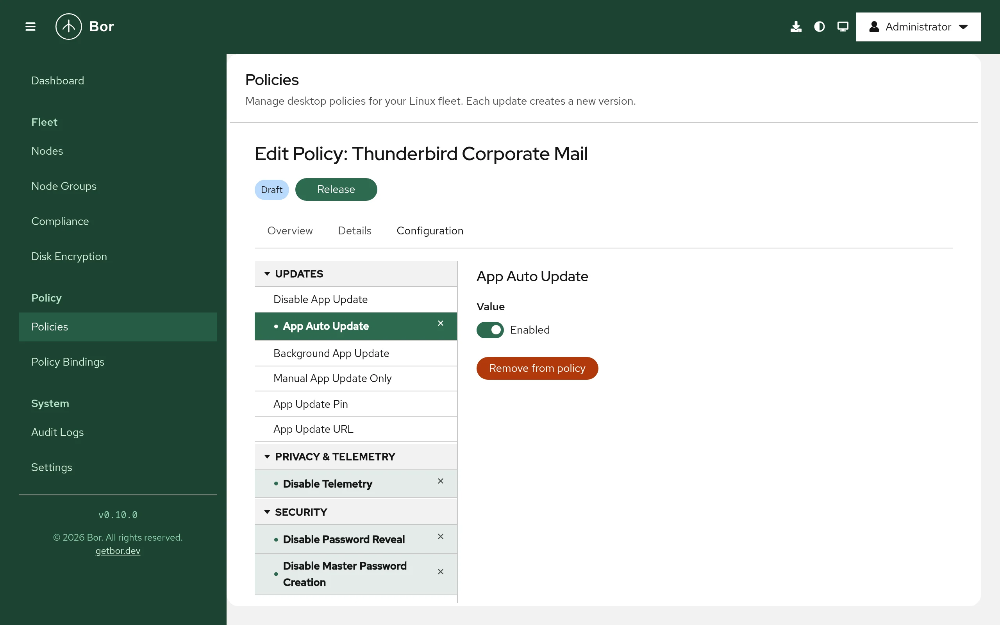

# Thunderbird

The **Thunderbird** policy type manages Mozilla Thunderbird through the same
enterprise policy mechanism Firefox uses: Bor writes a `policies.json` file
that Thunderbird reads at startup and applies to every profile on the node.
This page describes the available settings, the files on the endpoint, the
editor, merging behavior and how to verify the result.

!!! note
    The Thunderbird type manages application policies (updates, security,
    add-ons, network). It does not create or configure mail accounts.

## What it controls

| Group | Settings |
|---|---|
| Updates | **Disable App Update**, **App Auto Update**, **Background App Update**, **Manual App Update Only**, **App Update Pin**, **App Update URL** |
| Privacy & Telemetry | **Disable Telemetry** |
| Security | **Disable Password Reveal**, **Disable Master Password Creation**, **Primary Password**, **Password Manager Enabled**, **Offer To Save Logins**, **Offer To Save Logins Default**, **Disable Security Bypass**, **SSLVersion Min**, **SSLVersion Max** |
| Restrictions | **Block About Addons**, **Block About Config**, **Block About Profiles**, **Block About Support**, **Disable Safe Mode** |
| Developer Tools | **Disable Developer Tools** |
| Add-ons | **Disable System Addon Update**, **Extension Update**, **Extensions** (install, uninstall and locked lists) |
| Network | **DNSOver HTTPS**, **Proxy**, **Hardware Acceleration**, **Network Prediction**, **Captive Portal** |
| General | **Prompt For Download Location**, **Default Download Directory**, **Download Directory**, **Disable Builtin PDFViewer**, **Requested Locales** |
| Cookies | **Cookies** (allow, block and session lists, behavior, lock) |
| Authentication | **Authentication** (SPNEGO, delegated and NTLM host lists, non-FQDN and proxy options, lock) |
| Search | **Search Engines** (add, remove, default, prevent installs) |

Every setting maps to the Thunderbird enterprise policy of the same name.
The server validates **SSLVersion Min** / **SSLVersion Max** (`tls1`,
`tls1.1`, `tls1.2`, `tls1.3`), the proxy **Mode** (`none`, `system`,
`manual`, `autoDetect`, `autoConfig`) and the DNS-over-HTTPS provider URL
(`http` or `https`).

## Files on the endpoint

| Installation | File | Agent config key |
|---|---|---|
| Distribution package | `/etc/thunderbird/policies/policies.json` | `thunderbird.policies_path` |
| Flatpak (`net.thunderbird.Thunderbird`) | `/var/lib/flatpak/extension/net.thunderbird.Thunderbird.systemconfig/<arch>/stable/policies/policies.json` | `thunderbird.flatpak_policies_path` |

`<arch>` is `x86_64` on amd64 and `aarch64` on arm64 nodes.

The file has the same layout as the Firefox one: a `_comment` key that marks
it as managed by Bor and a `policies` object with the merged settings.
Writes are atomic, the file mode is `0644` and missing directories are
created.

Before the first write the agent saves any existing system file as
`policies.json.bor-backup`. When the last Thunderbird policy stops applying,
the original is restored (or the file is deleted if there was none). The
Flatpak copy is deleted.

To change a path or switch off the Flatpak copy, edit `/etc/bor/config.yaml`
and restart the agent:

```yaml
thunderbird:
  policies_path: /etc/thunderbird/policies/policies.json
  flatpak_policies_path: ""
```

The Flatpak write is best effort: if it fails, the agent logs a warning and
still reports the policy as deployed.

## Create a Thunderbird policy

{ loading=lazy }

1. Go to **Policies** and click **Create a policy**.
2. Choose **Thunderbird** on the **Type** step and fill in **Name** and
   **Description** on the **Details** step.
3. On the **Configuration** step pick settings from the tree. A selected
   setting is only a preview until you change its value or click
   **Add to policy**; **Remove from policy** takes it out again.
4. Review, create and release the policy, then bind it to a node group
   (see [bindings](../user-guide/bindings.md)).

Value editors work the same as for [Firefox](firefox.md#create-a-firefox-policy):
switches for on/off settings, drop-down lists for fixed values, one item
per line for lists and one field per sub-setting for composite settings.

## Examples

### Disable telemetry and lock updates to a version

| Group | Setting | Value |
|---|---|---|
| Privacy & Telemetry | **Disable Telemetry** | Enabled |
| Updates | **App Update Pin** | `128.` |

```json
"DisableTelemetry": true,
"AppUpdatePin": "128."
```

**App Update Pin** keeps Thunderbird on the given version prefix when it
updates itself.

### Require TLS 1.2 or newer

Group **Security**: set **SSLVersion Min** to `tls1.2`.

```json
"SSLVersionMin": "tls1.2"
```

### Enable Kerberos single sign-on for internal servers

Group **Authentication**, setting **Authentication**:

| Field | Value |
|---|---|
| SPNEGO | `.example.com` |
| Locked | Yes |

This lets Thunderbird use Kerberos (SPNEGO) with servers under
`example.com` and prevents users from changing the list.

## How multiple Thunderbird policies are merged

Merging works exactly as for [Firefox](firefox.md#how-multiple-firefox-policies-are-merged):
composite settings are merged field by field, lists are concatenated, and
when two policies set the same single value differently the result is not
defined. Binding priority is not used. Keep each setting in one policy.

## What users see

Thunderbird reads its policies at startup. After a change the agent can
notify logged-in users to restart Thunderbird (**Settings -> Agent
Notifications**, **Thunderbird policy notification message**).

Thunderbird shares the Firefox policy engine, including the
`about:policies` page that lists the active policies and any errors.
Locked preferences cannot be changed in the Thunderbird settings.

## Verify on the node

```bash
sudo cat /etc/thunderbird/policies/policies.json
python3 -m json.tool /etc/thunderbird/policies/policies.json > /dev/null && echo OK
sudo journalctl -u bor-agent | grep -i thunderbird
```

The agent logs `Thunderbird policies synced to ...` after a successful
sync, and the policy is reported **Compliant** with the message `Deployed`.

## Troubleshooting

**The policy is compliant but Thunderbird does not apply it.** Compliance
only confirms that the file was written. Restart Thunderbird and look at
`about:policies`; settings that the installed version does not support are
listed under **Errors**. If your Thunderbird build reads its policies from a
different location, change `thunderbird.policies_path`.

**Edits to `policies.json` are reverted.** The file is tamper-protected; the
agent restores it and logs a `tamper_detected` event in the
[audit log](../user-guide/audit-log.md).

**Non-compliant with "failed to sync Thunderbird policies".** The message
includes the file system error. Check `sudo journalctl -u bor-agent`.
