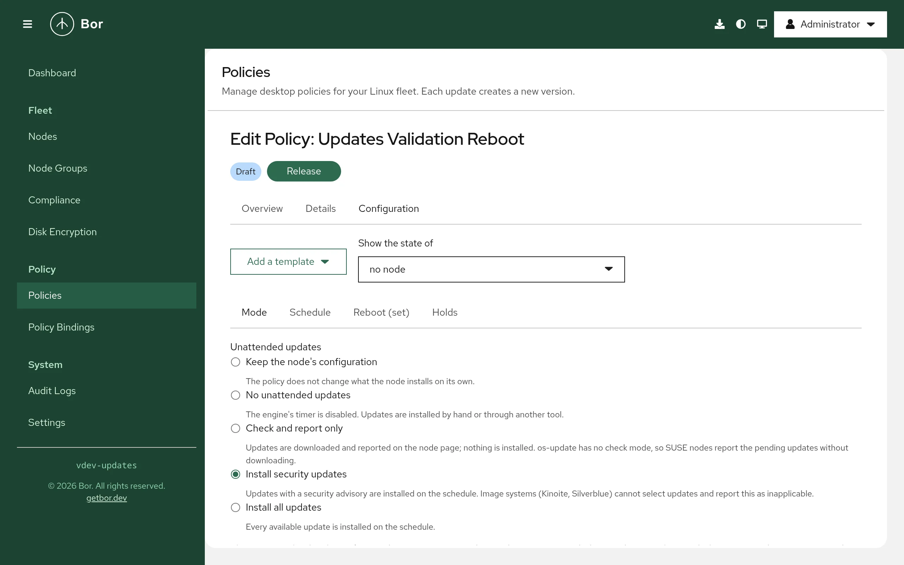

# Software updates

The **Software updates** policy type (technical name `Updates`) manages
the unattended update mechanism of every supported distribution and the
reboot that follows updates: what a node installs without a person, on
which schedule, which packages are held back, and when the node restarts.
Every node reports the updates it can install, with their advisories, and
whether it needs a reboot. This page explains what the agent changes on
the endpoint, how to build a policy in the editor, how several policies
are merged, and how to verify and troubleshoot the result.

!!! note "The Package type is for named packages"
    The [Package](packages.md) type manages repositories and the state of
    named packages (installed, latest, removed). The Software updates type
    manages everything else: the distribution's own update engine and the
    reboot. The two work together; a package the Package type keeps at
    *latest* is updated on every sync regardless of the update schedule.

## What it controls

- **Mode** - what the node installs on its own: nothing (the engine's
  timer is off), **check only** (download and report), **security
  updates** or **all updates**.
- **Schedule** - when the engine runs, as a systemd calendar expression
  with a random delay to spread a fleet, written as a drop-in of the
  distribution's timer.
- **Reboot** - every engine's own reboot is switched off and the agent
  decides: never, when an update needs it, or after every run; within a
  daily window; only when nobody is logged in, unless the reboot has been
  pending for a number of days; with a desktop warning before a reboot
  that affects users.
- **Holds** - packages the engine must not upgrade.
- **Engine** - the engine package is installed when missing, and a node
  without an engine can count as non-compliant.
- **Limits** - compliance thresholds in days: a security update pending
  longer than the limit, a reboot pending longer than the limit, or
  package metadata older than the limit makes the node non-compliant.
- **Firmware** - fwupd's daily metadata refresh, and whether pending
  firmware updates count against compliance. Firmware is never installed
  by policy.

Snap packages are out of scope: Bor does not manage snapd.

The engine per distribution:

| Distribution | Engine | Configuration Bor writes | Timer |
|---|---|---|---|
| Fedora 41 and later | `dnf5-plugin-automatic` | `/etc/dnf/automatic.conf` | `dnf5-automatic.timer` |
| RHEL 8 to 10, Rocky, AlmaLinux, CentOS Stream | `dnf-automatic` | `/etc/dnf/automatic.conf` | `dnf-automatic.timer` |
| Debian, Ubuntu | `unattended-upgrades` | `/etc/apt/apt.conf.d/90bor-updates` | `apt-daily-upgrade.timer` |
| openSUSE Leap 15.6 and 16, Tumbleweed, SLES 16 | `os-update` | `/etc/os-update.conf` and zypper locks | `os-update.timer` |
| Fedora Kinoite, Silverblue, IoT (rpm-ostree) | rpm-ostree's automatic update policy | `/etc/rpm-ostreed.conf` | `rpm-ostreed-automatic.timer` |

Image systems update as a whole: **security updates** reports as
inapplicable there and the node stays in check mode, and holds do not
apply.

Everything the agent changes is recorded in
`/var/lib/bor/agent/updates-state.json` (the original configuration file
is kept under `/var/lib/bor/agent/updates-backups`) and restored when the
node leaves every policy.

## Endpoint prerequisites

- **A package manager the agent knows**: dnf, apt, zypper or rpm-ostree.
  Other nodes report the policy as inapplicable (or non-compliant with
  **Treat nodes without an engine as non-compliant**).
- **The engine package** (`dnf5-plugin-automatic`, `dnf-automatic`,
  `unattended-upgrades`, `os-update`): installed through PackageKit when
  **Install the engine when it is missing** is on, which is the default.
- **systemd** reachable on the system bus, for the timer and the drop-in.
- **A reboot signal.** The agent compares the running kernel with the
  newest installed one everywhere, and asks `needs-restarting` (dnf),
  `needrestart` and `/run/reboot-required` (Debian, Ubuntu), `zypper
  needs-rebooting` (SUSE) or the staged deployment (rpm-ostree). The
  agent's deb package depends on `needrestart`; the rpm package recommends
  the dnf plugins.
- **loginctl** for the logged-in users rule, and a desktop session with
  a notification server for the warning.

## Agent configuration

| Key | Default | Description |
|-----|---------|-------------|
| `updates.state_path` | `/var/lib/bor/agent/updates-state.json` | Record of every original state, restored when the node leaves every policy. |
| `updates.backup_dir` | `/var/lib/bor/agent/updates-backups` | Backups of the engine configuration files Bor replaced. |
| `updates.reconcile_interval` | `10m` | Interval of the pass that re-asserts the timer and the configuration while a policy applies; `0` disables it. |
| `updates.inventory_interval` | `1h` | How often the node re-sends its update state while connected. |
| `updates.reboot_check_interval` | `1m` | How often the reboot rule runs while a policy applies. |
| `updates.tool_timeout` | `10m` | Maximum run time of one engine or package manager call. |
| `updates.allow_install` | `true` | Let policies install the engine package. With `false` a missing engine reports inapplicable. |
| `updates.allow_reboot` | `true` | Let policies reboot the node. With `false` reboot rules report inapplicable and the node never reboots on its own. |

## Create a Software updates policy

1. Go to **Policies -> Create a policy** and choose **Software updates**
   in the **System & security** group.
2. Pick a node from **Show the state of** at the top of the editor to see
   its engine, pending updates and reboot state.
3. Fill the tabs described below, or start from a template, review the
   summary and save. Release the policy and bind it to a node group; a
   pilot group with a tighter schedule is the usual first step.

{ loading=lazy }

### Editor sections

**Mode**
:   The five modes with one sentence each, and three switches: install
    the engine when missing, treat nodes without an engine as
    non-compliant, remove dependencies updates left unused.

**Schedule**
:   A preset or a calendar expression, the random delay and whether a run
    missed while the node was off is caught up.

**Reboot**
:   The reboot rule, the window, the logged-in users switch, the force
    period, the warning minutes and the message. Allowing forced reboots,
    or reboots with users logged in, asks for a confirmation because
    unsaved work is lost.

**Holds**
:   Package names or patterns with `*` and `?`.

**Limits**
:   The three age thresholds, in days; 0 leaves a threshold unchecked.
    The ages are measured on the node: how long each security update has
    been pending there since the agent first saw it, since when a reboot
    is pending, and when the engine last refreshed its metadata.

**Firmware**
:   Keep, enable or disable `fwupd-refresh.timer`, and whether pending
    firmware updates are reported as non-compliant.

**Templates**: *Workstations: security updates nightly, reboot in the
window*, *Servers: all updates, no automatic reboot*, *Check only: report
pending updates*.

## Setting reference

| Setting | Field | Values | What the agent does |
|---|---|---|---|
| Mode | `mode` | `UPDATES_MODE_OFF`, `_CHECK`, `_SECURITY`, `_ALL` | renders the engine configuration and enables or disables its timer |
| Schedule | `schedule.onCalendar`, `.randomizedDelay`, `.persistent` | calendar expression, time span, bool | writes `<timer>.d/90-bor.conf` |
| Reboot | `reboot.policy` | `UPDATES_REBOOT_NEVER`, `_WHEN_NEEDED`, `_ALWAYS` | runs the reboot rule every minute |
| Reboot window | `reboot.window` | `HH:MM-HH:MM`, local time, wraps past midnight | reboots only inside the window |
| Logged-in users | `reboot.onlyWithoutSessions` | bool, default on | no reboot while a graphical or SSH session exists |
| Force | `reboot.forceAfterDays` | 0 to 365 | reboots despite users once the reboot has been pending this long |
| Warning | `reboot.warnMinutes`, `reboot.message` | 0 to 1440, one line | desktop notification before a reboot that affects users |
| Hold | `hold[]` | name or pattern | `excludepkgs` (dnf), `Package-Blacklist` (apt), `zypper addlock` |
| Unused dependencies | `removeUnusedDependencies` | bool | apt `Remove-Unused-Dependencies` |
| Engine | `installEngine`, `requireEngine` | bool | installs the engine package; non-compliant without one |
| Limits | `limits.securityMaxAgeDays`, `.rebootMaxAgeDays`, `.checkMaxAgeDays` | 0 to 3650 days | evaluates the age items after every inventory scan |
| Firmware | `firmware.refreshMetadata`, `firmware.reportPending` | bool | enables or disables `fwupd-refresh.timer` (its state is recorded for the restore); reports pending firmware |

### Example: workstations

```json
{
  "mode": "UPDATES_MODE_SECURITY",
  "schedule": {"onCalendar": "*-*-* 02:00", "randomizedDelay": "1h", "persistent": true},
  "reboot": {"policy": "UPDATES_REBOOT_WHEN_NEEDED", "window": "03:00-05:00", "forceAfterDays": 7, "warnMinutes": 10},
  "hold": ["linux-image-*"]
}
```

### Example: servers

```json
{
  "mode": "UPDATES_MODE_ALL",
  "schedule": {"onCalendar": "*-*-* 04:00", "randomizedDelay": "30m"},
  "reboot": {"policy": "UPDATES_REBOOT_NEVER"}
}
```

## Merge behavior

Several Software updates policies bound to one node merge per key by
binding priority. On equal priority the mode that installs more wins (all
over security over check over off), the reboot rule that reboots more
wins as a whole (always over when needed over never, with its window and
switches), holds are a union, **Remove unused dependencies** and
**Treat nodes without an engine as non-compliant** are on when any policy
sets them, and the engine is installed unless a policy switches it off.
Two schedules with different expressions at equal priority are a conflict:
neither applies and both policies report an error item. The fwupd refresh
setting of the highest priority policy applies; pending firmware is
reported when any policy asks. Limits are evaluated per policy: each
policy reports its own thresholds, so two policies with different limits
both report, each against its own.

## What the agent changes on the node

| Path or state | Written by | Watched |
|---|---|---|
| `/etc/dnf/automatic.conf`, `/etc/os-update.conf`, `/etc/rpm-ostreed.conf` (the original is backed up and restored) | the mode | yes |
| `/etc/apt/apt.conf.d/90bor-updates` | the mode (apt lists are cleared and re-declared there) | yes |
| `/etc/systemd/system/<timer>.d/90-bor.conf` | the schedule | yes |
| the engine timer's enabled state | the mode | reconciled |
| `fwupd-refresh.timer`'s enabled state | the firmware setting | reconciled |
| zypper package locks | holds on SUSE | reconciled |
| `/var/lib/bor/agent/updates-state.json`, `/var/lib/bor/agent/updates-backups/` | every original state | yes |

Every file Bor writes starts with the line `Managed by Bor - changes are
overwritten` (after the comment marker of its syntax).

## The reboot

A reboot is **pending** when any signal says so: a newer kernel than the
running one, `needs-restarting` or `needrestart`, `/run/reboot-required`,
`zypper needs-rebooting`, or a staged rpm-ostree deployment. The agent
records when it first saw it, shows it on the node page and in the
**Reboot rule** item, and with **Reboot when an update needs it**:

1. waits for the window;
2. waits until nobody is logged in, unless the reboot has been pending
   longer than **Force after days**;
3. warns logged-in users through a desktop notification **Warning
   minutes** before a forced reboot;
4. reboots through `rebootmgr` when SUSE's reboot manager runs, otherwise
   `systemctl reboot`, and records the reboot as a tamper-style event with
   the resource `updates:reboot` and the reasons.

**Reboot after every update run** does the same after any run that
installed something. **Never reboot** only reports.

## Drift handling

Files Bor writes are guarded by the tamper watcher. The timer state is
re-asserted by the reconcile pass every `updates.reconcile_interval`;
each correction is a tamper event with the resource `updates:timer:<unit>`
or `updates:config:<file>`.

## Removal and restore

When a policy is unbound, archived or deleted, the agent restores the
engine's configuration from its backup (or removes the file it created),
removes the schedule drop-in, returns the timer to the enabled state it
had, and removes the zypper locks it added. The state file keeps only
the reboot bookkeeping (since when a reboot is pending) and goes away
with the next reboot. The engine package stays installed.

## The node details

The **Software updates** section of a node shows the engine and its
effective mode, who configured it (Bor, the vendor defaults or someone
else), the timer state, the last check and the last run with its outcome,
the running and newest installed kernel, whether a reboot is pending and
why, and the pending updates with their advisories, severities and CVE
ids, searchable and filterable to security updates, with pending
firmware updates when fwupd knows of any. Other update mechanisms the
node runs (PackageKit's background refresh, YaST's online update job)
are named.

Holders of `updates:operate` get three actions there:

- **Check for updates** refreshes the package metadata (`dnf makecache`,
  `apt-get update`, `zypper refresh`, `rpm-ostree upgrade --check`) and
  reports the inventory again.
- **Install updates now** runs the engine once with the policy's mode,
  the way its timer would (`dnf5 automatic`, `dnf-automatic`,
  `unattended-upgrade`, `os-update`, `rpm-ostree upgrade`), waits for it
  and shows the tail of its output. Refused when the policy's mode
  installs nothing. An engine run can take several minutes; the request
  waits up to fifteen.
- **Reboot** restarts the node at once when nobody is logged in. With a
  user logged in it is refused unless forced: then every graphical
  session gets a desktop warning and the node restarts after one minute
  (`shutdown -r +1`).

Every action is audit-logged as `updates.action` with the kind, the
outcome and the agent's message; a reboot also records a tamper-style
event with the resource `updates:reboot`. The agent refuses installs with
`updates.allow_install: false` and reboots with `updates.allow_reboot:
false`.

The nodes list has an **Updates** column (security updates pending, a
reboot pending, no engine, up to date) and a filter with the same values
plus *Not reported*. The dashboard's fleet overview counts the nodes with
security updates pending, with a reboot pending and without an engine,
each linking to the filtered list.

## Compliance

| Schema id | Compliant when |
|---|---|
| `updates:engine` | the engine is installed (inapplicable when the policy does not install it, non-compliant when it is required) |
| `updates:mode` | the configuration and the timer match the mode |
| `updates:schedule` | the drop-in is in place |
| `updates:reboot` | the reboot rule is applied; the message says since when a reboot is pending |
| `updates:hold` | the hold is in the configuration or the lock exists |
| `updates:last-run` | the engine's last run succeeded (error with its message otherwise) |
| `updates:security-age` | no security update has been pending on the node longer than the limit; the message names the oldest ones. Inapplicable until the first inventory scan |
| `updates:reboot-age` | no reboot has been pending longer than the limit |
| `updates:check-age` | the engine refreshed its metadata within the limit; non-compliant when no refresh is found |
| `updates:firmware` | `refresh`: the fwupd timer is in the requested state; `pending`: no firmware update is pending (inapplicable without fwupd) |

The age items read what the inventory scan recorded (every
`updates.inventory_interval`, after every sync and after every action),
so a scan is followed by a compliance report when a policy sets a limit.
On the Compliance page the mode and the age items carry the CIS control
*Ensure updates, patches, and additional security software are
installed* (1.2.2.1 in CIS Red Hat Enterprise Linux 9 Benchmark v2.0.0
and CIS Ubuntu Linux 24.04 LTS Benchmark v1.0.0).

## Verify on the endpoint

```bash
# The engine's configuration and timer
cat /etc/dnf/automatic.conf /etc/apt/apt.conf.d/90bor-updates /etc/os-update.conf 2>/dev/null
systemctl list-timers 'dnf*' 'apt-daily*' 'os-update*' 'rpm-ostreed*'
cat /etc/systemd/system/*/90-bor.conf

# Pending updates and the reboot signals
dnf5 -C check-upgrade; dnf5 needs-restarting
apt list --upgradable; needrestart -b; cat /run/reboot-required.pkgs
zypper list-patches; zypper needs-rebooting
rpm-ostree status

# What the agent recorded
cat /var/lib/bor/agent/updates-state.json
journalctl -u bor-agent | grep -i "software updates"
```

## Troubleshooting

**The engine item says the package is not available.**
The node's repositories do not carry it, or PackageKit is not running.
Install it by hand or add the repository with a Package policy.

**The last run item is an error with "Lock could not be acquired".**
Another package manager held the lock when the engine ran; the next run
retries. PackageKit keeps the lock for a while after its own transactions.

**A reboot is pending but the node never reboots.**
Check the **Reboot rule** item and the node page: the policy may say
never, the window may not have come, or a user is logged in and the force
period has not passed. The agent also waits ten minutes after a reboot it
started itself.

**Security updates on Kinoite reports inapplicable.**
Image systems cannot select updates; choose **all updates** for them, in
a separate policy bound to their group if the rest of the fleet installs
security updates only.

## Security considerations

- A hold keeps a vulnerable package on every node of the group. Creating,
  saving, releasing or importing a policy with holds is audited as
  `policy.updates_hold` with the patterns.
- Unattended reboots can lose users' work. Forced reboots and reboots with
  users logged in are off by default, need a confirmation in the editor,
  always warn users first, and can be refused per node with
  `updates.allow_reboot: false`.
- The agent never runs administrator-supplied commands for this type; it
  configures the distribution's engine and runs that engine's own units.
- The inventory carries package names, versions and advisory ids, no user
  data; the pending list is capped at 200 entries per node.
- The node actions change the node at once and need `updates:operate`,
  which only Super Admin holds on a new installation; every request is
  audited with the actor and the outcome. A forced reboot warns the
  users first and is refused by nodes with `updates.allow_reboot: false`.
