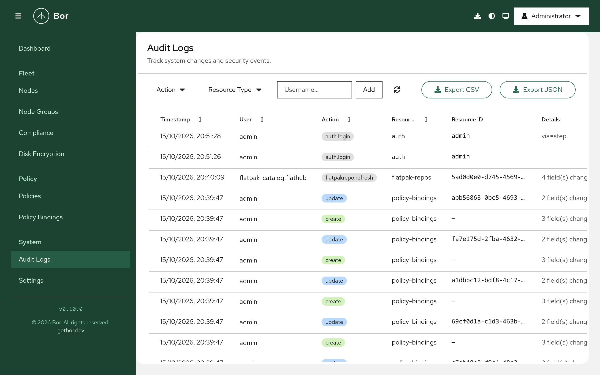

# Audit log

Bor records security-relevant activity as structured audit events: every
change made through the web UI or REST API, sign-ins, permission denials,
and tampering detected by agents. Events are stored in the database, shown
on the **Audit Logs** page, can be exported, and can be forwarded in real
time to a SIEM over syslog. This page explains what is logged, how to
search and export the log, and how to configure retention, IP
anonymization and syslog forwarding.

Open it from **System -> Audit Logs** in the sidebar. Viewing the log
requires `audit_log:view`; exporting it requires `audit_log:export`.

## What is logged

| Category | Recorded when | Typical action / resource type |
|---|---|---|
| Changes | Every successful (`2xx`) state-changing API request (`POST`, `PUT`, `PATCH`, `DELETE`): policies, bindings, nodes, node groups, users, roles, user groups, role assignments, settings, Flatpak repositories, Tang servers. | `create`, `update`, `delete` on `policies`, `nodes`, `node-groups`, `users`, ... |
| Authentication | Successful and failed sign-ins, logouts, MFA enrollment and removal, re-authentication for privileged actions. | `auth.login`, `auth.logout`, `auth.mfa.enroll`, `auth.mfa.disable`, ... |
| Authorization | A request refused because the user lacks a permission, including privilege-escalation attempts. | `access_denied` |
| Role removals | Role assignments removed. | `revoke_role` |
| Compliance reports | A compliance report was generated, downloaded, deleted or purged by retention, or its stored bundle no longer matched its hash. Generation and deletion events carry the report's SHA-256. | `report.generate`, `report.download`, `report.delete`, `report.purge`, `report.integrity_failure` on `compliance_report` |
| Tampering | An agent detected and reverted a local change to a file it manages. The event names the node, the file and the processes that held the file. | `tamper_detected` on `managed_file` |
| Unit drift | A reconcile pass of the Services & timers policy found a managed systemd unit stopped, started, enabled, disabled or masked by hand and put it back. The event names the node, the unit (`unit:bluetooth.service`), what was found and done, and, when the journal has a `sudo` or polkit record naming the unit, who did it. | `tamper_detected` on `systemd_unit` |
| Unit actions | An operator started, stopped or restarted a unit on a node from the node details. The event names the node, the unit, the action and the outcome the agent reported (`success`, `failed`, `not_connected`, `timeout`). | `systemd.unit_action` on `node` |
| Policy transfer | Policy export and completed policy import. | `policy.export`, `policy.import` |
| Disk encryption | Recovery key escrow, reveal (and refused reveals), rotation and related events. | `recoverykey.*`, `luks.*` |

Each event records the time, the actor (username and user ID, or the node
for agent events), the action, the resource type and ID, the source IP
address and details. For API changes the details hold the request body with
sensitive fields replaced by `[REDACTED]`: any field whose name contains
`password`, `passwd`, `secret`, `token`, `credential`, `passphrase`,
`private_key`, `api_key`, `jwt` or `recovery_key` (and similar variants)
is never stored.

Read-only requests (`GET`) are not logged, except where noted above.

## The Audit Logs page

{ loading=lazy }

The table shows **Timestamp**, **User**, **Action**, **Resource Type**,
**Resource ID**, **Details** and **IP Address**. **Timestamp**, **User**,
**Action** and **Resource Type** can be sorted.

Select a row to open the event details:

- **Identity** - the **User** (or **Node** for tamper events) and **IP
  Address**.
- **Event** - **Action**, **Resource Type**, **Resource Name** and
  **Resource ID**.
- For tamper events, **Tampered File** and **Processes at Detection
  Time**; for unit drift, **Tampered Unit**, what was found and restored,
  and **Attributed To** (the `sudo` or polkit record naming the unit, or
  "no actor identified" when a root shell left none).
- **Changed Values** or **Details** - the recorded request data.

### Filter the log

- **Action** - add one or more actions, for example `create`, `delete`,
  `access_denied` or `tamper_detected`.
- **Resource Type** - add one or more types, for example `policies`,
  `nodes`, `users`, `managed_file` or `systemd_unit`.
- **Username** - type a username and select **Add**.

Active filters appear as chips; remove one with its close button or use
**Clear all**. The refresh button reloads the list.

## Export the log

Select **Export CSV** or **Export JSON** to download `audit_logs.csv` or
`audit_logs.json`. The export contains all entries that match the active
action, resource type and username filters, not just the current page.

## Retention

Audit records older than the retention period are deleted automatically.
The purge runs at server start and then once a day.

| Setting | YAML (`/etc/bor/server.yaml`) | Environment variable | Default |
|---|---|---|---|
| Retention in days | `audit.retention_days` | `BOR_AUDIT_RETENTION_DAYS` | `365` |

Set it to `0` to keep audit records forever. Choose the value from your
legal and compliance requirements (for example GDPR data minimization on
one side and NIS2 incident-logging duties on the other). Forward events to
a SIEM if you need a longer or tamper-evident archive.

```yaml
audit:
  retention_days: 400
```

## IP anonymization

To reduce the personal data stored in audit records, the server can
truncate client IP addresses before storing them: IPv4 addresses to their
`/24` network (for example `192.0.2.0`) and IPv6 addresses to their `/48`
network (for example `2001:db8:1::`).

This setting is available only as an environment variable:

```bash
# /etc/bor/server.env
BOR_AUDIT_ANONYMIZE_IPS=true
```

Restart the server after changing it (`sudo systemctl restart
bor-server`). It affects new records only. Note that IP addresses are taken
from `X-Forwarded-For` or `X-Real-IP` when present, so a reverse proxy in
front of Bor must set those headers for the logged address to be the
client's.

## Forward to a SIEM over syslog

The server can send every audit event, as it happens, to a syslog
receiver. Messages use RFC 5424 framing with the application name `Bor`,
and the body in one of two formats:

| Format | Standard | Typical receivers |
|---|---|---|
| `cef` | ArcSight Common Event Format (vendor `Vute Tech`, product `Bor`) | IBM QRadar, ArcSight, Splunk with a CEF add-on, most SIEMs |
| `ocsf` | Open Cybersecurity Schema Framework 1.3.0, as JSON | Microsoft Sentinel, Splunk OCSF, AWS Security Lake |

In OCSF, API changes use class API Activity (`6003`), user account changes
use Account Change (`3002`) and tamper events use File System Activity
(`1001`); a unit drift event carries the unit (`unit:<name>`) as the file
path and the account of the drift in the message. In CEF a unit drift
carries the unit in `cs1` (labelled `resource`) instead of `filePath`.

### Configuration

| YAML key (under `audit.syslog`) | Environment variable | Default | Meaning |
|---|---|---|---|
| `enabled` | `BOR_AUDIT_SYSLOG_ENABLED` | `false` | Turn forwarding on. |
| `network` | `BOR_AUDIT_SYSLOG_NETWORK` | `udp` | `udp`, `tcp` or `tcp+tls`. |
| `addr` | `BOR_AUDIT_SYSLOG_ADDR` | `localhost:514` | Receiver `host:port`. |
| `format` | `BOR_AUDIT_SYSLOG_FORMAT` | `cef` | `cef` or `ocsf`. |
| `facility` | `BOR_AUDIT_SYSLOG_FACILITY` | `16` | Syslog facility 0-23 (`16` is `local0`). |
| `tls_ca` | `BOR_AUDIT_SYSLOG_TLS_CA` | empty | PEM CA file used to verify the receiver for `tcp+tls`. Empty means the system trust store. |

Example:

```yaml
audit:
  syslog:
    enabled: true
    network: "tcp+tls"
    addr: "siem.example.com:6514"
    format: "ocsf"
    facility: 16
    tls_ca: "/etc/bor/siem-ca.pem"
```

Restart the server after changing the configuration. The log shows `Audit
syslog sink enabled` with the transport, address and format.

Transport notes:

- `udp` has no delivery guarantee. Use it only on trusted networks.
- `tcp` reconnects and retries once if a write fails.
- `tcp+tls` is `tcp` with TLS 1.2 or later and server certificate
  verification. Use it whenever events cross an untrusted network.

Events are queued in memory (512 events) and sent asynchronously, so a
slow receiver never delays the web UI. If the queue is full or delivery
fails after the retry, the event is dropped from the syslog stream and a
warning is written to the server log; the database copy is not affected.

### Verify forwarding

1. Make a harmless change in the web UI, for example edit the description
   of a node group.
2. Check that your receiver got a line similar to:

    ```text
    <134>1 2026-10-15T10:23:45Z bor Bor - - - CEF:0|Vute Tech|Bor|...
    ```

    With `ocsf`, the message body is a JSON object with `class_uid` 6003.
3. If nothing arrives, check `sudo journalctl -u bor-server` for
   `audit SyslogSink` warnings and confirm the receiver port is reachable
   from the server.
