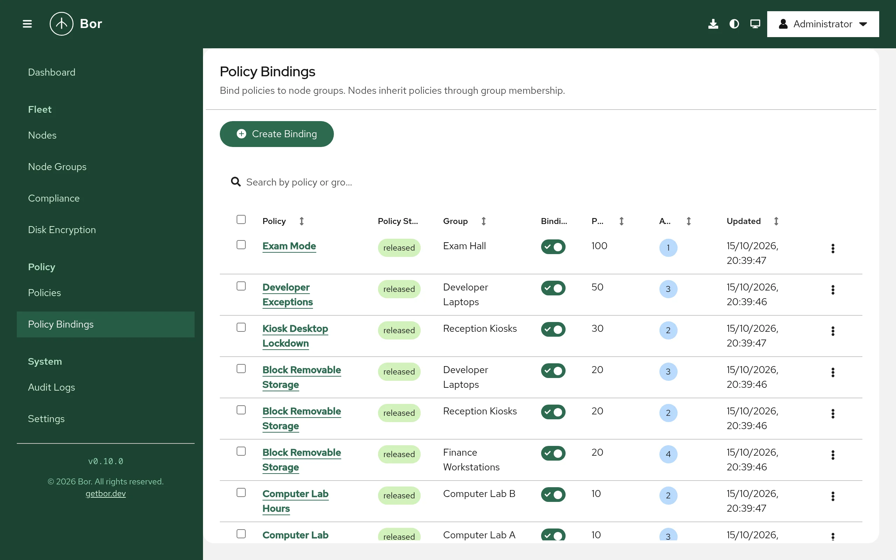

# Policy bindings

A binding connects one policy to one node group. Bindings are the only way
policies reach nodes: a node receives a policy when the policy is released
and has an enabled binding to at least one of the node's groups. This page
explains how to create, enable, disable and delete bindings, how binding
priority resolves conflicts between policies, and what agents receive when
bindings change.

Open it from **Policy -> Policy Bindings** in the sidebar. Viewing bindings
requires `binding:view`.

## The binding list

{ loading=lazy }

| Column | Content |
|---|---|
| **Policy** | The policy name. Select it to open the policy. Sortable. |
| **Policy State** | `draft`, `released` or `archived`. |
| **Group** | The node group. Sortable. |
| **Binding State** | A switch: on means `enabled`, off means `disabled`. |
| **Priority** | The binding priority (see below). Sortable. |
| **Affected Nodes** | Number of nodes in the group. Sortable. |
| **Updated** | Time of the last change. Sortable. |

Use **Search by policy or group...** to filter. The row menu offers **Edit**
and **Delete**; tick several rows to use **Actions** for **Edit** (one row
only) and **Delete**.

## Create a binding

1. Select **Create Binding**.
2. Choose the **Policy**. The list shows every policy with its state in
   brackets.
3. Choose the **Node Group**. The list shows the node count of each group.
4. Set the **Priority** (default `0`). See
   [Priority and conflicts](#priority-and-conflicts).
5. Select **Create**.

A new binding is always created **disabled**, whatever the **Binding
State** switch in the form shows, so creating a binding never changes a
node by itself. [Enable it](#enable-or-disable-a-binding) when you are
ready.

You can bind a draft policy, but the binding cannot be enabled until the
policy is released. Creating bindings requires `binding:create`.

!!! tip "From the create-policy wizard"
    After creating a policy, **Assign to a node group** on the wizard's
    success page opens this form with the policy already selected.

## Enable or disable a binding

Use the switch in the **Binding State** column:

- **Enabling** a binding delivers the policy to every node in the group.
  When the group has nodes, Bor asks first (**Enable this binding?**) and
  shows how many nodes are affected; select **Enable**. The policy must be
  **released**; otherwise the server refuses with `binding can only be
  enabled when policy is released`.
- **Disabling** a binding stops delivering the policy to the group. Nodes
  that get the policy through no other enabled binding remove its
  settings.

You can also change the state and the priority with **Edit** (the policy
and node group of an existing binding cannot be changed; delete and
recreate the binding instead), then select **Save**.

Enabling, disabling, editing and deleting bindings require `binding:toggle`.

## Delete a binding

Select **Delete**, type the confirmation text shown in the dialog (`<policy
name> to <group name>`, or `Yes` for several bindings) and select
**Delete**. Deleting an enabled binding has the same effect on nodes as
disabling it.

Bindings are also removed automatically when their policy or their node
group is deleted.

## What agents receive

Agents keep a streaming connection to the server and receive changes in
real time. When you enable, disable or delete an enabled binding, or change
its priority, the server tells every connected agent in that node group to
fetch a fresh snapshot of its policies. The agent then applies the new set:
it writes the settings of newly delivered policies and removes the
settings of policies it no longer receives. Each agent reports the result
per policy, visible on the [Compliance](compliance.md) page within seconds.

The same happens when you change the state of a released policy that has
enabled bindings. Offline agents receive the current set when they
reconnect.

!!! note
    A node's group memberships are read when its agent connects. After
    adding a node to a group or removing it from one, restart the agent
    (`sudo systemctl restart bor-agent`) or wait for its next reconnect. See
    [Nodes](nodes.md#move-nodes-between-groups).

## Priority and conflicts

A node often receives several policies of the same type, for example a
baseline Firefox policy from `All Desktops` and a stricter one from
`Finance`. The agent merges them into one configuration per type. Binding
priority is an integer; it influences the merge for some policy types.

**Which priority counts**

If the same policy reaches a node through several enabled bindings (the
node is in several bound groups), the highest of those binding priorities
is used for that policy on that node.

**How each policy type uses priority**

| Policy type | Merge behavior |
|---|---|
| **Dconf** | Policies are applied in ascending priority, so for the same schema, path and key the policy with the **higher** priority wins. |
| **Package** | Applied in ascending priority; for the same package or repository the **higher** priority wins. |
| **Flatpak apps** | Higher priority wins: remotes are de-duplicated by name and apps by app ID and scope, keeping the higher-priority entry. Auto-update and uninstall-unused are enabled if any policy enables them. Installation, update interval and operation timeout come from the highest-priority policy that sets them. |
| **Firewall** | List settings (services, ports and so on) are combined from all policies and de-duplicated; boolean settings are on if any policy turns them on; the zone target comes from the **highest**-priority policy that sets it. |
| **Disk encryption** | `require_*` settings and recovery key escrow are on if any policy turns them on; the rotation interval takes the smallest non-zero value; everything else, including the Tang server list, comes from the **highest**-priority policy that sets it. |
| **Polkit** | Each policy is written to its own rules file named after its priority (`NNN-bor-<id>.rules`, zero-padded). polkitd evaluates rules files in alphabetical order and the first matching rule wins, so the policy with the **lower** priority number is evaluated first. |
| **Session Access** | All rules from all policies are combined; priority is not used. |
| **Firefox**, **Thunderbird**, **Chrome**, **Microsoft Edge**, **KDE Plasma** | All policies are merged into one file per product; priority is not used and the merge order is not defined. List values from several policies are combined. |

!!! warning "Avoid overlapping settings"
    For the types where priority is not used, do not configure the same
    setting in two policies that can reach the same node: which value wins
    is not defined. Keep such settings in a single policy, or make sure the
    groups that receive the conflicting policies do not overlap.

### Example

| Policy | Group | Priority |
|---|---|---|
| GNOME baseline (Dconf) | All Desktops | `0` |
| GNOME kiosk lock-down (Dconf) | Kiosks | `100` |

A node in both groups gets both policies. Where both set the same dconf
key, the kiosk value (priority `100`) wins; all other keys from the
baseline still apply.
