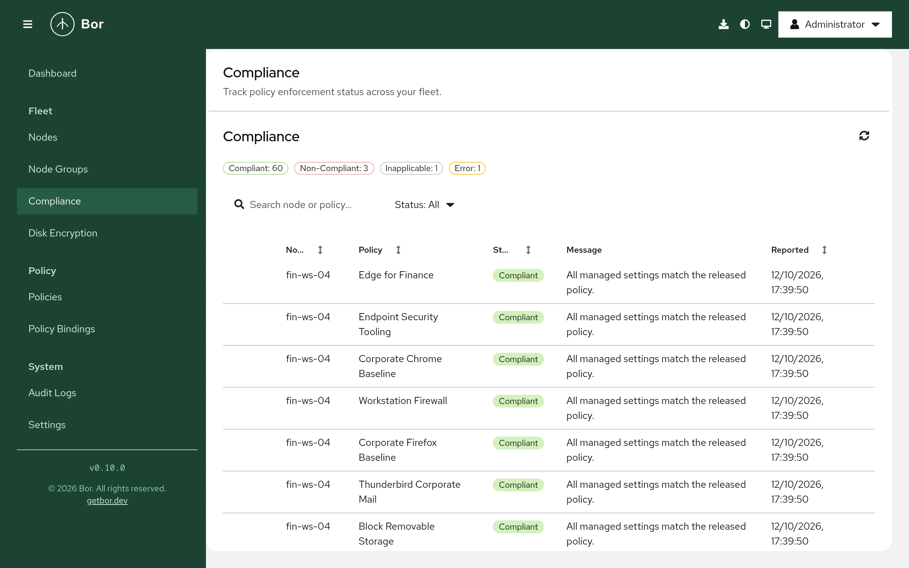

# Compliance

The **Compliance** page shows, for every node and every policy it receives,
whether the agent managed to enforce the policy. This page explains the
compliance states, how and when agents report them, and how to
troubleshoot a non-compliant result.

Open it from **Fleet -> Compliance** in the sidebar. Viewing compliance
requires `compliance:view`.

The page shows the current state only. To keep what the fleet looked
like at a point in time, generate a [compliance report](reports.md): it
freezes the results, the nodes' posture and the benchmark controls, and
can be downloaded as JSON and CSV.

## How agents report compliance

After the agent applies a policy type (on startup, when it receives a
policy change, and after restoring a tampered file), it checks the result
and sends one compliance report per policy to the server. The report
carries a status, a message and, for many policy types, a per-setting
breakdown. The server keeps the latest report for each node and policy, so
each row on the page reflects the most recent result.

Only current results are shown: a row appears only while the policy is
still delivered to the node through an enabled binding to one of its
groups. When you disable a binding or remove a node from a group, the
matching rows disappear.

Agents also watch the files they manage. If someone changes a managed file
on the node, the agent restores it immediately, reports the policy again,
and records a `tamper_detected` event in the [audit log](audit-log.md).

## Compliance states

| State | Meaning |
|---|---|
| **Compliant** | The policy was applied and the check confirmed the desired state. The message is often `Deployed`. |
| **Non-Compliant** | The policy was applied but the node does not match it, for example a setting could not be enforced or a package is not in the requested state. |
| **Error** | The feature is present on the node, but writing the configuration or running the check failed. The message contains the error. |
| **Inapplicable** | The policy or a setting does not apply to this node, for example a GNOME schema that is not installed, PackageKit missing on the node, or a dconf key that was overridden by a higher-priority policy. Inapplicable results do not count as failures. |
| **Unknown** | No conclusive result was reported. |

## The Compliance page

{ loading=lazy }

At the top, a chip per state shows how many results are in that state
(for example `Non-Compliant: 3`). Select a chip to show only that state;
select it again to show all. The refresh button reloads the results.

The table has these columns:

| Column | Content |
|---|---|
| **Node** | Node name. Sortable. |
| **Policy** | Policy name. Sortable. |
| **Status** | One of the states above. Sortable. |
| **Message** | The agent's summary message. |
| **Reported** | Time of the report. Sortable. |

Use **Search node or policy...** to find rows, or the **Status** filter in
the toolbar.

### Per-setting breakdown

Rows with details have an expand toggle. Expanding shows a table with one
line per **Key**, its **Status** and **Details**, for example:

- dconf keys (shown with their schema summary where known),
- polkit rules,
- Flatpak apps and Flatpak remotes,
- disk encryption items such as **Encryption**, **Cipher**, **Recovery
  key**, **TPM2 protector**, **Tang protector**, **TPM 2.0** and **Secure
  Boot**.

Use the breakdown to find exactly which setting failed in a policy with
many settings.

Items that correspond to a control of a security benchmark carry a label
with the control's number, for example **CIS RHEL 9 1.3.1.5** on the
SELinux mode item or **CIS Ubuntu 24.04 1.3.1.4** on an AppArmor profile
item; hovering the label shows the benchmark version and the control's
title. The numbers are those of the benchmark version named, and other
versions of the same benchmark number the same controls differently. The
labels are also part of the `controls` list of each item in the
compliance API, so an export can be grouped by control.

## Troubleshoot non-compliance

1. **Read the message and the breakdown.** Expand the row; the failing key
   and its details usually name the cause (missing schema, package not
   found, service not running, permission error).
2. **Check that the node is online.** On the [Nodes](nodes.md) page the node
   must be `online` to receive changes. An offline node keeps its last
   report until it reconnects.
3. **Check what the agent did.** On the node:

    ```bash
    sudo journalctl -u bor-agent --since "15 min ago"
    ```

    The agent logs each sync per policy type and any error it hit.
4. **Look for overlapping policies.** A setting marked **Inapplicable**
   with `Overridden by a higher-priority policy` is set differently by
   another policy that won the merge. See
   [Bindings](bindings.md#priority-and-conflicts).
5. **Check for local tampering.** Filter the [audit log](audit-log.md) by
   action `tamper_detected`. Repeated events for the same file mean
   something on the node keeps rewriting a managed file; the event lists
   the processes that held the file.
6. **Check prerequisites of the policy type.** Some types need software on
   the node (for example PackageKit for packages, firewalld for firewall
   policies, cryptsetup for disk encryption). See the page of the type
   under [Policy types](../policy-types/index.md).
7. **Force a fresh sync.** Restarting the agent re-applies all policies and
   reports again:

    ```bash
    sudo systemctl restart bor-agent
    ```

If a node has no rows at all, it receives no policies: check that it is in
a node group and that the group has enabled bindings to released policies.
See [Node groups](node-groups.md) and [Bindings](bindings.md). For more
help, see [Troubleshooting](../operations/troubleshooting.md).
