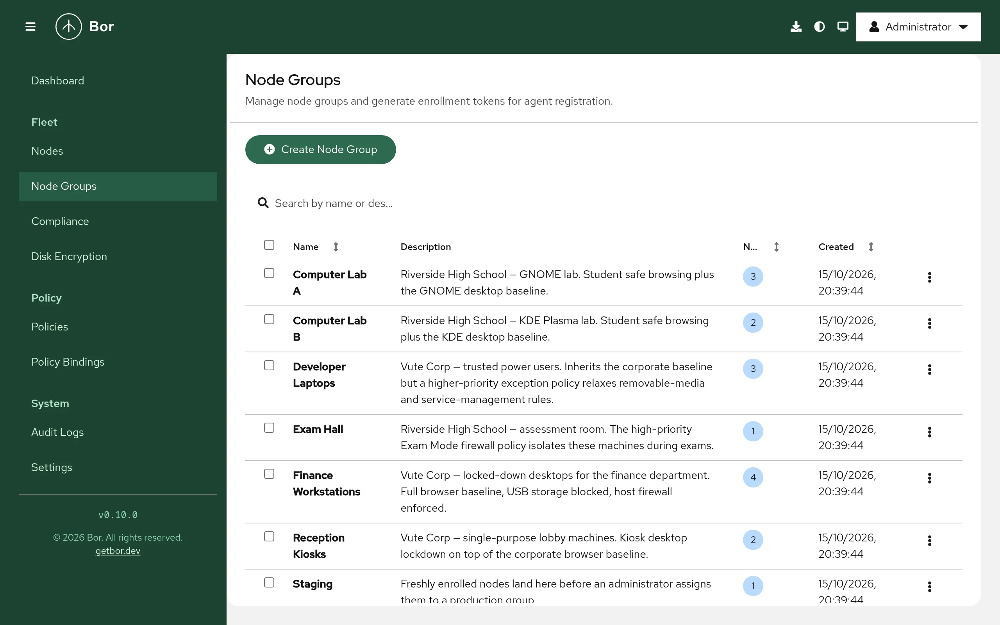

# Node groups

A node group is a named set of nodes. Groups are how policies reach
machines: you bind a policy to a node group, and every node in the group
receives it. This page covers creating, editing and deleting node groups,
how membership works, and generating enrollment tokens.

Open it from **Fleet -> Node Groups** in the sidebar.

## How group membership determines policies

- A node can be a member of **any number** of node groups, and a group can
  contain any number of nodes (many-to-many).
- A node receives every policy that is **released** and has an
  **enabled** binding to **at least one** of its groups. A policy bound to
  several of the node's groups is delivered once.
- A node in no group (shown as **Unassigned**) receives no policies.
- When several policies of the same type apply to one node, they are merged
  on the node. The binding priority decides which value wins for some
  policy types; see [Bindings](bindings.md#priority-and-conflicts).

New nodes join the node group of the enrollment token they used. You can
add them to more groups later on the [Nodes](nodes.md#move-nodes-between-groups)
page.

## The node group list

{ loading=lazy }

| Column | Content |
|---|---|
| **Name** | Group name. Sortable. |
| **Description** | Optional description. |
| **Nodes** | Number of member nodes. Sortable. |
| **Created** | Creation time. Sortable. |

Use **Search by name or description...** to filter the list. The row menu
offers **Generate token**, **Edit** and **Delete**. Tick several rows to use
**Actions** for bulk **Edit** (one row only) and **Delete**.

## Create a node group

1. Select **Create Node Group**.
2. Enter a **Name** (for example `Engineering Desktops`) and an optional
   **Description**.
3. Select **Create**.

Requires `node_group:create`.

!!! tip "Plan groups around policy needs"
    Groups are cheap. Typical layouts are by department (`Finance`,
    `Engineering`), by location (`Berlin Office`), by hardware or role
    (`Kiosks`, `Laptops`), plus a broad group such as `All Desktops` for
    baseline policies. Because nodes can be in several groups, you can
    combine a baseline group with more specific ones.

## Edit a node group

Select **Edit** in the row menu. You can change the **Name** and
**Description**, then select **Save**. The dialog also shows the **Group
ID** with a copy button; you need this ID when configuring Kerberos
auto-enrollment (see [Kerberos](../configuration/kerberos.md)). Requires
`node_group:edit`.

## Delete a node group

1. Make sure the group has no member nodes. The server refuses to delete a
   group that still has nodes assigned (`cannot delete node group: N
   node(s) still assigned`). Remove the nodes on the
   [Nodes](nodes.md#move-nodes-between-groups) page first, or decommission
   them.
2. Select **Delete** in the row menu (or **Actions -> Delete** for several
   groups).
3. Type the group name to confirm (`Yes` when deleting several groups) and
   select **Delete**.

All policy bindings of the deleted group are removed with it. Requires
`node_group:delete`.

## Generate an enrollment token

An agent proves it may join the fleet with a one-time enrollment token
that is tied to a node group. When the agent enrolls, the server creates
the node and adds it to that group.

1. In the row menu of the target group, select **Generate token**.
2. Review the token rules shown in the dialog and select **Generate
   Token**.
3. The dialog shows:
    - **Enrollment Command** - a ready-made `sudo bor-agent --token ...`
      command.
    - **Token Only** - the token itself, with a copy button.
4. Copy the token and select **Done**. The token is not shown again after
   the dialog is closed.

Token rules:

- The token expires **5 minutes** after it is generated. The exact expiry
  time is shown in the dialog.
- The token is **single-use**: it enrolls exactly one machine.
- Generating a token requires `node_group:create`.

!!! tip "Prefer a token file over the command line"
    The generated command passes the token with `--token`, which is
    deprecated because the token becomes visible in process listings. Save
    the token to a root-only file and use `--token-file` instead:

    ```bash
    sudo install -m 0600 /dev/null /root/bor-token
    sudoedit /root/bor-token        # paste the token, save
    sudo bor-agent --token-file /root/bor-token
    sudo systemctl enable --now bor-agent
    sudo rm /root/bor-token
    ```

    The agent also reads the token from the `BOR_ENROLLMENT_TOKEN`
    environment variable. See [Agent installation](../installation/agent.md)
    and the [CLI reference](../reference/cli.md).

For many machines, the **Deploy agent** dialog (masthead or **Nodes**
page) can generate the token for you and produce one script that installs,
enrolls and starts the agent. Pick the node group under **Enroll into node
group...** and select **Add enrollment step**.

Machines joined to FreeIPA or Active Directory can enroll with Kerberos
instead of a token; they then land in the group configured on the server.
See [Kerberos](../configuration/kerberos.md).

## Verify

After enrollment, the new node appears on the [Nodes](nodes.md) page with
the group in the **Node Group** column. The **Nodes** count of the group
increases by one.
