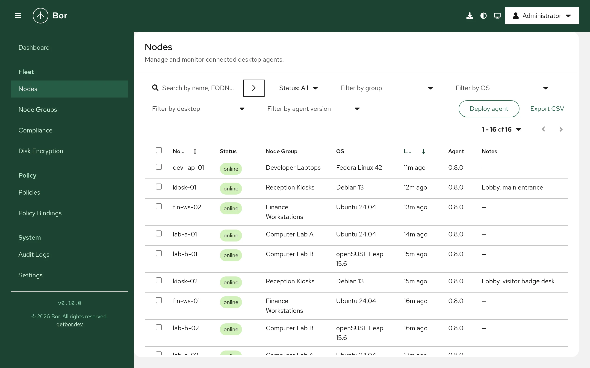
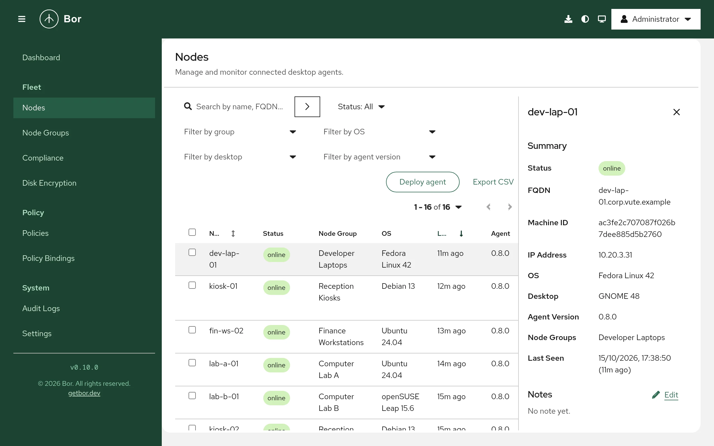

# Nodes

A node is a Linux desktop or laptop running `bor-agent` that has enrolled
with the server. This page explains the **Nodes** page: the node list, what
the status values mean, the node details panel, filtering, moving nodes
between node groups, decommissioning a node, and re-enrolling a machine.

Open it from **Fleet -> Nodes** in the sidebar. Viewing nodes requires the
`node:view` permission; see [Permissions](../reference/permissions.md) for
the actions below.

## The node list

{ loading=lazy }

The table shows one row per enrolled node:

| Column | Content |
|---|---|
| **Node** | The node name. This is the agent's client ID and the common name (CN) of its client certificate, and it is unique on the server. Sortable. |
| **Status** | `online`, `offline` or `unknown` (see below). Hover the label for the reason. |
| **Node Group** | The node groups the node belongs to, comma separated. |
| **OS** | Operating system name and version reported by the agent. |
| **Last Seen** | How long ago the agent last reported to the server (for example `5m ago`, `Never`). Sortable. |
| **Agent** | The `bor-agent` version on the node. |
| **Notes** | The first characters of the node's note. |

The list is paginated. Use the pagination controls above the table to
change the page size.

### Node status

| Status | Meaning |
|---|---|
| `online` | The agent has an open policy stream to the server (port `8444`). Policy changes reach it immediately. |
| `offline` | The agent's stream disconnected. The node keeps enforcing the policies it last received and reconnects automatically with exponential backoff (up to 60 seconds between attempts). |
| `unknown` | The node never connected, or enrollment is still pending. |

Status is updated when the stream opens or closes. A node that shows
`offline` for a long time is usually powered off, off the network, or its
agent service is stopped. On the node, check with:

```bash
sudo systemctl status bor-agent
sudo journalctl -u bor-agent -n 50
```

Compliance (whether policies are actually enforced) is tracked separately
on the [Compliance](compliance.md) page.

## Search and filter

- **Search** - type in **Search by name, FQDN, IP, group...** and press
  ++enter++.
- **Status** - `online`, `offline` or `unknown`.
- **Group** - a node group, **All Groups**, or **Unassigned** (nodes in no
  group, which therefore receive no policies).
- **OS**, **Desktop**, **Agent version** - values reported by your agents.

Active filters appear as chips; remove one by closing its chip, or clear
all of them at once. The Dashboard cards **Online**, **Offline**,
**Unknown** and **Unassigned Nodes** open this page with the matching
filter applied.

## Export the list

Select **Export CSV** to download `nodes-export.csv` with the name, status,
groups, last seen time, agent version, OS and notes of every node that
matches the current search and filters (all pages). To export only some
nodes, select them with the row checkboxes and choose **Actions -> Export
selected (CSV)**.

## Node details

{ loading=lazy }

Select a row to open the details panel on the right.

**Summary**
:   **Status**, **FQDN**, **Machine ID**, **IP Address**, **OS**,
    **Desktop**, **Agent Version**, **Node Groups** and **Last Seen** (date
    and relative time).

**Notes**
:   A free-text note for the node, for example the owner or location.
    Select **Edit**, type the note and select **Save**. Requires
    `node:edit`.

**Certificate**
:   The client certificate's **Serial** (last 16 characters) and when it
    **Expires**. Agent certificates are valid for 90 days and the agent
    renews its certificate automatically within 30 days of expiry. The
    expiry turns to a warning color within 30 days and red once expired.

**Disk encryption**
:   Shown when you hold `disk_encryption:view`: the node's LUKS volumes and
    recovery key status. See [Disk encryption](../policy-types/disk-encryption.md).

**Actions**
:   - **Update metadata** - asks the agent to collect fresh system
      information (OS, desktop, IP address and so on) and report it. Only
      available while the node is `online`.
    - **Add to group** / **Remove from group** - see
      [Move nodes between groups](#move-nodes-between-groups).
    - **Decommission** - see [Decommission a node](#decommission-a-node).
    - **Revoke Certificate** - see [Revoke a certificate](#revoke-a-certificate).

## Deploy an agent

To add machines, select **Deploy agent** on this page (or the **Deploy
agent** icon in the masthead). When the list is empty the page offers
**Deploy your first agent** instead. The dialog builds an install script
for the platform and architecture you choose and can include the
enrollment step for a node group. The button is shown only when the server
ships the agent package repository. See
[Agent installation](../installation/agent.md) for the full procedure.

## Move nodes between groups

A node can belong to several node groups at the same time; it receives the
policies bound to all of them. See [Node groups](node-groups.md).

To add nodes to a group:

1. Select one node and open its details panel, or tick several nodes and
   open **Actions**.
2. Choose **Add to group**.
3. Pick the **Node group** and select **Assign**.

To remove nodes from groups:

1. Select the nodes and choose **Remove from group**.
2. Tick the groups to remove them from (when the nodes belong to only one
   group it is preselected) and select **Remove**.

Adding nodes needs `node:create`; removing them needs `node:delete`.

!!! warning "Group changes take effect on the next agent connection"
    The server reads a node's group memberships when the agent opens its
    policy stream. After you move a node, it receives the policies of its
    new groups the next time the agent reconnects. To apply the change at
    once, restart the agent on the node:

    ```bash
    sudo systemctl restart bor-agent
    ```

    Then check the node's rows on the [Compliance](compliance.md) page.

## Decommission a node

Decommissioning deletes the node record and revokes its client
certificate. Use it when a machine is retired, reinstalled or replaced.

1. Select the node and choose **Decommission** (or tick several nodes and
   choose **Actions -> Decommission**).
2. In **Decommission node**, type the node name to confirm. When several
   nodes are selected, type `Yes` instead.
3. Select **Decommission**.

What happens:

- The server first revokes the node's certificate (reason `node deleted`)
  and then deletes the node and its group memberships. If revocation fails,
  the node is not deleted.
- The revocation is permanent and survives the node deletion, so the old
  certificate can never be used again, even if someone copies it from the
  machine.
- Revocations are checked on every request an agent makes, so further
  requests with the old certificate are refused (`certificate has been
  revoked`). To manage the machine again, re-enroll it.

Decommissioning requires `node:delete`.

## Revoke a certificate

**Revoke Certificate** in the node details revokes the node's current
client certificate without deleting the node record. Use it when you
suspect the machine's credentials are compromised. The panel confirms with
**Certificate revoked**: the agent is denied on its next connection
attempt. The node record, its notes and its group memberships remain. To
bring the machine back, [re-enroll](#re-enroll-a-node) it.

This action requires `node:create`.

## Re-enroll a node

Re-enrollment gives a machine a new certificate, for example after a
reinstall, after its certificate was revoked or expired, or after the
server's CA changed.

The node name must be unique. If a node record with the same name still
exists, the server rejects the enrollment with `a node named "..." already
exists; delete it before re-enrolling`. So:

1. [Decommission](#decommission-a-node) the old node record if it still
   exists.
2. Generate an enrollment token for the target node group on
   [Node groups](node-groups.md#generate-an-enrollment-token).
3. On the machine, stop the agent, save the token to a file and enroll
   again. When a token is supplied to an already-enrolled agent, the agent
   removes its old certificate files first:

    ```bash
    sudo systemctl stop bor-agent
    sudo install -m 0600 /dev/null /root/bor-token
    sudoedit /root/bor-token        # paste the token, save
    sudo bor-agent --token-file /root/bor-token
    sudo systemctl enable --now bor-agent
    sudo rm /root/bor-token
    ```

4. Check that the node appears on the **Nodes** page as `online`.

The token is valid for 5 minutes and for one enrollment only. See
[Agent installation](../installation/agent.md) for Kerberos-based
enrollment, which needs no token.
