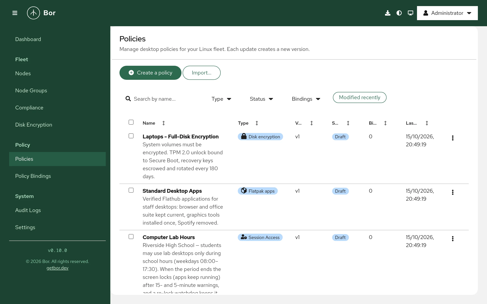
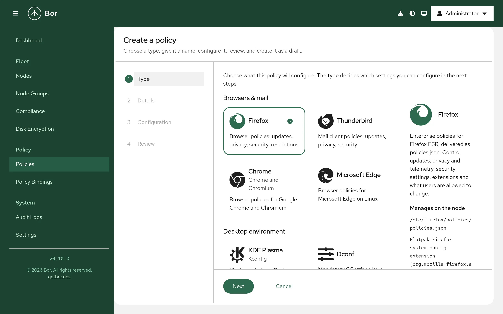
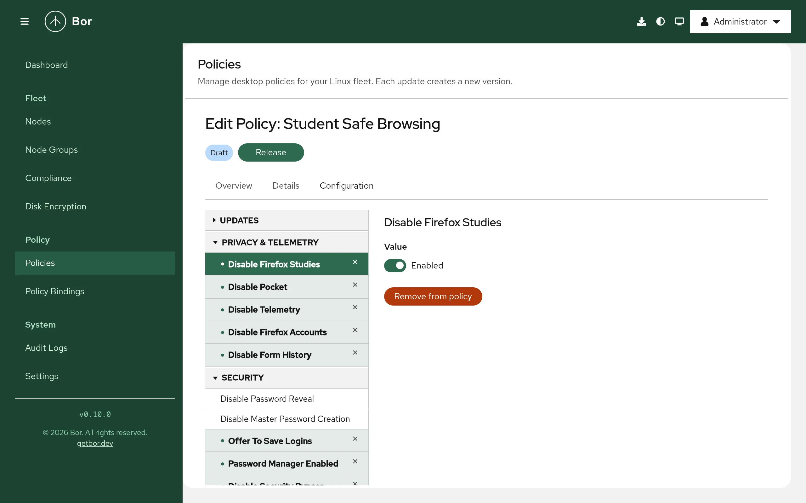

# Policies

A policy is a named, typed set of settings that Bor enforces on nodes, for
example Firefox settings, KDE Plasma locks or firewall zones. This page
explains the **Policies** page, creating a policy with the wizard, the
editors, the policy lifecycle, editing and deleting policies, and moving
policies between servers with export and import.

Open it from **Policy -> Policies** in the sidebar. Viewing policies
requires `policy:view`.

## Policy types

Each policy has exactly one type. The type decides which editor you get
and what the agent changes on the node.

| Type (as shown in the UI) | Category | Reference |
|---|---|---|
| **Firefox** | Browsers & mail | [Firefox](../policy-types/firefox.md) |
| **Thunderbird** | Browsers & mail | [Thunderbird](../policy-types/thunderbird.md) |
| **Chrome** | Browsers & mail | [Chrome](../policy-types/chrome.md) |
| **Microsoft Edge** | Browsers & mail | [Microsoft Edge](../policy-types/edge.md) |
| **KDE Plasma** | Desktop environment | [KDE Plasma (KConfig)](../policy-types/kconfig.md) |
| **Dconf** | Desktop environment | [GNOME (dconf)](../policy-types/dconf.md) |
| **Polkit** | System & security | [Polkit](../policy-types/polkit.md) |
| **Firewall** | System & security | [Firewall (firewalld)](../policy-types/firewalld.md) |
| **Session Access** | System & security | [Session access](../policy-types/session-access.md) |
| **Package** | System & security | [Packages](../policy-types/packages.md) |
| **Flatpak apps** | System & security | [Flatpak](../policy-types/flatpak.md) |
| **Disk encryption** | System & security | [Disk encryption](../policy-types/disk-encryption.md) |

See [Policy types](../policy-types/index.md) for an overview.

## The policy list

{ loading=lazy }

| Column | Content |
|---|---|
| **Name** | Policy name, with the description underneath. |
| **Type** | Policy type. |
| **Version** | Version counter, for example `v3`. |
| **Status** | `Draft`, `Released` or `Archived`. A `Deprecated` label is added when the policy has been marked deprecated through the API. |
| **Bindings** | Number of bindings to node groups, and how many are enabled. |
| **Last Updated** | Time of the last change, including state changes. |

All columns except **Description** can be sorted.

### Filter the list

- **Search policies by name** - free text.
- **Type** - one or more policy types.
- **Status** - `draft`, `released`, `archived`.
- **Bindings** - **Has bindings** or **No bindings**.
- **Modified recently** - only policies changed in the last 7 days.

The Dashboard cards **Released**, **Draft** and **Archived** open this
page with the matching status filter.

### Row actions and bulk actions

The row menu shows the actions that apply to the policy's state:
**Release**, **Unpublish**, **Archive**, **Restore to draft**, **Edit**
(drafts) or **View details** (other states), **Export policy** and
**Delete**.

Tick several policies to use **Actions**: **Release**, **Unpublish** and
**Archive** apply to the selected policies that are eligible and skip the
rest (the menu shows how many are eligible), plus **Edit** (one policy),
**Export selected** and **Delete**.

## Lifecycle

Every policy is in one of three states:

| State | Meaning | Delivered to agents |
|---|---|---|
| **Draft** | Being written. The only state in which the policy can be edited. New and imported policies always start here. | No |
| **Released** | Final. Can be bound to node groups. | Yes, through enabled bindings |
| **Archived** | Retired. Kept for reference. | No |

Allowed transitions:

| Action | From -> To | Condition |
|---|---|---|
| **Release** | Draft -> Released | The policy has a name, a type and content, and the content passes the server-side validation for its type. |
| **Unpublish** | Released -> Draft | No **enabled** bindings. |
| **Archive** | Released -> Archived | No **enabled** bindings. |
| **Restore to draft** | Archived -> Draft | No **enabled** bindings. |

**Release** and **Archive** ask for confirmation. When an action is blocked
by enabled bindings, the row menu shows it greyed out with a tooltip such
as `Cannot unpublish: 2 enabled bindings exist. Disable the bindings
first.` Disable the bindings on the [Policy Bindings](bindings.md) page,
then retry.

Changing the state of a policy notifies all agents in node groups with an
enabled binding to that policy, so they pick up the change immediately.

!!! note "Permission used for lifecycle changes"
    Release, unpublish, archive and restore are authorized with the
    `policy:edit` permission. The seeded `policy:release` permission is not
    currently checked by the server. See [Permissions](../reference/permissions.md).

## Create a policy

{ loading=lazy }

Select **Create a policy**. The **Create a policy** wizard has four steps;
use **Next** and **Back** to move between them.

1. **Type** - choose the policy type from the tiles, grouped into
   **Browsers & mail**, **Desktop environment** and **System & security**.
   Each tile describes what the type manages. If you switch the type later
   in the wizard, Bor asks before clearing the settings you already
   configured (**Change type and clear settings**).
2. **Details** - enter a **Name** (required; it is shown in the policies
   list and in compliance reports) and an optional **Description** (why the
   policy exists, who it targets, who owns it).
3. **Configuration** - set the policy's settings in the type-specific
   editor (see [Editors](#editors)). You cannot continue while the
   configuration is invalid.
4. **Review** - check the **Type**, **Name**, **Description** and a table
   of every configured **Setting** and **Value** (and whether it is
   **Locked**, for types that support locking). **Show policy JSON** shows
   the exact content that will be stored. Select **Create policy**.

A help panel with documentation for the selected type is available on the
**Details**, **Configuration** and **Review** steps.

The policy is created as a **draft** at version `v1`. The success page
offers:

- **Release now** - releases the policy after confirmation.
- **Assign to a node group** - opens **Policy Bindings** with the policy
  preselected in the **Create Binding** form.
- **Open the policy**, **Create another policy**, **Back to policies**.

Nothing reaches a node until the policy is released **and** bound to a
node group with an enabled binding. Creating policies requires
`policy:create`.

If you cancel the wizard after entering data, Bor asks before discarding it
(**Discard this policy?**).

## Editors

{ loading=lazy }

Bor has two kinds of editors:

**Tree editor** (Firefox, Thunderbird, Chrome, Microsoft Edge)
:   The left side lists every supported browser policy as a tree, grouped
    by topic. Configured policies are highlighted. Select a policy to see
    its description and value form on the right. A policy you have not
    added yet is only previewed: edit its value and select **Add to
    policy**. Select **Remove from policy** to drop a configured policy.
    List values take **One item per line**; object values take JSON.

**Type-specific editors** (all other types)
:   Purpose-built forms for each type, for example a KConfig setting picker
    with lock options, a dconf schema browser fed by the schemas your
    agents report, polkit rule builders, firewall zone forms, package and
    repository lists, a Flatpak application picker, session time windows
    and LUKS settings. See the page for each type under
    [Policy types](../policy-types/index.md).

The editor checks values as you type. The server checks the content again
when you release the policy and refuses to release content that does not
match the type's schema.

## View and edit a policy

Select **Edit** (drafts) or **View details** (other states) to open the
policy page. It shows the policy name with its state label and the
lifecycle buttons that apply (**Release**, **Unpublish**, **Archive**,
**Restore to draft**), and three tabs:

**Overview**
:   **Policy Settings** - a table of every configured setting and its
    value - and the description.

**Details**
:   **Name**, **Description**, **Type** and **State**, plus **Version**,
    **Created by**, **Last modified** and **Created at**.

**Configuration**
:   The editor. For policies that are not drafts it is read-only, with the
    notice that the policy must be moved back to draft to make changes.

For drafts, change the fields and select **Save Changes**. Each save
increases the version number by one. Lifecycle buttons are disabled while
there are unsaved changes. Editing requires `policy:edit`.

### Change a released policy

Released policies cannot be edited in place, and Bor does not keep earlier
versions of the content: the version number is a counter, not a history. To
change a released policy:

1. On [Policy Bindings](bindings.md), disable every enabled binding of the
   policy. Nodes in those groups stop receiving it, and agents remove its
   settings.
2. **Unpublish** the policy (it becomes a draft).
3. Edit and **Save Changes**.
4. **Release** it again.
5. Enable the bindings again.

!!! tip "Avoid an enforcement gap"
    To keep nodes covered while you work on a change, export the policy,
    change `metadata.displayName` in the exported file, and import it. The
    copy is created as a new draft that you can edit, release and bind
    while the original stays in force. Then disable the old binding and
    archive the original. See [Export and import](#export-and-import).

## Delete a policy

Select **Delete** in the row menu (or **Actions -> Delete**), type the
policy name (or `Yes` for several policies) and select **Delete**. The
policy page also has a **Delete** button.

- A policy with **enabled** bindings cannot be deleted; disable the
  bindings first.
- Disabled bindings of the policy are deleted together with it.
- Deletion cannot be undone. Export the policy first if you may need it
  again.

Requires `policy:delete`.

## Export and import

Policies can be exported to a file and imported on the same or another Bor
server, for example to copy policies from a test server to production or to
keep them in version control.

### Export

- One policy: row menu -> **Export policy**.
- Several policies: tick them and choose **Actions -> Export selected**.

The UI exports in YAML and always includes the bindings of the exported
policies. A single policy is saved as `<slug>.yaml`; several are saved as
`bor-policies.yaml`. Exporting requires `policy:view`; bindings are
included only for node groups you may view.

### File format

The file is a multi-document YAML stream (documents separated by `---`).
Every document has the same envelope:

| Key | Content |
|---|---|
| `apiVersion` | Always `bor.dev/v1`. |
| `kind` | `Policy` or `PolicyBinding`. |
| `metadata.name` | A slug derived from the policy name, unique within the file. |
| `metadata.displayName` | The policy name (policies only). It wins over `metadata.name` on import. |
| `metadata.description` | The policy description (policies only). |
| `spec` | For `Policy`: `type` and `content`. For `PolicyBinding`: `policy`, `group` and `priority`. |

Example:

```yaml
apiVersion: bor.dev/v1
kind: Policy
metadata:
  name: firefox-baseline
  displayName: Firefox baseline
  description: Telemetry and studies off for all desktops
spec:
  type: Firefox
  content:
    DisableFirefoxStudies: true
    DisableTelemetry: true
---
apiVersion: bor.dev/v1
kind: PolicyBinding
metadata:
  name: firefox-baseline-all-desktops
spec:
  policy: firefox-baseline
  group: All Desktops
  priority: 0
```

Content is normalized on export (known fields only, in a stable order), so
exports of the same policy produce the same bytes and diff cleanly in git.
The policy state is not exported.

### Import

1. Select **Import...** and choose a `.yaml`, `.yml` or `.json` file (at
   most 1 MiB).
2. Bor validates the file without changing anything and shows **Import
   preview** with one row per document: **Doc**, **Kind**, **Name**,
   **Status** (`created`, `updated`, `skipped` or `error`) and **Details**.
3. Choose what happens when a policy with the same name already exists,
   under **If a policy name already exists**:

    | Option | Effect |
    |---|---|
    | **Fail the import (recommended)** | The document is an error and nothing is imported. |
    | **Skip that policy** | The existing policy is kept unchanged. |
    | **Update the existing draft** | The existing policy's content is replaced, but only if it is a draft; a released or archived policy is an error. |

    Changing the option re-runs the preview.
4. If the preview is valid, select **Import N resources**. Otherwise fix
   the file; if any document has an error, nothing is imported.

Rules:

- Imported policies are always created as **drafts**. Release them
  yourself.
- Imported bindings are always created **disabled**. Enable them on
  [Policy Bindings](bindings.md) after releasing the policy.
- A binding's `spec.policy` refers to a `metadata.name` in the same file or
  to the name of a policy that already exists on the server. Its
  `spec.group` must be the name of an existing node group; node groups are
  not created by import.
- The policy content is checked against the type's schema; unknown policy
  types are rejected.
- Importing requires `policy:create`. Exports and completed imports are
  recorded in the [audit log](audit-log.md) (`policy.export`,
  `policy.import`).
