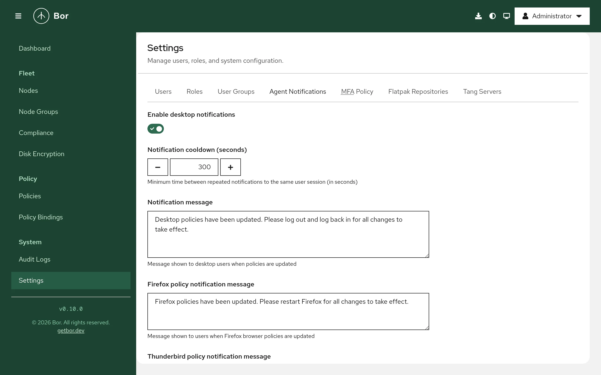
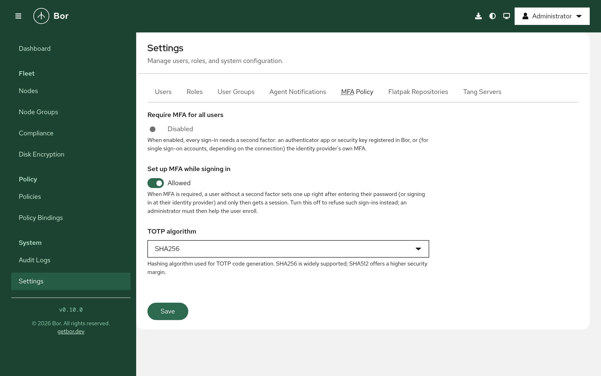
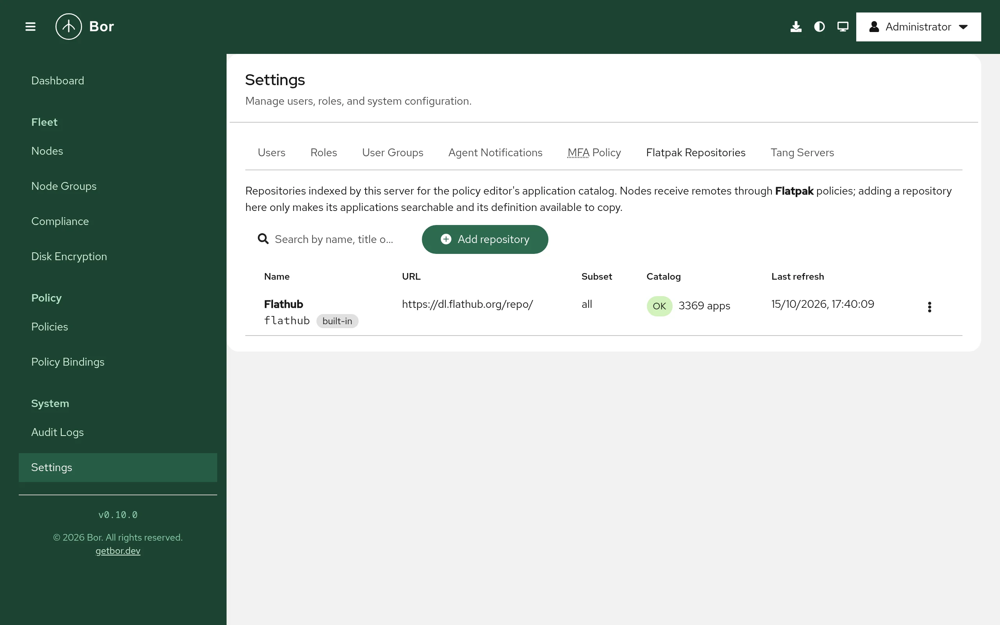

# Settings

The **Settings** page holds user and access management and the
server-wide settings that are changed at runtime from the web UI. This
page describes each tab. Settings that are read from
`/etc/bor/server.yaml` at startup are described in
[Server configuration](../configuration/server.md) instead.

Open it from **System -> Settings** in the sidebar. Each tab is shown only
to users who hold the permission listed below; the page opens on the first
tab you can see, and the selected tab is kept in the address (`?tab=`) so
you can bookmark it.

| Tab | Needed permission | Purpose |
|---|---|---|
| **Users** | `user:view` | Local and LDAP user accounts |
| **Roles** | `role:view` | Built-in and custom roles |
| **User Groups** | `user_group:view` | Groups of users for role assignment |
| **Agent Notifications** | `settings:manage` | Desktop notifications shown on nodes after policy changes |
| **MFA Policy** | `settings:manage` | Whether multi-factor authentication is mandatory |
| **Flatpak Repositories** | `flatpak_repo:view` | Repository catalog for the Flatpak policy editor |
| **Tang Servers** | `tang_server:view` | Tang servers for network-bound disk unlocking |

!!! note "Your own password and MFA"
    Changing your own password and setting up your own authenticator app
    or security key is not done here but in **Account security** in the
    account menu of the masthead. See
    [Web UI](web-ui.md#account-settings).

## Users

Create, edit, enable, disable and delete user accounts, reset local
passwords and assign roles. See
[Users and roles](users-and-roles.md#local-users).

## Roles

Review the built-in roles and create custom roles with a permission
matrix. See [Users and roles](users-and-roles.md#custom-roles).

## User Groups

Group users and assign roles to the whole group. See
[Users and roles](users-and-roles.md#user-groups).

## Agent Notifications

{ loading=lazy }

When an agent applies changed policies, it can show a desktop notification
to the users logged in on the node, asking them to log out or restart an
application so that every change takes effect. This tab controls those
notifications for the whole fleet.

| Field | Meaning |
|---|---|
| **Enable desktop notifications** | Turns the notifications on or off. |
| **Notification cooldown (seconds)** | Minimum time between repeated notifications to the same user session. Minimum `60`; default `300`. |
| **Notification message** | Shown when desktop policies change. Default: `Desktop policies have been updated. Please log out and log back in for all changes to take effect.` |
| **Firefox policy notification message** | Shown when Firefox policies change. |
| **Thunderbird policy notification message** | Shown when Thunderbird policies change. |
| **Chrome/Chromium policy notification message** | Shown when Chrome or Chromium policies change. |
| **Microsoft Edge policy notification message** | Shown when Microsoft Edge policies change. |

Select **Save** to store the settings.

!!! tip
    Keep the cooldown high enough that users are not interrupted by
    several notifications while you roll out a series of changes, and
    write the messages in the language your users read.

## MFA Policy

{ loading=lazy }

Controls multi-factor authentication for web UI sign-in.

| Field | Meaning |
|---|---|
| **Require MFA for all users** | When **Enabled**, every sign-in needs a second factor (an authenticator app or a security key registered in Bor). |
| **Set up MFA while signing in** | When **Allowed** and MFA is required, a user without a second factor enrolls one right after entering their password and only then gets a session. When **Not allowed**, such sign-ins are refused and an administrator must help the user enroll. |
| **TOTP algorithm** | Hash algorithm for authenticator app codes: `SHA256` or `SHA512`. SHA256 is widely supported by authenticator apps; SHA512 has a higher security margin. Check that your users' apps support the algorithm before changing it. |

Select **Save** to apply. Before requiring MFA, enroll your own
administrator account (**Account security**), and keep a second
administrator account enrolled. If an administrator loses their
authenticator, reset it on the server with
`sudo bor-server --reset-mfa <username>`. See
[MFA configuration](../configuration/mfa.md).

## Flatpak Repositories

{ loading=lazy }

The server indexes the applications of Flatpak repositories so that the
[Flatpak policy](../policy-types/flatpak.md) editor can search them and
copy a repository definition into a policy. Adding a repository here does
**not** add it to any node; nodes receive remotes only through Flatpak
policies. Flathub is preconfigured.

The list shows **Name**, **URL**, **Subset**, **Catalog** (indexing status,
or **Catalog off**) and **Last refresh**. The row menu offers:

- **Refresh now** - download and re-index the repository's catalog now
  (needs `flatpak_repo:refresh`).
- **Upload catalog...** - import a catalog file downloaded elsewhere (needs
  `flatpak_repo:refresh`).
- **Edit** (needs `flatpak_repo:edit`).
- **Delete** - type the repository name to confirm. Policies that already
  copied the remote keep working. Built-in repositories cannot be deleted;
  turn their catalog off instead (needs `flatpak_repo:delete`).

### Add a repository

1. Select **Add repository** (needs `flatpak_repo:create`).
2. Optionally fill the form from a repository file: paste its URL into
   **Import from .flatpakrepo URL** and select **Import**, or use a preset
   such as **Flathub Beta**.
3. Check or enter:

    | Field | Meaning |
    |---|---|
    | **Name** | Suggested remote name for policies, for example `flathub`. |
    | **Title** | Display name. |
    | **Repository URL** | The repository URL, for example `https://dl.flathub.org/repo/`. |
    | **Subset** | Suggested subset for policies that copy this repository. Does not affect indexing. |
    | **GPG public key** | Key file (`.gpg`, `.asc`, `.key`, `.pub`). Copied into policies that add this remote so nodes verify downloads. |
    | **Catalog** | **Index this repository's applications** on or off. |
    | **Refresh interval (hours)** | How often the catalog is re-indexed, 1-720. |
    | **Architectures** | `x86_64`, `aarch64`, `i686`. Each is indexed separately. |

    Under **Advanced**: **AppStream URL override** (default
    `<URL>/appstream/<arch>/appstream.xml.gz`, `{arch}` is replaced per
    architecture), **Collection ID**, **Default branch**, **GPG key
    fingerprint (optional)**, **Homepage**, **Comment**, **Description**
    and **Icon URL**.
4. Select **Add repository**.

### Upload a catalog (offline servers)

If the server has no outbound internet access, disable outbound catalog
downloads with `flatpak_catalog.refresh_enabled: false` (or
`BOR_FLATPAK_CATALOG_REFRESH=false`); the tab then shows a notice and
**Refresh now** is unavailable. Import catalogs manually instead:

1. On a machine with internet access, download the repository's
   `appstream.xml.gz` for the architecture you need, for example
   `https://dl.flathub.org/repo/appstream/x86_64/appstream.xml.gz`.
2. In the repository's row menu, select **Upload catalog...**.
3. Choose the **Architecture** and the **Catalog file (appstream.xml.gz)**
   (gzip-compressed AppStream XML, at most 64 MiB).
4. Select **Upload and index**. The upload replaces the indexed apps of
   that architecture; a notice reports how many applications were
   indexed.

## Tang Servers

Tang servers let LUKS volumes unlock automatically while the machine is on
your network. This tab is the registry of Tang servers that
[Disk encryption](../policy-types/disk-encryption.md) policies can bind
volumes to. The confirmed signing keys of each server are copied into the
policies.

The list shows **Name**, **URL**, **Trusted keys** (each key thumbprint
marked `preferred` or `accepted`, with the number of volumes bound to it),
**Status** (**Never checked**, **OK**, **New key advertised**, **Error**)
and **Last check**.

### Add a Tang server

1. Select **Add Tang server** (needs `tang_server:create`).
2. Enter a **Name** and the **URL**, for example
   `http://tang1.example.com`. Tang uses plain HTTP by design; the
   exchange never reveals key material.
3. Select **Probe** to fetch the server's advertisement.
4. Under **Signing keys**, compare each thumbprint with the output of
   `tang-show-keys` on the Tang host, and tick only the keys that match.
   Agents refuse to bind to keys you have not confirmed.
5. Select **Add server**.

### Check and rotate keys

- **Check advertisement** in the row menu fetches the current
  advertisement again (needs `tang_server:edit`). If the server advertises
  a key you have not confirmed, the status becomes **New key advertised**
  and the row menu offers **Confirm new key...**. Verify the new
  thumbprint on the Tang host and confirm it.
- After rotating keys on the Tang host, delete the old key there only when
  its bound-volume count on this tab reaches zero.
- **Delete** removes the server from the registry (type the name to
  confirm; needs `tang_server:delete`).

## Extension panels

Server extensions can add their own tabs to this page. The community
edition does not ship any extension, so no such tab is shown there.
