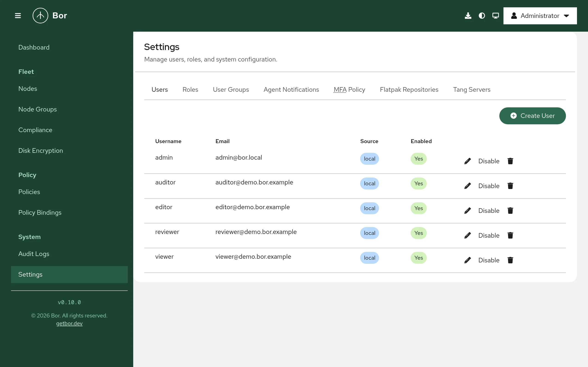
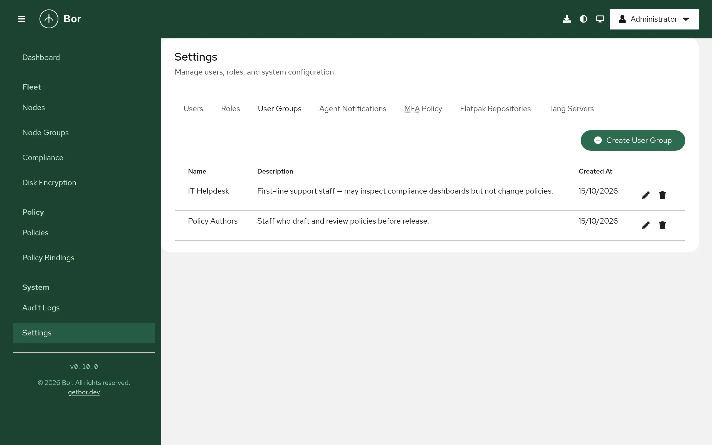
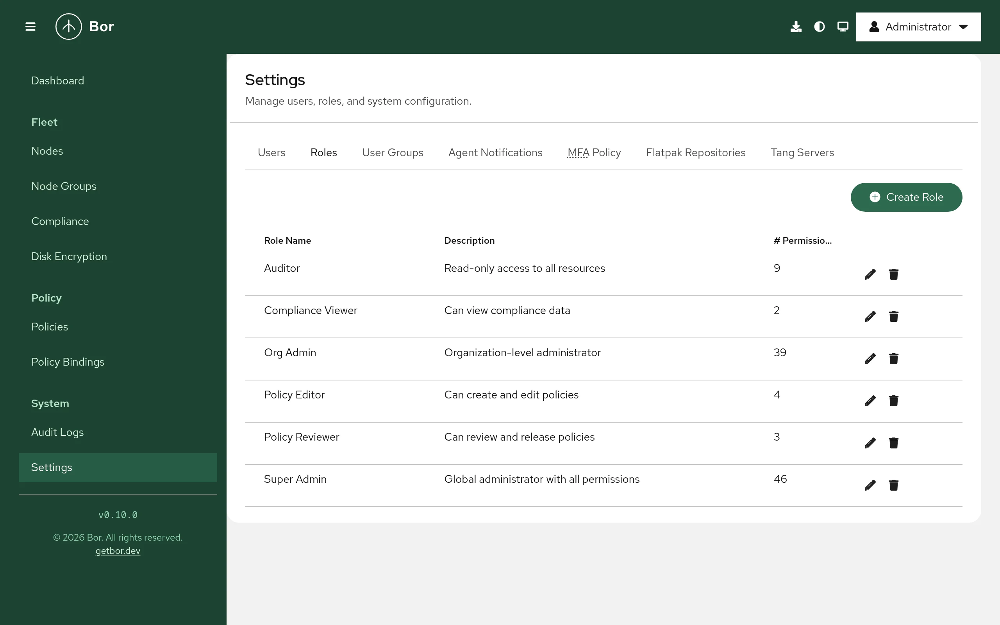

# Users and roles

Bor controls who may do what in the web UI with role-based access control
(RBAC). Users get permissions through roles, either assigned to them
directly or through user groups. This page covers local and LDAP users,
user groups, the built-in roles, custom roles, role assignments, and the
safeguards that prevent privilege escalation and lock-outs.

All of this is managed under **System -> Settings** on the **Users**,
**Roles** and **User Groups** tabs. The full list of permissions is in the
[Permissions reference](../reference/permissions.md).

## How access works

- A **permission** is a `resource:action` pair, for example `policy:edit`
  or `node:view`.
- A **role** is a named set of permissions.
- A **role assignment** (role binding) gives a role to a **user** or to a
  **user group**. Members of a user group hold every role assigned to the
  group.
- A user's effective permissions are the union of all roles assigned to
  them directly and through their groups.

!!! note "Community edition: global scope only"
    In the community edition every role assignment is **global**: it
    applies to all nodes, node groups and policies. Assignments limited to
    specific node groups are not available. Where such a scoped assignment
    exists in the database (for example from another edition), the UI
    labels it as inactive in this edition and it grants nothing.

## The initial administrator

On first start, when the user table is empty, the server creates the local
user `admin` with the **Super Admin** role. The password is taken from
`security.admin_password` in `/etc/bor/server.yaml` (or
`BOR_ADMIN_PASSWORD`); the distribution packages generate a random one at
installation and print it. If no password is configured at all, the server
generates one and writes it to `/var/lib/bor/initial_admin_password`
(mode 0600) instead of logging it. Sign in as `admin`, then change the password in
**Account security -> Change Password** (see
[Web UI](web-ui.md#account-settings)).

Create personal accounts for every administrator rather than sharing
`admin`, so the [audit log](audit-log.md) shows who did what.

## Local users

{ loading=lazy }

### Create a user

1. Go to **Settings -> Users** and select **Create User**.
2. Enter the **Username**, optional **Email** and **Full Name**, and a
   **Password** of at least 12 characters.
3. Select **Create**.
4. Edit the new user (pencil icon) and assign roles on the **Role
   Assignments** tab (see [Assign roles](#assign-roles)). A user without
   roles can sign in but sees almost nothing.

Requires `user:create`.

### The user list

| Column | Content |
|---|---|
| **Username** | Sign-in name. |
| **Email** | Email address. |
| **Source** | `local` (password stored by Bor) or `ldap` (password checked against the directory). |
| **Enabled** | `Yes` or `No`. Disabled users cannot sign in. |

Row actions: the pencil icon (**Edit**), **Disable** / **Enable**, and the
trash icon (**Delete**).

### Edit a user

The **Edit User** dialog has these tabs:

- **Profile** - **Email**, **Full Name** and **Enabled**.
- **Role Assignments** - the roles assigned directly to the user.
- **Password** (local users only) - set a **New password** and **Confirm
  new password**, then select **Set password**. The user does not need the
  old password. Use this to reset a forgotten password.

Editing requires `user:edit`.

### Disable or delete a user

- **Disable** keeps the account and its role assignments but blocks
  sign-in. All of the user's existing sessions are revoked immediately.
- **Delete** removes the user and their role assignments permanently. The
  dialog **Delete user?** requires you to type the username. Requires
  `user:delete`.

Setting a new password for a user also revokes all of their sessions.

## LDAP users

When LDAP is enabled (see [LDAP](../configuration/ldap.md)), directory users
sign in with their directory password. On their first successful sign-in,
Bor creates the account with source `ldap`, copying email and full name
from the directory; these are refreshed on every sign-in. LDAP users:

- have no **Password** tab and cannot change their password in Bor,
- can be disabled in Bor, which blocks their sign-in even if the directory
  still accepts the password,
- can be given roles manually like local users, or automatically from
  their directory groups.

### Roles from LDAP groups

With `ldap.group_role_map` in `/etc/bor/server.yaml` (or
`BOR_LDAP_GROUP_ROLE_MAP`), Bor maps directory groups to roles. At every
sign-in it compares the user's directory groups with the map, adds the
mapped role assignments the user should have and removes mapped ones the
user no longer qualifies for. Role assignments that are not produced by the
map (assigned by an administrator) are never touched.

```yaml
ldap:
  group_role_map:
    "Domain Admins": "Super Admin"
    "IT Staff": "Org Admin"
```

## User groups

{ loading=lazy }

User groups let you assign roles to many users at once.

1. Go to **Settings -> User Groups** and select **Create User Group**.
2. Enter a **Name** and an optional **Description**, then select
   **Create**.
3. Edit the group (pencil icon). The **Edit User Group** dialog has three
   tabs:
    - **Details** - name and description.
    - **Members** - **Add Member** to pick a **User**; remove members from
      the list.
    - **Role Assignments** - **Add Role** to assign a role to the whole
      group.

Deleting a group (type the group name to confirm) removes the group and its
role assignments; the member users are not deleted.

Managing groups requires `user_group:view`, `user_group:create`,
`user_group:edit` and `user_group:delete` as appropriate.

## Built-in roles

{ loading=lazy }

Bor ships six built-in roles. Their permissions are fixed: the server
refuses to change or delete them (`built-in roles cannot be modified`).

| Role | Purpose |
|---|---|
| **Super Admin** | Global administrator with every permission, including revealing and rotating disk encryption recovery keys. |
| **Org Admin** | Day-to-day administrator: policies, bindings, nodes, node groups, users, user groups, audit logs, system settings, Flatpak repositories and Tang servers. Cannot view or edit roles and cannot reveal or rotate recovery keys. |
| **Policy Editor** | Writes policies: create, edit and view policies, and view bindings. Cannot bind or delete policies. Because lifecycle changes are authorized by `policy:edit`, it can also release policies (see the warning below). |
| **Policy Reviewer** | Intended to review and release policies: holds `policy:view`, `policy:release` and `binding:view`. |
| **Compliance Viewer** | Views compliance results and policies. |
| **Auditor** | Read-only access: views policies, bindings, compliance, nodes, node groups, user groups, disk encryption status and audit logs, and can export audit logs. |

The exact permission matrix is in the
[Permissions reference](../reference/permissions.md#built-in-roles).

!!! warning "Release is authorized by `policy:edit`"
    The server currently checks `policy:edit`, not `policy:release`, for
    releasing, unpublishing, archiving and restoring policies. As a result
    the **Policy Editor** role can release policies and the **Policy
    Reviewer** role cannot. Plan your role design accordingly.

## Custom roles

Create a custom role when the built-in roles do not fit, for example a
help-desk role that can view nodes and update node notes.

1. Go to **Settings -> Roles** and select **Create Role**.
2. Enter a **Role Name** and an optional **Description**, then select
   **Create**.
3. Edit the new role (pencil icon). The **Permission Matrix** lists every
   permission grouped by resource; tick the actions the role should have.
4. Select **Save**.

The **Roles** list shows the **Role Name**, **Description** and **#
Permissions** of each role. Deleting a role (type the role name to confirm)
also removes it from every user and group that had it.

Viewing roles requires `role:view`; creating, editing and deleting them
require `role:create`, `role:edit` and `role:delete`.

## Assign roles

To a user:

1. **Settings -> Users**, edit the user, open **Role Assignments**.
2. Select **Add Role**, choose the **Role** and select **Add**.
3. To remove an assignment, use the remove button in its row.

To a user group: the same steps on the group's **Role Assignments** tab.

Assigning roles to users (and removing them) requires `user:manage`. On a
user group, adding members or role assignments requires `user_group:create`
and removing them requires `user_group:delete`.

## Safeguards

### Privilege-escalation guard

You can only hand out permissions you hold yourself:

- **Assigning a role** to a user or a user group is refused if the role
  contains any permission you do not hold (`cannot assign a role that
  grants permissions you do not hold at this scope`).
- **Adding a member to a user group** is refused unless you could assign
  every role the group carries yourself; otherwise anyone who can edit
  groups could join a group with more rights.
- **Setting the permissions of a custom role** is refused if it would add a
  permission you do not hold.
- **Built-in roles** cannot be modified or deleted, so nobody can widen
  them.

Refused attempts are recorded in the [audit log](audit-log.md) as
`access_denied` events.

### Last Super Admin protection

The server refuses any change that would leave the system without a user
holding a global **Super Admin** assignment: deleting, disabling, or
removing the **Super Admin** role from the last such user fails with
`operation would remove the last Super Admin from the system`. Grant
**Super Admin** to a second account before retiring the first.

If all administrators are locked out of MFA, use
`bor-server --reset-mfa <username>` on the server (see
[CLI reference](../reference/cli.md)).

### Type-to-confirm deletes

Every destructive action asks you to type a confirmation before the
**Delete** (or **Decommission**) button becomes active: the exact name of
the user, role, group, policy, node or node group, the text `<policy> to
<group>` for a binding, or `Yes` when deleting several items at once.
