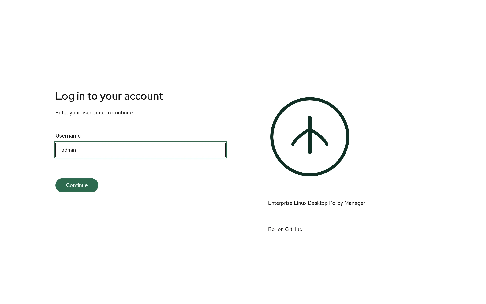
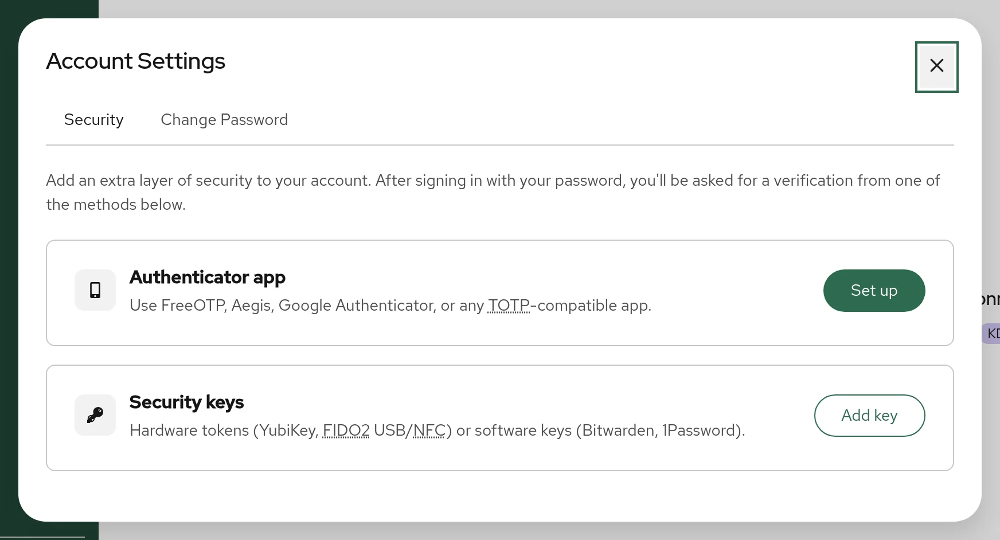

# Web UI overview

The Bor web UI is where administrators manage nodes, node groups, policies,
bindings, users and roles. This page explains how to sign in, how the
interface is laid out, what the Dashboard shows, how to manage your own
account security, and how long a session lasts.

The web UI is served by `bor-server` on its web port
(`server.enrollment_port`; default `8443`, 443 recommended for production),
for example `https://bor.example.com/`, or `https://bor.example.com:8443/`
on the default port. See
[Server configuration](../configuration/server.md) for how to change the port
and [TLS](../configuration/tls.md) for the certificate the browser sees.

## Sign in

{ loading=lazy }

Bor uses a step-by-step sign-in form. You always enter your username first;
the server then decides which step comes next for your account.

1. Open `https://bor.example.com/` in a browser. The **Log in to your
   account** page appears.
2. Enter your **Username** and select **Continue**.
3. Complete the step Bor asks for:

    | Step shown | What to do |
    |---|---|
    | **Enter your password** | Type your **Password** and select **Log in**. A **Caps Lock is on.** hint appears when Caps Lock is active, and the eye button shows or hides the password. |
    | **Enter your authenticator code** | Type the 6-digit **Authenticator code** from your authenticator app and select **Verify**. Bor then asks for your password. |
    | **Verify your identity** | Select **Authenticate with security key** and touch your security key or confirm the passkey prompt. A security key completes the sign-in on its own; no password is asked. If you also have an authenticator app, **Use authenticator code instead** switches to the code step. |
    | **Set up two-factor authentication** | Your organization requires multi-factor authentication (MFA) and your account has none yet. See [MFA enrollment during sign-in](#mfa-enrollment-during-sign-in). |

4. Select **Back** at any step to start over with a different username.

!!! note "Order of the steps"
    For accounts that have MFA set up, Bor asks for the second factor
    **before** the password. Accounts without MFA go straight to the
    password step.

### Local and LDAP accounts

Both account types use the same form:

- **Local accounts** are created in **Settings -> Users** and their password
  is stored by Bor.
- **LDAP accounts** are checked against your directory. When LDAP is
  enabled and the username does not exist in Bor yet, the password is
  verified against LDAP and the account is created automatically on its
  first successful sign-in. See [LDAP](../configuration/ldap.md).

A local account and an LDAP account can never share a username: if a local
account exists with that name, an LDAP password is not accepted for it.

If your deployment has single sign-on options configured by an extension,
they appear below the **Continue** button as **Sign in with ...** buttons.
The community edition does not ship such an extension.

### MFA enrollment during sign-in

When an administrator has turned on **Require MFA for all users** (see
[Settings](settings.md#mfa-policy)), an account without a second factor
must set one up before it gets a session:

- If **Set up MFA while signing in** is allowed, the sign-in form shows
  **Set up two-factor authentication** after the password step. Choose
  **Set up an authenticator app** (scan a QR code with FreeOTP, Aegis,
  Google Authenticator or a similar TOTP app) or **Use a security key**.
  Signing in finishes as soon as the factor is registered.
- If you already have a session when the requirement is switched on, the
  next page you load shows **Two-factor authentication required**. Select
  **Set up two-factor authentication** to enroll, or **Log out**.

If you lose your authenticator, an administrator can reset MFA for your
account on the server with `bor-server --reset-mfa <username>`. See
[MFA configuration](../configuration/mfa.md).

## Layout and navigation

After signing in you see the masthead across the top, the navigation
sidebar on the left, and the current page in the main area. Every page has
a title and a one-line description under it. The browser tab title follows
the page (for example `Nodes | Bor`), and each page has its own URL, so you
can bookmark pages or open them in a new tab.

### Sidebar

The sidebar is grouped as follows. Items you do not have permission for are
hidden.

| Group | Item | What it is for | Shown when you hold |
|---|---|---|---|
| | **Dashboard** | Fleet health at a glance | always |
| **Fleet** | **Nodes** | Enrolled machines and their status. See [Nodes](nodes.md). | always |
| | **Node Groups** | Groups of nodes and enrollment tokens. See [Node groups](node-groups.md). | always |
| | **Compliance** | Per-node, per-policy enforcement results. See [Compliance](compliance.md). | always |
| | **Disk Encryption** | LUKS volumes and escrowed recovery keys. See [Disk encryption](../policy-types/disk-encryption.md). | `disk_encryption:view` |
| **Policy** | **Policies** | Create and manage policies. See [Policies](policies.md). | always |
| | **Policy Bindings** | Attach policies to node groups. See [Bindings](bindings.md). | always |
| **System** | **Audit Logs** | Security and change history. See [Audit log](audit-log.md). | `audit_log:view` |
| | **Settings** | Users, roles, MFA policy and other system settings. See [Settings](settings.md). | any of `user:view`, `role:view`, `user_group:view`, `settings:manage`, `flatpak_repo:view` |

Items that are always shown still need the matching permission to load
data; without it the page shows an error. See
[Permissions](../reference/permissions.md).

The bottom of the sidebar shows the server version (for example `v0.10.0`),
a link to getbor.dev and, if the server has a privacy policy URL
configured, a **Privacy Policy** link.

Use the menu button at the left of the masthead (**Global navigation**) to
collapse or expand the sidebar.

### Masthead

The right side of the masthead holds these controls, from left to right:

**Deploy agent**
:   Opens the **Deploy agent** dialog, which builds a copy-and-paste
    install script for a platform and architecture you choose, using the
    agent packages and package repository hosted by this server. It can
    also add an enrollment step with a one-time token for a node group you
    pick. The button is shown only when the server ships the agent
    package repository and you hold `node:view`. Adding the enrollment step
    also needs `node_group:view` and `node_group:create`. See
    [Agent installation](../installation/agent.md).

**High contrast**
:   Toggles a high-contrast theme. The setting is stored in your browser.

**Theme**
:   Cycles through **Light**, **Dark** and **System** (follow the operating
    system preference). The icon shows the current mode; the setting is
    stored in your browser.

**Account menu**
:   Shows your full name (or username). It contains:

    - **Account security** - opens **Account Settings**, see below.
    - **Log out** - ends the session.

## Dashboard

{ loading=lazy }

The Dashboard is the start page (`/`). It refreshes itself every 30
seconds; select **Refresh** to update immediately. The time of the last
update is shown at the top left. If a refresh fails, the last data stays
on screen with the warning **Showing last-known data - the latest refresh
failed** and a **Retry** link.

Many cards are links: select one to open the matching list, already
filtered.

### Fleet Overview

| Card | Meaning |
|---|---|
| **Total Nodes** | All enrolled nodes. Opens **Nodes**. |
| **Online** | Nodes whose agent currently holds an open policy stream to the server. |
| **Offline** | Nodes whose agent stream has disconnected. |
| **Unknown** | Nodes that never connected, for example right after enrollment. |
| **Agent Versions** | Number of nodes per agent version. Use it to spot nodes that missed an upgrade. |
| **OS / Distribution** | Number of nodes per operating system. |
| **Desktop Environment** | Number of nodes per desktop environment. |
| **Expired Certificates** | Shown only when at least one node's client certificate has expired. Such a node cannot connect until it is re-enrolled. |
| **Certificates Expiring Soon** | Shown only when node certificates are close to expiry. Agents renew their certificate automatically within 30 days of expiry, so an entry that stays here usually means the node has been offline. |

### Nodes & Groups

| Card | Meaning |
|---|---|
| **Total Groups** | Number of node groups. |
| **Unassigned Nodes** | Nodes that belong to no node group. Such nodes receive no policies. Highlighted when greater than zero; opens **Nodes** filtered to unassigned nodes. |

### Policies

| Card | Meaning |
|---|---|
| **Total Policies** | All policies. |
| **Released** / **Draft** / **Archived** | Policies in each lifecycle state. Each card opens **Policies** filtered by that state. |
| **Policy Types** | Number of policies per policy type. |

### Policy Bindings

| Card | Meaning |
|---|---|
| **Total Bindings** | All policy-to-group bindings. |
| **Enabled** / **Disabled** | Bindings by state. Only enabled bindings deliver policies. |
| **Groups Without Policy** | Node groups that have no binding. Highlighted when greater than zero. |
| **Coverage by Group** | For each node group: its node count and every bound policy with the binding state (`enabled` or `disabled`). A policy that is not released also shows its state, which tells you the binding has no effect yet. |

## Account settings

{ loading=lazy }

Select your name in the masthead, then **Account security**. The **Account
Settings** dialog has two tabs.

### Security tab

Manage your own second factors:

**Authenticator app**
:   Select **Set up** to enroll a TOTP app. The dialog **Set up
    two-factor authentication** shows a QR code and a **Manual entry
    secret**. Scan the code, then type the 6-digit code into **Enter 6-digit
    code from your authenticator app** to confirm. Bor then shows **Save
    your backup codes**: eight one-time codes. Use **Copy codes** or
    **Download** (saves `bor-backup-codes.txt`), store them somewhere
    safe, and tick **I have saved these backup codes in a safe place**.
    When an app is configured it shows **Configured**; select **Remove**
    and confirm with your password (**Remove authenticator app**) to remove
    it.

**Security keys**
:   Select **Add key** to register a hardware key (YubiKey, FIDO2 USB or
    NFC) or a software passkey. Give it a **Security key name**. Registered
    keys can be renamed or removed from the list.

### Change Password tab

Shown only for local accounts. Enter your **Current password**, a **New
password** and **Confirm new password**, then select **Change password**.
New passwords must be at least 12 characters long. Changing your password
signs out all your other sessions. LDAP users change their password in the
directory, not in Bor.

## Session lifetime

A web session uses two cookies:

- An access token valid for `security.jwt_lifetime` (default `1h`).
- A refresh token valid for `security.refresh_lifetime` (default `24h`).

When the access token expires, the browser silently gets a new one with the
refresh token, so you are not interrupted. Once the refresh token expires
(by default 24 hours after you signed in) you must sign in again. Bor then
shows the sign-in page but keeps the address, so after signing in you
return to the page you were on.

Sessions end early when you select **Log out**, when your password is
changed or reset, or when an administrator disables your account. Both
lifetimes are set in `/etc/bor/server.yaml` or with `BOR_JWT_LIFETIME` and
`BOR_REFRESH_LIFETIME`; see [Server configuration](../configuration/server.md).

## Accessibility

The web UI targets WCAG 2.2 Level AA. It provides a **Skip to main
content** link as the first focusable element, visible focus rings in all
themes, labelled icon-only buttons, status messages announced to screen
readers, page titles that change with each page, and the high-contrast and
dark themes described above. Status is never shown by color alone; labels
and icons always carry text.
